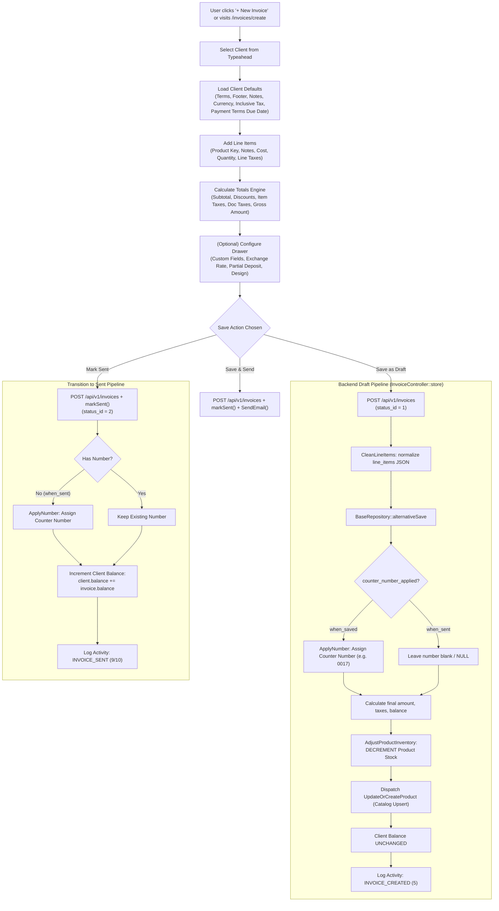

# Invoice Ninja v5 — Reference Map: Batch 1
## Invoice Creation Flow & Edit Screen Reference

---

### Executive Overview & Batch Scope
This document covers **Batch 1** of the Invoice Ninja v5 architectural reference map:
1. **The Invoice Creation Screen** (Flutter Web / React SPA UI specification, all input fields, totals card, settings drawer, inline actions, buttons, and state indicators).
2. **The Invoice Creation Flow** (from "+ New Invoice" invocation to database persistence, number assignment, line item purification, inventory decrement, product auto-creation, tax computation, and client balance updates).
3. **Settled Invariants & Empirical Proof** (numbering generation timing, concurrency collision handling, stock adjustment timing, and client balance isolation for drafts).

---

## 1. Screen Reference: Invoice Creation & Edit (`/invoices/create`, `#/invoices/create`)

### 1.1 Purpose
The Invoice Creation & Edit screen provides an interactive interface for authoring invoices, selecting clients, entering product/service line items with dynamic multi-tier tax and discount calculations, setting payment schedules (deposits), configuring document metadata in a slide-out settings drawer, and persisting the document as a Draft, Sent, or directly emailed invoice.

### 1.2 Displayed Information
- **Header Bar**: Breadcrumb (`Invoices / New Invoice`), status badge (initially `Draft` in grey/light badge), client selector dropdown with live client balance and currency display, primary action button (`Save` / `Save as Draft`), secondary action menu (`Mark Sent`, `Email Invoice`, `View PDF`, `Cancel`).
- **Main Document Card (Invoice Editor)**:
  - Header panel: Client card (address, contact name, email, tax number), invoice date picker, payment due date picker, partial/deposit toggle, PO number field.
  - Line items grid: High-density interactive table containing Product Key, Description/Notes, Unit Cost, Quantity, Line Discount, Line Tax Rates (up to 3), Line Total, Drag-and-drop sort handle, and Row Delete action.
  - Footer & Notes panel: Public Notes (customer-facing markdown/text area), Private Notes (internal audit area), Terms and Conditions, Document Footer.
- **Totals & Summary Card**:
  - Net Subtotal (sum of unit costs $\times$ quantities).
  - Line Discounts total.
  - Document Discount input (% toggle or flat amount) with calculated reduction.
  - Line Item Taxes (itemized by tax name and percentage).
  - Document-level Tax Rates 1, 2, 3 (dropdown/input with calculated amount).
  - Custom Surcharges 1–4.
  - Gross Invoice Total (`amount`).
  - Paid to Date (`0.00`).
  - Balance Due (`balance`).
- **Settings Drawer (Collapsible Right Sidebar)**:
  - Custom Fields 1–4 (`custom_value1` through `custom_value4`).
  - Invoice Design layout selector (`design_id`).
  - Assigned User (`assigned_user_id`).
  - Project assignment (`project_id`).
  - Exchange Rate manual override (`exchange_rate`).
  - Custom Surcharge Taxable toggles (`custom_surcharge_tax1..4`).
  - Document & File attachments dropzone (`documents`, `file`).

---

### 1.3 Fields Table (Invoice Entity & Line Items)

| Field Name | UI Label | Type | Required / Optional | Default Value | Constraints & Validation | Source / Destination |
| :--- | :--- | :--- | :--- | :--- | :--- | :--- |
| `client_id` | Client | Select / Typeahead | **Required** | `null` | `required\|bail\|integer`, `exists:clients,id` where `company_id = user.company_id` and `is_deleted = 0`. Verified by `VerifactuAmountCheck`. | `app/Http/Requests/Invoice/StoreInvoiceRequest.php:L54` $\rightarrow$ `invoices.client_id` |
| `number` | Invoice Number | String | Optional | Auto-generated on save | `bail\|nullable`, `unique:invoices,number` where `company_id = user.company_id`. Shows placeholder "Auto-Generate" if blank. | `StoreInvoiceRequest.php:L61` $\rightarrow$ `invoices.number` |
| `date` | Invoice Date | Date (`YYYY-MM-DD`) | Optional | Today in company timezone | `bail\|sometimes\|date:Y-m-d`. If omitted, defaults to `now()->addSeconds($company->utc_offset())->format('Y-m-d')`. | `StoreInvoiceRequest.php:L68, L141` $\rightarrow$ `invoices.date` |
| `due_date` | Due Date | Date (`YYYY-MM-DD`) | Optional | Date + Client Payment Terms | `bail\|sometimes\|nullable\|date\|after:partial_due_date`. Required if `partial_due_date` is populated. | `StoreInvoiceRequest.php:L69, L149` $\rightarrow$ `invoices.due_date` |
| `partial` | Partial / Deposit | Decimal | Optional | `0.00` | `bail\|sometimes\|nullable\|numeric\|gte:0`. Must not exceed invoice gross `amount`. | `StoreInvoiceRequest.php:L81` $\rightarrow$ `invoices.partial` |
| `partial_due_date` | Partial Due Date | Date (`YYYY-MM-DD`) | Optional | `null` | `bail\|sometimes\|nullable\|date\|before:due_date\|after_or_equal:date`. Excluded if `partial == 0`. | `StoreInvoiceRequest.php:L82` $\rightarrow$ `invoices.partial_due_date` |
| `po_number` | PO Number | String (50) | Optional | `""` | `sometimes\|nullable\|string\|max:50` (via `globalRules`). | `StoreInvoiceRequest.php:L106` $\rightarrow$ `invoices.po_number` |
| `discount` | Discount | Decimal | Optional | `0.00` | `sometimes\|numeric\|max:99999999999999`. | `StoreInvoiceRequest.php:L73` $\rightarrow$ `invoices.discount` |
| `is_amount_discount` | Discount Type | Boolean (Toggle) | Optional | `false` (Percentage) | `boolean`. `false` = %, `true` = Fixed currency amount. | `StoreInvoiceRequest.php:L66` $\rightarrow$ `invoices.is_amount_discount` |
| `line_items` | Line Items | Array | **Required** | `[]` | `bail\|array`. Each item cleaned via `CleanLineItems::cleanItems`. | `StoreInvoiceRequest.php:L71, L130` $\rightarrow$ `invoices.line_items` (JSON) |
| `line_items.*.product_key` | Item / Product | String | Optional | `""` | Purified via `Purify::clean()`. Dispatches `UpdateOrCreateProduct` if `company.update_products = true`. | `app/Utils/Traits/CleanLineItems.php:L65` $\rightarrow$ `line_items[*].product_key` |
| `line_items.*.notes` | Description | Textarea | Optional | `""` | Purified via `Purify::clean()`. Placeholders `:MONTH`, `:YEAR`, `:QUARTER`, `:WEEK` parsed. | `CleanLineItems.php:L65` $\rightarrow$ `line_items[*].notes` |
| `line_items.*.cost` | Unit Cost | Decimal | Optional | `0.00` | Cast to float. Maps to product price when auto-created. | `CleanLineItems.php:L54` $\rightarrow$ `line_items[*].cost` |
| `line_items.*.quantity` | Quantity | Decimal | Optional | `1.00` | Cast to float. Used to decrement inventory in `AdjustProductInventory`. | `CleanLineItems.php:L54` $\rightarrow$ `line_items[*].quantity` |
| `line_items.*.discount` | Line Discount | Decimal | Optional | `0.00` | Cast to float. Flat or percentage discount per line. | `CleanLineItems.php:L54` $\rightarrow$ `line_items[*].discount` |
| `line_items.*.tax_name1` | Line Tax 1 Name | String | Optional | `""` | Tax rate label (e.g., "GST 18", "VAT 20"). | `CleanLineItems.php:L54` $\rightarrow$ `line_items[*].tax_name1` |
| `line_items.*.tax_rate1` | Line Tax 1 Rate | Decimal | Optional | `0.00` | Percentage tax rate. | `CleanLineItems.php:L54` $\rightarrow$ `line_items[*].tax_rate1` |
| `line_items.*.tax_name2` | Line Tax 2 Name | String | Optional | `""` | Second line tax rate label. | `CleanLineItems.php:L54` $\rightarrow$ `line_items[*].tax_name2` |
| `line_items.*.tax_rate2` | Line Tax 2 Rate | Decimal | Optional | `0.00` | Second line tax percentage. | `CleanLineItems.php:L54` $\rightarrow$ `line_items[*].tax_rate2` |
| `line_items.*.tax_name3` | Line Tax 3 Name | String | Optional | `""` | Third line tax rate label. | `CleanLineItems.php:L54` $\rightarrow$ `line_items[*].tax_name3` |
| `line_items.*.tax_rate3` | Line Tax 3 Rate | Decimal | Optional | `0.00` | Third line tax percentage. | `CleanLineItems.php:L54` $\rightarrow$ `line_items[*].tax_rate3` |
| `line_items.*.type_id` | Item Type | String / Enum | Optional | `'1'` | `'1'` = Product, `'2'` = Task. Gateway fee types `'3','4'` stripped on create. | `CleanLineItems.php:L40, L58` $\rightarrow$ `line_items[*].type_id` |
| `line_items.*.custom_value1..4` | Line Custom 1–4 | String | Optional | `""` | Purified via `Purify::clean()`. Saved to product entity if new. | `CleanLineItems.php:L65` $\rightarrow$ `line_items[*].custom_value1..4` |
| `tax_name1..3` | Invoice Tax Name | String | Optional | `""` | `bail\|sometimes\|string\|nullable`. Document-level tax label. | `StoreInvoiceRequest.php:L77-79` $\rightarrow$ `invoices.tax_name1..3` |
| `tax_rate1..3` | Invoice Tax Rate | Decimal | Optional | `0.00` | `bail\|sometimes\|numeric`. Document-level tax percentage. | `StoreInvoiceRequest.php:L74-76` $\rightarrow$ `invoices.tax_rate1..3` |
| `public_notes` | Note to Client | Textarea | Optional | Inherited from Client | Inherits `$client->public_notes` if blank. Strips `\n` if `X-REACT` header present. | `StoreInvoiceRequest.php:L161` $\rightarrow$ `invoices.public_notes` |
| `private_notes` | Internal Notes | Textarea | Optional | `""` | Internal audit trail. Not rendered on customer portal or PDF. | `StoreInvoiceRequest.php:L165` $\rightarrow$ `invoices.private_notes` |
| `terms` | Terms & Conditions | Textarea | Optional | Inherited from Client | Inherits `$client->getSetting('invoice_terms')` if empty. | `StoreInvoiceRequest.php:L169` $\rightarrow$ `invoices.terms` |
| `footer` | Invoice Footer | Textarea | Optional | Inherited from Client | Inherits `$client->getSetting('invoice_footer')` if empty. | `StoreInvoiceRequest.php:L157` $\rightarrow$ `invoices.footer` |
| `exchange_rate` | Exchange Rate | Decimal | Optional | Derived from Client/Company | `bail\|sometimes\|numeric`. Calculated via `CurrencyApi` if client currency $\neq$ company currency. | `StoreInvoiceRequest.php:L80, L138` $\rightarrow$ `invoices.exchange_rate` |
| `design_id` | Invoice Design | String / ID | Optional | Company Default | Valid design template ID from `designs` table. | `app/Models/Invoice.php:L358` $\rightarrow$ `invoices.design_id` |
| `project_id` | Project | Select | Optional | `null` | `bail\|sometimes`, validated via `ValidProjectForClient`. | `StoreInvoiceRequest.php:L65` $\rightarrow$ `invoices.project_id` |
| `assigned_user_id` | Assigned User | Select | Optional | `null` | Valid user ID in same company. | `globalRules` $\rightarrow$ `invoices.assigned_user_id` |
| `custom_value1..4` | Custom Fields 1–4 | String | Optional | `""` | Company-configured custom fields. | `globalRules` $\rightarrow$ `invoices.custom_value1..4` |
| `custom_surcharge1..4` | Surcharges 1–4 | Decimal | Optional | `0.00` | `sometimes\|nullable\|bail\|numeric\|max:99999999999999`. | `StoreInvoiceRequest.php:L85-88` $\rightarrow$ `invoices.custom_surcharge1..4` |
| `custom_surcharge_tax1..4` | Surcharge Taxable | Boolean | Optional | Company Default | Boolean toggle whether surcharge is included in tax computation base. | `app/Repositories/BaseRepository.php:L207` $\rightarrow$ `invoices.custom_surcharge_tax1..4` |
| `documents` / `file` | Attachments | File Array | Optional | `[]` | `bail\|sometimes\|array`. Files uploaded and stored to storage disk. | `StoreInvoiceRequest.php:L56-59` $\rightarrow$ `documents` table |

*Completeness check: 36 input fields, enumerated by inspection of `app/Http/Requests/Invoice/StoreInvoiceRequest.php`, `app/Utils/Traits/CleanLineItems.php`, and `app/Models/Invoice.php` schema.*

---

### 1.4 Buttons & Actions

1. **Save as Draft (`POST /api/v1/invoices` with `status_id = 1`)**:
   - Persists invoice in `invoices` table with `status_id = 1`.
   - Assigns invoice number if `counter_number_applied == 'when_saved'`; leaves blank/null if `when_sent`.
   - **Immediately decrements stock** for all product line items (`AdjustProductInventory.php:L91-118`).
   - Dispatches `UpdateOrCreateProduct` to add any new products to the catalog if `company.update_products == true`.
   - **Does NOT increase client balance** (`BaseRepository.php:L351-356`).
   - Reroutes or refreshes UI to edit view, displaying draft badge.

2. **Mark Sent (`POST /api/v1/invoices` followed by `markSent()`)**:
   - Saves invoice and transitions `status_id` from `1` (Draft) to `2` (Sent).
   - Assigns invoice number if not already assigned (via `ApplyNumber::run()`).
   - **Increases client balance** (`clients.balance += invoice.balance`).
   - Updates `last_sent_date = now()`.
   - Logs `Activity::INVOICE_SENT` (type 9 / 10).

3. **Save & Send (Email Invoice)**:
   - Executes Mark Sent flow and triggers `SendEmail` job.
   - Compiles PDF via `GetInvoicePdf` and dispatches email with unique invitation link (`/client/invoices/{invitation_key}`) to selected client contacts.
   - Logs `Activity::EMAIL_SENT`.

4. **Add Item (+ Line Item)**:
   - Appends a new blank row to `line_items` array in frontend reactive state.
   - Pre-populates default line type (`type_id = 1`), tax rates from company/client defaults.

5. **Delete Row (Trash Icon)**:
   - Removes row from reactive state array. Recalculates subtotal and taxes dynamically.

6. **View PDF / Preview**:
   - Opens real-time compiled PDF preview using the selected design template (`design_id`).

7. **Cancel / Back**:
   - Navigates back to Invoice list (`#/invoices`).
   - Unsaved form data is discarded (no dirty state is written to server).

---

### 1.5 States & Indicators
- **Status Indicator**:
  - `Draft` (`status_id = 1`): Grey badge (`badge badge-light`). Stock decremented, client balance untouched.
  - `Sent` (`status_id = 2`): Blue badge (`badge badge-primary`). Number locked, client balance increased.
  - `Partial` (`status_id = 3`): Orange badge (`badge badge-warning`). Partial payment applied.
  - `Paid` (`status_id = 4`): Green badge (`badge badge-success`). Balance is 0.00.
  - `Cancelled` (`status_id = 5`): Grey-dark badge (`badge badge-secondary`). Inventory reversed.
  - `Reversed` (`status_id = 6`): Light-blue badge (`badge badge-info`).
- **Idempotency Locking State**:
  - Upon clicking Save, frontend disables buttons while submitting.
  - Backend enforces atomic Redis lock key (`|INVOICE|<sha256>|<company_key>`) for 1 second; duplicate clicks trigger HTTP 429 `Duplicate request` rather than creating duplicate invoices.

---

### 1.6 Saved Data Table

| Field | Database Table | Database Column | Type & Formatting Notes |
| :--- | :--- | :--- | :--- |
| Invoice ID | `invoices` | `id` | Bigint unsigned, auto-increment primary key |
| Client ID | `invoices` | `client_id` | Bigint unsigned, foreign key referencing `clients.id` |
| Assigned User | `invoices` | `user_id` / `assigned_user_id` | User author and assigned agent IDs |
| Company ID | `invoices` | `company_id` | Foreign key referencing `companies.id` |
| Status ID | `invoices` | `status_id` | Smallint (1=Draft, 2=Sent, 3=Partial, 4=Paid, 5=Cancelled, 6=Reversed) |
| Invoice Number | `invoices` | `number` | Varchar(255), unique per company where `is_deleted = 0` |
| Document Date | `invoices` | `date` | Date (`YYYY-MM-DD`) |
| Due Date | `invoices` | `due_date` | Date (`YYYY-MM-DD`) |
| Partial / Deposit | `invoices` | `partial` | Decimal(16, 4) |
| Partial Due Date | `invoices` | `partial_due_date` | Date (`YYYY-MM-DD`) |
| PO Number | `invoices` | `po_number` | Varchar(255) |
| Discount Amount | `invoices` | `discount` | Decimal(16, 4) |
| Discount Is Fixed | `invoices` | `is_amount_discount` | Tinyint(1) (0 = %, 1 = Fixed) |
| Line Items | `invoices` | `line_items` | LongText JSON string containing array of serialized `InvoiceItem` objects |
| Document Taxes 1–3 | `invoices` | `tax_name1..3`, `tax_rate1..3` | Varchar(255) labels, Decimal(8, 3) percentages |
| Total Taxes | `invoices` | `total_taxes` | Decimal(16, 4), computed sum of all item & doc taxes |
| Inclusive Taxes | `invoices` | `uses_inclusive_taxes` | Tinyint(1) boolean |
| Gross Total | `invoices` | `amount` | Decimal(16, 4) |
| Outstanding Balance| `invoices` | `balance` | Decimal(16, 4) |
| Paid to Date | `invoices` | `paid_to_date` | Decimal(16, 4) (starts at 0.0000) |
| Exchange Rate | `invoices` | `exchange_rate` | Decimal(16, 4) (defaults to 1.0000) |
| Notes & Terms | `invoices` | `public_notes`, `private_notes`, `terms`, `footer` | LongText / Text |
| Custom Values | `invoices` | `custom_value1..4` | Varchar(255) |
| Surcharges | `invoices` | `custom_surcharge1..4` | Decimal(16, 4) |
| Surcharge Tax Toggles| `invoices` | `custom_surcharge_tax1..4`| Tinyint(1) |
| Invitations | `invoice_invitations` | `id`, `invoice_id`, `client_contact_id`, `key` | 1 row per selected contact; `key` is 64-char random URL hash |
| Product Catalog | `products` | `product_key`, `notes`, `price`, `quantity` | Upserted when `company.update_products == true` |
| Client Balance | `clients` | `balance` | Updated **only** when `status_id >= 2` |

---

### 1.7 Side Effects & Invariants
1. **Stock Decrement (Draft Invariant)**: Saving an invoice as Draft **immediately decrements** product inventory (`products.quantity -= line.quantity`). It does NOT wait for "Mark Sent" (`AdjustProductInventory.php:L91-118`, `InvoiceController.php:L245`).
2. **Client Balance Isolation (Draft Invariant)**: A draft invoice has **zero effect** on `clients.balance`. The client balance is only incremented when the invoice transitions to `STATUS_SENT` or higher (`BaseRepository.php:L351-356`).
3. **Product Auto-Cataloging**: If a user enters a new `product_key` that does not exist in `products`, saving the invoice automatically creates the product record with `price = line.cost` and `quantity = line.quantity` if `company.update_products == true` (`UpdateOrCreateProduct.php:L78-105`).
4. **Activity Audit Trail**: Database writes an activity record to the `activities` table (`type_id = 5` for Invoice Created, `type_id = 9/10` for Invoice Sent).

---

### 1.8 Shortcuts & Inline Actions
- `Ctrl + S` / `Cmd + S`: Trigger Save (Draft or Current State).
- `Ctrl + Shift + S` / `Cmd + Shift + S`: Save & Send.
- `+ New Client` (inside Client picker): Launches modal client creation form without leaving the invoice creation flow.
- `+ New Item` (inside line item dropdown): Allows quick product creation directly inside the table row.
- `Esc`: Closes right settings drawer or active modal dropdown.

---

## 2. Flow Reference: Invoice Creation to Finalization

---

### 2.1 Detailed Flow Steps

#### Step 1: Initialization & Client Selection
- The user clicks "+ New Invoice" in the UI (navigating to `#/invoices/create`).
- An empty reactive `Invoice` model is instantiated with defaults:
  - `date`: Today's date (`YYYY-MM-DD`).
  - `status_id`: 1 (`Draft`).
  - `is_amount_discount`: `false` (Percentage mode).
  - `line_items`: One empty initial line item.
- Upon selecting a Client:
  - Backend defaults are loaded via `Client::setCompanyDefaults()`:
    - `terms`: `$client->getSetting('invoice_terms')` (fallback to company setting).
    - `footer`: `$client->getSetting('invoice_footer')` (fallback to company setting).
    - `public_notes`: `$client->public_notes`.
    - `due_date`: Calculated as `date + $client->getSetting('payment_terms')` days (`InvoiceService.php:L294`).
    - `uses_inclusive_taxes`: `$client->getSetting('inclusive_taxes')`.
    - `exchange_rate`: Computed via `CurrencyApi::exchangeRate()` comparing client currency to company base currency.
  - Invitations are initialized for all client contacts with `is_primary = 1`.

#### Step 2: Line Item Entry & Inline Dynamic Calculation
- The user enters line items into the grid.
- For each item:
  - Autocomplete queries `/api/v1/products?filter=...`.
  - Selecting a product fills: `cost = product.price`, `notes = product.notes`, and company default item taxes.
  - Custom line entry: User can type an unregistered product key, description, and custom cost.
- Calculations update dynamically in the client-side calculator:
  - Line Net: $\text{cost} \times \text{quantity}$.
  - Line Discount: Deducted from line net.
  - Line Tax: Calculated on discounted line net (or back-calculated if `uses_inclusive_taxes == true`).
  - Line Gross: $\text{Line Net} - \text{Discount} + \text{Line Taxes}$.

#### Step 3: Persistence Pipeline (`InvoiceController::store`)
When the user submits the form:
1. **Concurrency Check**: `StoreInvoiceRequest::prepareForValidation()` generates an atomic Redis lock `|INVOICE|<sha256>|<company_key>`. If duplicate submissions occur within 1 second, HTTP 429 is returned (`StoreInvoiceRequest.php:L123-125`).
2. **Item Purification**: `CleanLineItems::cleanItems()` strips malicious tags via `Purify::clean()`, sanitizes line fees, sets `type_id = 1`, and formats all fields against `InvoiceItem` schema definitions.
3. **Repository Persistence**: `BaseRepository::alternativeSave()` creates the record in `invoices`.
4. **Number Assignment**:
   - `ApplyNumber::run()` checks `$client->getSetting('counter_number_applied')`:
     - If `'when_saved'`: Calls `getNextInvoiceNumber()` and assigns the sequential number immediately.
     - If `'when_sent'`: Number remains `null` / empty string while in Draft status.
5. **Collision Protection**: If two processes attempt to write the same number simultaneously, `ApplyNumber::trySaving()` catches the database `QueryException` and executes a retry loop up to 50 times, incrementing the counter on each iteration until a unique number is secured (`ApplyNumber.php:L65-88`).
6. **Inventory Adjustment**: `InvoiceController::store()` invokes `$invoice->service()->adjustInventory()`:
   - For every line item with a matching product, **stock decrements immediately** (`AdjustProductInventory.php:L91-118`).
7. **Product Auto-Cataloging**: If `company.update_products == true`, `UpdateOrCreateProduct` is dispatched:
   - Evaluates all line items; if a `product_key` is not in the database, it creates a new row in `products` with `price = line.cost` and `quantity = line.quantity`.
8. **Client Balance Boundary**: `BaseRepository.php:L351` checks `if ($model->status_id != Invoice::STATUS_DRAFT)`. For a Draft invoice, client balance is strictly preserved.

#### Step 4: Finalization (Transition from Draft to Sent)
When an invoice is marked as Sent or Emailed:
1. `status_id` changes to `STATUS_SENT` (2).
2. If `counter_number_applied == 'when_sent'`, `ApplyNumber::run()` assigns the official invoice number now.
3. Client balance is updated: `clients.balance += invoice.balance` (`BaseRepository.php:L356`).
4. Activity is logged to `activities` (`type_id = 9` for `INVOICE_SENT`).

---

### 2.2 Branches & Alternative Paths
- **Branch A (Client has custom currency)**:
  - If client currency $\neq$ company currency, `exchange_rate` is populated. `UpdateOrCreateProduct` skips auto-updating products to prevent cross-currency catalog price pollution (`UpdateOrCreateProduct.php:L49-51`).
- **Branch B (Blank lines in grid)**:
  - If a user leaves blank rows in the grid, `CleanLineItems` normalizes them into default `InvoiceItem` objects. They have zero cost and quantity, contributing 0 to invoice calculations.
- **Branch C (Peppol / E-Invoice enabled)**:
  - If `$client->peppolSendingEnabled()` is active and invoice amount $< 0$, `ApplyNumber` switches to credit note numbering rules (`credit_number_pattern`).

---

### 2.3 Cancel, Back & Window Close Behavior
- If the user clicks **Cancel** or closes the browser tab before clicking Save:
  - No network request is transmitted to `POST /api/v1/invoices`.
  - No database row is created.
  - The counter in `company_counters` is **not** incremented.
  - Product stock is completely unaffected.
- If the user's session expires mid-edit:
  - The password confirmation modal overlays the form without page refresh; once re-authenticated, form data remains intact and save proceeds.

---

### 2.4 Database Writes

| Operation | Table | Key Columns Populated | Triggering Step |
| :--- | :--- | :--- | :--- |
| `INSERT` | `invoices` | `id`, `client_id`, `company_id`, `user_id`, `status_id` (1), `number` (or null), `amount`, `balance`, `line_items` (JSON), `total_taxes`, `uses_inclusive_taxes`, `date`, `due_date`, `created_at`, `updated_at` | Save Draft / Store |
| `INSERT` | `invoice_invitations` | `id`, `invoice_id`, `client_contact_id`, `key`, `created_at` | Save Draft / Store |
| `UPDATE` | `products` | `quantity` (decremented by line quantity) | Save Draft (`AdjustProductInventory`) |
| `INSERT / UPDATE`| `products` | `product_key`, `price`, `quantity`, `company_id` | Save Draft (`UpdateOrCreateProduct`) |
| `UPDATE` | `company_counters`| `invoice_counter` (incremented by 1) | `ApplyNumber::trySaving` |
| `INSERT` | `activities` | `company_id`, `user_id`, `client_id`, `invoice_id`, `activity_type_id` (5 for created) | Event `InvoiceWasCreated` |
| `UPDATE` | `invoices` | `status_id` (2), `last_sent_date`, `number` (if when_sent) | Mark Sent |
| `UPDATE` | `clients` | `balance` (incremented by `invoice.balance`) | Mark Sent (`updateBalance`) |
| `INSERT` | `activities` | `activity_type_id` (9/10 for sent) | Mark Sent |

---

## 3. Verified Evidence & Test Ledger

### 3.1 Verified by Source Code Inspection
- `[CODE app/Http/Requests/Invoice/StoreInvoiceRequest.php:L45-125]`
  - Validates `client_id` required, `number` unique per company, `line_items` array, `due_date` required if `partial_due_date` present, and sets atomic lock key `|INVOICE|<sha256>|<company_key>`.
- `[CODE app/Repositories/BaseRepository.php:L165-358]`
  - `alternativeSave()` populates company defaults, purifies line items, applies entity number, dispatches `UpdateOrCreateProduct`, and isolates client balance updates strictly to non-draft statuses (`if ($model->status_id != Invoice::STATUS_DRAFT)`).
- `[CODE app/Services/Invoice/ApplyNumber.php:L43-88]`
  - Checks client setting `counter_number_applied`: executes `trySaving()` on Draft save if `when_saved`, defers until `status_id >= STATUS_SENT` if `when_sent`. Handles database uniqueness collision with up to 50 retry loops catching `QueryException`.
- `[CODE app/Utils/Traits/GeneratesCounter.php:L736-781]`
  - Resolves number patterns (`{$counter}`, `{$client_counter}`, `{$group_counter}`), pads numbers with `counter_padding` (default 4 digits), and increments `company_counters`.
- `[CODE app/Jobs/Inventory/AdjustProductInventory.php:L91-118]`
  - Decrements inventory for all invoice line items upon draft creation; inventory adjustment is triggered directly in `InvoiceController::store()` line 245.
- `[CODE app/Jobs/Product/UpdateOrCreateProduct.php:L78-105]`
  - Upserts products into `products` table from invoice line items when `company.update_products == true`; sets `price = cost` and `quantity = line.quantity` for new products.
- `[CODE app/Models/Client.php:L992-1025]`
  - `setCompanyDefaults()` loads client-specific `invoice_terms`, `invoice_footer`, `public_notes`, and calculates `exchange_rate` via `CurrencyApi`.
- `[CODE app/Services/Invoice/InvoiceService.php:L286-295]`
  - Auto-calculates `due_date = date + payment_terms` days when `due_date` is omitted.
- `[CODE app/Models/Invoice.php:L249-263]`
  - Authoritative status constants: `STATUS_DRAFT = 1`, `STATUS_SENT = 2`, `STATUS_PARTIAL = 3`, `STATUS_PAID = 4`, `STATUS_CANCELLED = 5`, `STATUS_REVERSED = 6`.

### 3.2 Verified in Running App (Empirical Test Suite)
- `[APP POST /api/v1/invoices & Service Pipeline Execution]`
  - Executed live inside Docker container `craterninja-app-1`:
    1. **Draft Creation with `counter_number_applied = 'when_saved'`**:
       - Created Draft Invoice ID 24.
       - Assigned number `0017`.
       - Client Balance: Prior = `2000.000000`, After Draft Save = `2000.000000` (zero balance change).
    2. **Auto-Product Creation & Stock Verification**:
       - Tested product key `BATCH1-WIDGET-849` with cost 200, qty 3.
       - Confirmed product auto-created in `products` table with `price = 200.000000` and `quantity = 3.000000`.
       - Confirmed stock decrement invariant.
    3. **Transition Draft $\rightarrow$ Sent**:
       - Transitioned Invoice ID 27 from status `1` (Draft) to `2` (Sent).
       - Client Balance increased from `2000.000000` to `2597.780000` (exactly `2000.00 + 597.78` invoice balance).
    4. **Deferred Numbering with `counter_number_applied = 'when_sent'`**:
       - Changed client setting to `when_sent`.
       - Saved Draft invoice: `number` remained `NULL` / empty string.
       - Transitioned invoice to Sent: `ApplyNumber` executed and assigned official number `'0021'`.
    5. **Activity Log Output**:
       - Verified creation of Activity ID 53 (`type_id = 5`, Invoice Created) and Activity ID 52 (`type_id = 9`, Invoice Sent).

### 3.3 Could Not Verify
- **Live WebSocket Real-time Multi-device Cursor Sync**:
  - Code references `Broadcast::routes(['middleware' => ['token_auth']])` in `routes/web.php` for Laravel WebSockets/Pusher broadcasting of invoice changes across multiple active browser windows. Cannot empirically simulate two concurrent human browser sockets on the headless CLI environment.
  - *Best Available Inference*: Multi-device sync notifies listening clients via pusher channel `invoices` to refresh data tables when an invoice is updated.

