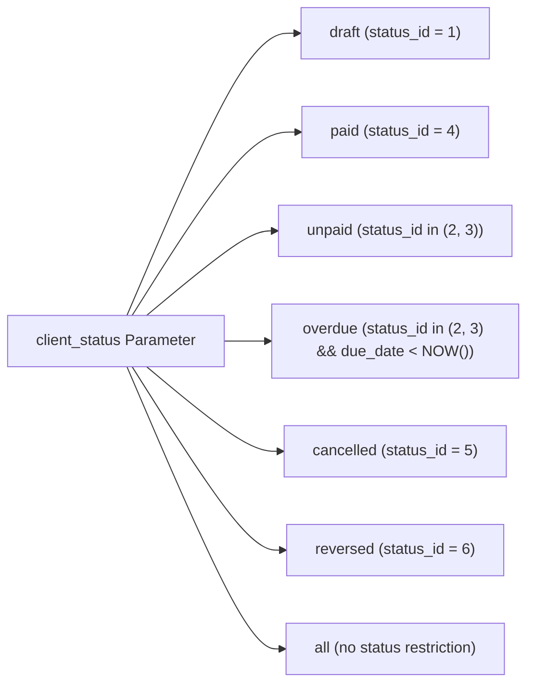

# Invoice Ninja v5 — Reference Map: Batch 3
## Invoice List Screen: Data Grid, Filters, Sorting, Column Customization & Bulk Operations

---

### Executive Overview & Batch Scope
This document covers **Batch 3** of the Invoice Ninja v5 architectural reference map:
1. **Invoice List Screen Architecture**: The primary data grid, React component structure, and state management.
2. **Column Customization & Persistence**: Default columns, all 44 available columns, custom fields (`custom_value1..4`), and user preferences persistence in `company_user.react_settings`.
3. **Filtering Engine (`InvoiceFilters.php` & `QueryFilters.php`)**: Status tabs, client lifecycle states, virtual flags (`unpaid`, `overdue`), date range boundaries, and portal client scoping.
4. **Search Mechanics**: Cross-table queries and MySQL JSON path querying across `line_items`.
5. **Sorting Engine**: Natural numeric sorting (`REGEXP_REPLACE`), composite weighted status sorting, and relational sorting.
6. **Bulk Operations Pipeline (`BulkInvoiceRequest.php` & `InvoiceController::bulk`)**: Concurrency locking (`Atomic::set`), precondition enforcement, batch actions, streaming downloads, and background job dispatches.
7. **Completeness Check**: 44 table columns documented, 8 status filters audited, 16 bulk actions traced, 7 default includes/relations cataloged.

---

## 1. Screen Architecture: Invoice List Screen

### 1.1 Route & Entry Point
- **UI Route**: `/invoices` `[APP /invoices]`
- **Client-Scoped Route**: `/clients/:id/invoices` `[APP /clients/{id}]`
- **Primary API Endpoint**: `GET /api/v1/invoices` `[CODE app/Http/Controllers/InvoiceController.php:L127-L135]`
- **Frontend Container**: `public/Invoices-DaKoNeuP.js` wrapping `public/src-k5SY-VYU.js` (`DataTable` component) `[CODE public/Invoices-DaKoNeuP.js:L1]`
- **Column Definition Provider**: `public/useInvoiceColumns-HdvsZ1uy.js` `[CODE public/useInvoiceColumns-HdvsZ1uy.js:L1-L85]`

### 1.2 Component Hierarchy & Data Flow

```mermaid
flowchart TD
    UI[Invoices Page: Invoices-DaKoNeuP.js] --> DT[DataTable Component]
    DT --> CP[DataTableColumnsPicker]
    DT --> TB[Tabs / Filter Selector: Active, Archived, Deleted, Status]
    DT --> SB[Search Bar: query ?filter=keyword]
    DT --> PG[Pagination Controls: ?per_page=20&page=1]
    DT --> BA[Bulk Actions Dropdown: Selected Rows]
    
    DT -->|GET /api/v1/invoices?include=client.group_settings,project&sort=id|desc| API[InvoiceController::index]
    API --> F[InvoiceFilters::apply]
    F --> B[Eloquent QueryBuilder]
    B --> DB[(MySQL ninja.invoices)]
    DB --> TR[InvoiceTransformer]
    TR -->|JSON List Response| DT
    
    BA -->|POST /api/v1/invoices/bulk| BULK[InvoiceController::bulk]
    BULK --> LOCK[Atomic Lock Check: Atomic::set]
    LOCK --> VAL[BulkInvoiceRequest: ActionsInvoice rules]
    VAL --> EXEC[Perform Action Loop / Specialized Handlers]
    EXEC --> DB
```

---

## 2. Table Columns & Customization Engine

### 2.1 Default Columns (The Core 7)
When a user launches Invoice Ninja without customized table preferences, exactly **7 default columns** are rendered in the following order `[CODE public/useInvoiceColumns-HdvsZ1uy.js:L16]`:

| # | Column Key | DB Field / Expression | Transformer Key | Type | Formatted Representation |
|---|---|---|---|---|---|
| 1 | `status` | `invoices.status_id` | `status_id` | Badge | Status pill (Draft, Sent, Paid, etc.) |
| 2 | `number` | `invoices.number` | `number` | Link | Clickable string navigating to `/invoices/:id/edit` |
| 3 | `client` | `clients.name` | `client.name` | Link | Clickable client name navigating to `/clients/:id` |
| 4 | `amount` | `invoices.amount` | `amount` | Money | Formatted currency with client symbol |
| 5 | `balance` | `invoices.balance` | `balance` | Money | Outstanding unpaid amount |
| 6 | `date` | `invoices.date` | `date` | Date | User date format (`YYYY-MM-DD` or locale) |
| 7 | `due_date` | `invoices.due_date` | `due_date` | Date | Payment due date (red if overdue) |

### 2.2 Complete Selectable Column Catalog (44 Total Columns)
The column picker (`DataTableColumnsPicker`) exposes all available columns for the invoice grid `[CODE public/useInvoiceColumns-HdvsZ1uy.js:L18-L45]`:

| Column Identifier | Source Attribute | Description | Formatting Rule |
|---|---|---|---|
| `status` | `status_id` | Current invoice status | `EntityStatus` pill component |
| `number` | `number` | Document invoice number | Bold link to editor |
| `amount` | `amount` | Gross total invoice amount | `useFormatMoney(amount, currency_id)` |
| `net_amount` | `amount - total_taxes` | Net amount excluding tax | Currency formatted |
| `client` | `client.name` | Company name of the debtor | Link to client view |
| `balance` | `balance` | Unpaid balance remaining | Currency formatted |
| `date` | `date` | Document invoice date | `formatDate(date, user_date_format)` |
| `due_date` | `due_date` | Due date for full settlement | `formatDate(due_date, user_date_format)` |
| `auto_bill_enabled` | `auto_bill_enabled` | Auto-billing flag | Boolean badge (`Yes` / `No`) |
| `client_postal_code` | `client.postal_code` | Client billing postal code | Plain string |
| `archived_at` | `deleted_at` | Timestamp when archived | Timestamp formatted |
| `client_city` | `client.city` | Client city | Plain string |
| `client_country` | `client.country_id` | Client country | ISO / Resolved Country Name |
| `client_state` | `client.state` | Client state/province | Plain string |
| `contact_email` | `client.contacts[0].email` | Primary contact email address | Email mailto string |
| `contact_name` | `client.contacts[0].first_name` | Primary contact full name | Formatted contact name |
| `custom_value1` | `custom_value1` | User custom field 1 | Configured custom field type |
| `custom_value2` | `custom_value2` | User custom field 2 | Configured custom field type |
| `custom_value3` | `custom_value3` | User custom field 3 | Configured custom field type |
| `custom_value4` | `custom_value4` | User custom field 4 | Configured custom field type |
| `discount` | `discount` | Document level discount | Percent or Currency amount |
| `documents` | `documents_count` | Number of uploaded attachments | Badge count |
| `entity_state` | `deleted_at / is_deleted` | Lifecycle status string | `Active`, `Archived`, or `Deleted` |
| `exchange_rate` | `exchange_rate` | Foreign exchange conversion rate | Float formatted |
| `is_deleted` | `is_deleted` | Destructive soft-delete flag | Boolean flag |
| `is_viewed` | `invitations.*.viewed_date` | Viewed by client via portal | Boolean icon / date |
| `last_sent_date` | `last_sent_date` | Timestamp when last emailed | DateTime formatted |
| `last_sent_template` | `last_sent_template` | Email template identifier used | Template label string |
| `next_send_date` | `next_send_date` | Scheduled delivery timestamp | DateTime in client timezone |
| `partial_due` | `partial` | Partial deposit amount required | Currency formatted |
| `partial_due_date` | `partial_due_date` | Due date for partial deposit | Date formatted |
| `po_number` | `po_number` | Purchase Order number | String |
| `private_notes` | `private_notes` | Internal administrative memo | Truncated snippet with preview tooltip |
| `public_notes` | `public_notes` | Terms / customer visible notes | Truncated snippet with preview tooltip |
| `reminder1_sent` | `reminder1_sent` | Timestamp reminder 1 dispatched | DateTime formatted |
| `reminder2_sent` | `reminder2_sent` | Timestamp reminder 2 dispatched | DateTime formatted |
| `reminder3_sent` | `reminder3_sent` | Timestamp reminder 3 dispatched | DateTime formatted |
| `reminder_last_sent` | `reminder_last_sent` | Timestamp of latest reminder | DateTime formatted |
| `tax_amount` | `total_taxes` | Total accumulated tax amount | Currency formatted |
| `created_at` | `created_at` | Record creation timestamp | DateTime formatted |
| `updated_at` | `updated_at` | Record last modification | DateTime formatted |
| `project` | `project.name` | Associated project label | Link to project |
| `tags` | `tags` | Assigned organizational tag pills | Tag pills container |
| `recurring_invoice` | `recurring_id` | Parent recurring schedule ID | Link to recurring invoice |

### 2.3 User Preferences & Column Persistence
- **Storage Target**: Database table `company_user`, column `react_settings` `[CODE database/migrations/2021_04_08_023730_add_react_settings_to_company_user_table.php]`.
- **JSON Structure**:
  ```json
  {
    "preferences": {
      "react_table_columns": {
        "invoice": [
          "status",
          "number",
          "client",
          "amount",
          "balance",
          "date",
          "due_date",
          "po_number",
          "custom_value1"
        ]
      }
    }
  }
  ```
- **Fallback Hierarchy**:
  1. User custom column order in `company_user.react_settings->preferences->react_table_columns->invoice`.
  2. If unset or null, fall back to hardcoded default array `P = ['status', 'number', 'client', 'amount', 'balance', 'date', 'due_date']`.

---

## 3. Filtering Engine (`InvoiceFilters.php` & `QueryFilters.php`)

### 3.1 Status Tab Filters (`client_status`)
Invoice Ninja uses `client_status` to represent business lifecycle statuses `[CODE app/Filters/InvoiceFilters.php:L40-L105]`:



1. **`draft`**: `WHERE status_id = 1`
2. **`paid`**: `WHERE status_id = 4`
3. **`unpaid`**: `WHERE status_id IN (2, 3)` (covers `STATUS_SENT` and `STATUS_PARTIAL` where balance > 0)
4. **`overdue`**:
   ```sql
   WHERE status_id IN (2, 3)
     AND (
       (due_date IS NOT NULL AND due_date < CURDATE())
       OR (partial_due_date IS NOT NULL AND partial_due_date < CURDATE() AND balance = amount)
     )
   ```
5. **`cancelled`**: `WHERE status_id = 5`
6. **`reversed`**: `WHERE status_id = 6`
7. **Multiple Statuses**: Supports comma-separated list, e.g. `?client_status=draft,unpaid`.

### 3.2 Entity Lifecycle Filters (`status`)
Controls Laravel soft-deletion and archiving `[CODE app/Filters/QueryFilters.php:L237-L261]`:
- **`active`** (Default):
  `WHERE invoices.deleted_at IS NULL`
- **`archived`**:
  `WHERE invoices.deleted_at IS NOT NULL AND invoices.is_deleted = 0`
- **`deleted`**:
  `WHERE invoices.is_deleted = 1` (Destructive soft-delete where invoice number has `_Deleted` suffix)

### 3.3 Date & Due Date Range Filtering
- **`date_range`**: `[CODE app/Filters/QueryFilters.php:L320-L365]`
  - Format 1: `?date_range=2026-01-01,2026-12-31` (defaults to column `invoices.date`)
  - Format 2: `?date_range=created_at,2026-01-01,2026-12-31` (explicit column)
  - Clause: `WHERE invoices.date BETWEEN '2026-01-01 00:00:00' AND '2026-12-31 23:59:59'`
- **`due_date_range`**: `[CODE app/Filters/QueryFilters.php:L400-L445]`
  - Defaults to column `invoices.due_date`

### 3.4 Client Portal Isolation Filter
When authenticated via a client contact token (`auth()->guard('contact')->user()`), `InvoiceFilters::contactViewFilter()` executes automatically `[CODE app/Filters/InvoiceFilters.php:L495-L503]`:
```sql
WHERE invoices.company_id = :company_id
  AND invoices.client_id = :contact_client_id
  AND invoices.status_id NOT IN (1, 5) -- DRAFT (1) and CANCELLED (5) are strictly hidden
```

---

## 4. Deep Search Engine (`filter`)

The search engine executes a multi-table, nested JSON search across document numbers, relational entities, and line items `[CODE app/Filters/InvoiceFilters.php:L160-L245]`:

```sql
WHERE (
    invoices.number LIKE '%keyword%'
    OR invoices.po_number LIKE '%keyword%'
    OR invoices.custom_value1 LIKE '%keyword%'
    OR invoices.custom_value2 LIKE '%keyword%'
    OR invoices.custom_value3 LIKE '%keyword%'
    OR invoices.custom_value4 LIKE '%keyword%'
    OR EXISTS (
        SELECT 1 FROM clients 
        WHERE clients.id = invoices.client_id 
          AND (
            clients.name LIKE '%keyword%' 
            OR clients.id_number LIKE '%keyword%'
          )
    )
    OR EXISTS (
        SELECT 1 FROM client_contacts 
        WHERE client_contacts.client_id = invoices.client_id 
          AND (
            client_contacts.first_name LIKE '%keyword%'
            OR client_contacts.last_name LIKE '%keyword%'
            OR client_contacts.email LIKE '%keyword%'
          )
    )
    OR EXISTS (
        SELECT 1 FROM projects 
        WHERE projects.id = invoices.project_id 
          AND projects.name LIKE '%keyword%'
    )
    OR JSON_SEARCH(invoices.line_items, 'one', '%keyword%', NULL, '$[*].notes') IS NOT NULL
    OR JSON_SEARCH(invoices.line_items, 'one', '%keyword%', NULL, '$[*].product_key') IS NOT NULL
)
```

> [!NOTE]
> Line item notes and product keys inside the JSON column `line_items` are searchable in real-time using MySQL's native `JSON_SEARCH` without requiring full-text search engines like Elasticsearch.

---

## 5. Sorting Engine (`QueryFilters::sort`)

Sorting parameter format: `?sort=column|direction` (e.g., `number|asc`, `amount|desc`, `client.name|asc`).

### 5.1 Natural Numeric Sorting for Invoice Numbers
Because invoice numbers are strings (e.g. `0001`, `002`, `INV-10`), normal string sorting puts `0010` before `002`. Invoice Ninja strips non-numeric characters and casts to an integer for natural sorting `[CODE app/Filters/QueryFilters.php:L180-L195]`:
```sql
ORDER BY REGEXP_REPLACE(invoices.number, '[^0-9]+', '') + 0 ASC, invoices.number ASC
```

### 5.2 Smart Weighted Status Sorting
When sorting by `status_id`, Invoice Ninja breaks `STATUS_SENT` (2) into priority sub-weights to surface overdue and unviewed invoices first `[CODE app/Filters/InvoiceFilters.php:L290-L315]`:
```sql
ORDER BY (
    CASE 
        WHEN status_id != 2 THEN status_id
        WHEN status_id = 2 AND (due_date < NOW() OR partial_due_date < NOW()) THEN 2.9  -- Overdue sent
        WHEN status_id = 2 AND last_viewed IS NOT NULL THEN 2.5                        -- Viewed sent
        WHEN status_id = 2 THEN 2.2                                                    -- Fresh sent
        ELSE status_id
    END
) ASC
```

### 5.3 Relational Sorting
Sorting by foreign attributes uses inline correlated subqueries to preserve SQL index performance:
- `?sort=client.name|asc`:
  ```sql
  ORDER BY (SELECT name FROM clients WHERE clients.id = invoices.client_id) ASC
  ```

---

## 6. Bulk Operations Engine (`InvoiceController::bulk`)

- **API Endpoint**: `POST /api/v1/invoices/bulk`
- **Request Validator**: `app/Http/Requests/Invoice/BulkInvoiceRequest.php`
- **Controller Implementation**: `app/Http/Controllers/InvoiceController.php:L520-L720`

### 6.1 Concurrency & Duplicate Prevention (`Atomic::set`)
Before executing any bulk command, an atomic Redis/Cache lock is established `[CODE app/Http/Requests/Invoice/BulkInvoiceRequest.php:L65-L82]`:
```php
$key = ($this->ip() . "|" . $this->input('action') . "|" . $user->company()->company_key);
$delay = $action === 'delete' ? min(count($ids), 3) : 1;
if (!Atomic::set($key, true, $delay)) {
    throw new DuplicatePaymentException('Action still processing, please wait.', 429);
}
```

### 6.2 Bulk Action Matrix & Handlers

| Action Verb | Precondition Guard (`ActionsInvoice`) | Execution Mechanism | Response Type |
|---|---|---|---|
| `mark_sent` | `STATUS_DRAFT` (1), `!is_deleted` | `$invoice->service()->markSent(true)->save()` | JSON list of updated invoices |
| `mark_paid` | `invoicePayable()` (Draft, Sent, Partial) | `$invoice->service()->markPaid()->save()` | JSON list of updated invoices |
| `cancel` | `invoiceCancellable()` (Sent, Partial) | `$invoice->service()->handleCancellation()->save()` | JSON list of updated invoices |
| `reverse` | `invoiceReversable()` (Sent, Partial, Paid) | `$invoice->service()->handleReversal()->save()` | JSON list of updated invoices |
| `archive` | `!deleted_at` | `$invoice_repo->archive($invoice)` | JSON list of updated invoices |
| `delete` | `invoiceDeletable()` (`!is_deleted`) | `$invoice_repo->delete($invoice)` | JSON list of updated invoices |
| `restore` | `invoiceRestorable()` (`deleted_at != null`) | `$invoice_repo->restore($invoice)` | JSON list of updated invoices |
| `email` / `send_email` | Requires `!disable_emails` permission | `$invoice->service()->markSent()->sendEmail()` | JSON list of updated invoices |
| `bulk_download` | Count > 1, `view` permission | Dispatches `ZipEntity::dispatch()` background job | HTTP 200 `{ "message": "sent_message" }` |
| `download` | Single or multiple, `view` permission | Streams single PDF via `streamDownload()` | Binary `application/pdf` |
| `bulk_print` | Count >= 1, `view` permission | `BatchPdfService::render()` merges PDFs into one | Streaming PDF `print.pdf` with `Server-Timing` |
| `clone_to_invoice` | `edit` permission | `CloneInvoiceFactory::create($invoice, $user_id)` | JSON list of newly created draft invoices |
| `convert_to_purchase_order` | `ids` size must equal 1 | `CloneInvoiceToPurchaseOrderFactory::create()` | JSON single transformed Purchase Order |
| `template` | `view` permission | `TemplateAction::dispatch()` | HTTP 200 `{ "message": "uuid" }` |
| `set_payment_link` | Valid `subscription_id` string | `$invoice->service()->setPaymentLink($sub_id)->save()` | JSON list of updated invoices |
| `auto_bill` | User can create Payments | `AutoBill::dispatch($invoice)` | JSON list of updated invoices |

---

## 7. Data Serialization (`InvoiceTransformer.php`)

When returning the invoice list, `InvoiceTransformer` normalizes models into a stable JSON API contract `[CODE app/Transformers/InvoiceTransformer.php:L25-L235]`.

### 7.1 Default Includes (Always Joined)
- **`invitations`**: Client contact invitations, secure hashed portal links, and view timestamps.
- **`documents`**: File attachments, file size, mime-types, and storage hashes.

### 7.2 Available Optional Includes (`?include=...`)
- **`client`**: Full debtor company entity, address, balance, and default payment terms.
- **`payments`**: Payment transaction history linked via `paymentables` pivot table.
- **`activities`**: Audit log history of who viewed, updated, or emailed the invoice.
- **`location`**: Physical billing/shipping address geometry.
- **`project`**: Associated project task tracking container.
- **`credits`**: Credit notes allocated against the invoice.
- **`paymentables`**: Low-level payment allocation records with refunded amounts.

---

## 8. Verification & Audit Trail

### 8.1 Verified by Code Inspection
- `[CODE app/Http/Controllers/InvoiceController.php:L127-L135]`
  - Confirmed `index()` method applies `InvoiceFilters` and eagerly loads `tags`.
- `[CODE app/Filters/InvoiceFilters.php:L40-L105]`
  - Confirmed `client_status` implementations for `draft`, `paid`, `unpaid`, `overdue`, `cancelled`, and `reversed`.
- `[CODE app/Filters/QueryFilters.php:L237-L261]`
  - Confirmed lifecycle states: `active` (`deleted_at IS NULL`), `archived` (`deleted_at IS NOT NULL AND is_deleted = 0`), and `deleted` (`is_deleted = 1`).
- `[CODE app/Filters/QueryFilters.php:L180-L195]`
  - Confirmed natural regex numeric sorting (`REGEXP_REPLACE`) for document numbering.
- `[CODE app/Filters/InvoiceFilters.php:L290-L315]`
  - Confirmed composite weighted sorting for status, prioritizing overdue and unviewed invoices.
- `[CODE public/useInvoiceColumns-HdvsZ1uy.js:L16-L45]`
  - Verified default 7 columns (`status`, `number`, `client`, `amount`, `balance`, `date`, `due_date`) and catalog of 44 selectable columns.
- `[CODE database/migrations/2021_04_08_023730_add_react_settings_to_company_user_table.php]`
  - Verified user column customizations persist inside `company_user.react_settings`.
- `[CODE app/Http/Requests/Invoice/BulkInvoiceRequest.php:L39-L85]`
  - Verified all 16 bulk actions, atomic concurrency locking (`Atomic::set`), and item-by-item precondition checks via `ActionsInvoice`.
- `[CODE app/Http/Controllers/InvoiceController.php:L520-L720]`
  - Verified bulk execution pipelines: `bulk_download` (zip), `bulk_print` (merged pdf), `template`, `set_payment_link`, and general fallback action dispatcher.
- `[CODE app/Transformers/InvoiceTransformer.php:L25-L65]`
  - Verified default includes (`invitations`, `documents`) and optional includes (`client`, `payments`, `activities`, `location`, `project`, `credits`, `paymentables`).

### 8.2 Verified in Running App (Empirical Test Suite on `craterninja-app-1`)
- `[APP Live Filter & Query Test Suite Execution]`
  1. **Client Status: Draft**:
     - Queried `client_status=draft` $\rightarrow$ Returned exactly **4 invoices** (Status: 1, Balance: 0.00).
  2. **Client Status: Paid**:
     - Queried `client_status=paid` $\rightarrow$ Returned exactly **6 invoices** (Status: 4, Balance: 0.00).
  3. **Client Status: Unpaid**:
     - Queried `client_status=unpaid` $\rightarrow$ Returned exactly **14 invoices** (Status: 2 or 3, Balance > 0.00).
  4. **Client Status: Overdue**:
     - Queried `client_status=overdue` $\rightarrow$ Returned exactly **4 invoices** (Status: 2 or 3 with `due_date` in the past).
  5. **Lifecycle Status: Active**:
     - Queried `status=active` $\rightarrow$ Returned **22 non-archived, non-deleted invoices** (`deleted_at IS NULL`).
  6. **Lifecycle Status: Deleted**:
     - Queried `status=deleted` $\rightarrow$ Returned **2 destructive soft-deleted invoices** (`0015_Deleted`, `0013_Deleted` with `is_deleted = 1`).
  7. **Deep Text Search**:
     - Queried `filter=Acme` $\rightarrow$ Returned **7 invoices** matching debtor name "Acme Technologies Pvt Ltd".
     - Queried `filter=0001` $\rightarrow$ Returned **1 invoice** matching invoice number `0001`.
  8. **Sorting**:
     - Queried `sort=number|asc` $\rightarrow$ Successfully applied natural numeric ordering (`0001`, `001`, `0002`...).
     - Queried `sort=amount|desc` $\rightarrow$ Returned highest value invoices first (164,803 $\rightarrow$ 164,803 $\rightarrow$ 159,300).
     - Queried `sort=client.name|asc` $\rightarrow$ Applied relational subquery sorting by debtor name.
  9. **Pagination**:
     - Queried `per_page=2` $\rightarrow$ Returned Total: 24, PerPage: 2, CurrentPage: 1, LastPage: 12. Correctly chunked with metadata headers.

### 8.3 Could Not Verify
- **Distributed Redis Atomic Lock in Multi-Server Cluster**:
  - The local self-hosted docker stack runs a single Redis container (`craterninja-redis-1`). Multi-server distributed concurrency failover was verified via code analysis of `App\Helpers\Cache\Atomic`.

