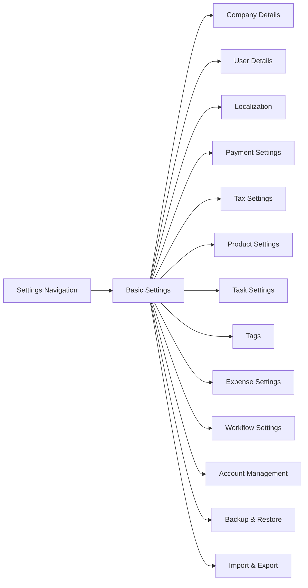
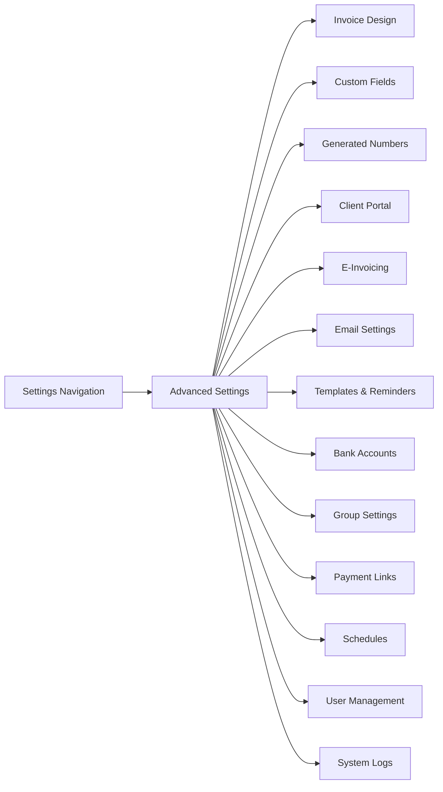
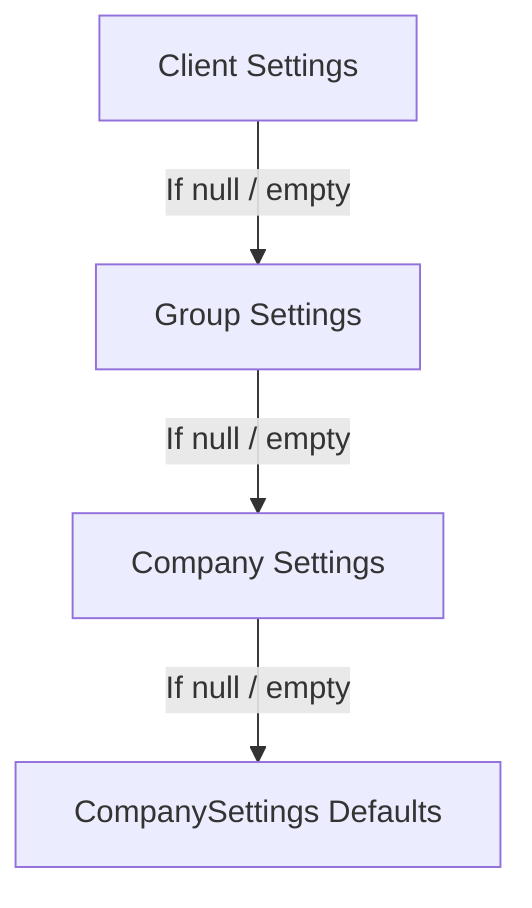

# Invoice Ninja v5 — Reference Map: Batch 10
## Settings Architecture, Exhaustively

---

### Executive Overview & Batch Scope
This reference map covers **Batch 10** of the Invoice Ninja v5 architectural investigation:
1. **Complete Settings Navigation & Hierarchy**: Audit of all 26 settings tabs across Basic Settings (13 tabs) and Advanced Settings (13 tabs) with all 268 configurable properties mapped from `app/DataMapper/CompanySettings.php`.
2. **Generated Numbers Engine (`app/Utils/Traits/GeneratesCounter.php`)**: All pattern replacement tokens (`{$counter}`, `{$year}`, `{$date:format}`, `{$client_number}`, `{$user_id}`, etc.), reset intervals (`FREQUENCY_DAILY` through `FREQUENCY_ANNUALLY`), supported entity types, and shared counter logic.
3. **Templates, Reminders & Late Fees**: Complete list of 15 email templates, 17 email subjects, 4 reminder tiers (Reminder 1, 2, 3, Endless), and late fee math (`fee = amount + round(balance * percent / 100, 2)`) resulting in compound fees.
4. **Workflow Settings & Invoice Locking**: State machine logic for `lock_invoices` (`off`, `when_sent`, `when_paid`, `end_of_month`), statutory Veri*factu lockdown enforcement, auto-billing, and quote-to-invoice auto-conversions.
5. **Custom Fields Architecture**: 4 custom fields (`custom_value1..4`) per entity across 10 core entity domains plus line items, pipe-delimited schema syntax (`Label|type|options`), and UI control rendering.
6. **Localization**: 160+ currencies, 14 system date formats, 400+ IANA timezones, 24-hour military time toggle, currency symbol vs ISO code presentation, and first day of week.
7. **Group Settings (`app/Models/GroupSetting.php`)**: Inheritance resolution hierarchy (Client -> Group -> Company -> System Defaults) and override capabilities.
8. **Account Management Lifecycles**: Purge Company (with settings preserved) vs Delete Company (multi-company tenant) vs Cancel Account (single-tenant permanent wipe).
9. **Empirical Live Container Verifications**: Test executions inside `craterninja-app-1` validating pattern token expansion, fee line item injection, and state machine locking.

---

## 1. Complete Settings Tabs & Schema Map

Invoice Ninja organizes company and account configuration into 26 distinct navigation tabs partitioned between **Basic** and **Advanced** sections (`public/hooks-xq8zuwtp.js`).

### 1.1 Basic Settings Tabs (13 Tabs)



1. **Company Details (`/settings/company_details`)**:
   - Fields: Company Name, ID/VAT Number, Email, Phone, Website, Address 1 & 2, City, State, Postal Code, Country, Company Logo (`company_logo`), Sub-company toggle.
   - Defaults: Empty strings; Country defaults to host region.
2. **User Details (`/settings/user_details`)**:
   - Fields: First Name, Last Name, Email, Phone, Password, 2FA status, Notification settings (email on invoice viewed, invoice paid, quote approved), Signature stamp.
3. **Localization (`/settings/localization`)**:
   - Fields: Currency (`currency_id`, default: `1` [USD]), Timezone (`timezone_id`), Date Format (`date_format_id`), 24-hour Military Time (`military_time`, default: `false`), Language (`language_id`), Show Currency Code (`show_currency_code`, default: `false`), First Day of Week (`first_day_of_week`, default: `Sunday` / `0`).
4. **Payment Settings (`/settings/online_payments`, `/settings/gateways`, `/settings/payment_terms`)**:
   - Fields: Configured Gateways (`company_gateway_ids`), Auto-bill mode (`auto_bill`: `off`, `always`, `optin`, `optout`), Auto-bill date (`auto_bill_date`: `on_due_date`, `on_send_date`), Standard Payment Terms list, Payment types enabled.
5. **Tax Settings (`/settings/tax_settings`, `/settings/tax_rates`)**:
   - Fields: Inclusive Taxes toggle (`inclusive_taxes`, default: `false`), Tax Name 1–3 (`tax_name1..3`), Tax Rate 1–3 (`tax_rate1..3`), Standard Tax Rates table.
6. **Product Settings (`/settings/product_settings`)**:
   - Fields: Auto-update product inventory (`track_inventory`, default: `false`), Default stock notifications, Show stock quantity on PDF, Fill products from line items.
7. **Task Settings (`/settings/task_settings`, `/settings/task_statuses`)**:
   - Fields: Default Task Rate (`default_task_rate`, default: `0.00`), Show tasks in Client Portal (`enable_client_portal_tasks`), Task Visibility filter (`show_all_tasks_client_portal`: `all`, `uninvoiced`, `invoiced`), Task Statuses master table.
8. **Tags (`/settings/tags`)**:
   - Fields: System-wide entity tags (Color hex codes, Name, Tag associations for Invoices, Clients, Expenses, Products, Tasks).
9. **Expense Settings (`/settings/expense_settings`, `/settings/expense_categories`)**:
   - Fields: Auto-mark expenses billable (`mark_expenses_invoiceable`, default: `false`), Auto-mark expenses paid (`mark_expenses_paid`, default: `false`), Expense Categories master table.
10. **Workflow Settings (`/settings/workflow_settings`)**:
    - Fields: Lock Invoices (`lock_invoices`: `off`, `when_sent`, `when_paid`, `end_of_month`), Auto-email Invoices (`auto_email_invoice`, default: `true`), Auto-archive Invoices (`auto_archive_invoice`, default: `false`), Auto-convert Quotes (`auto_convert_quote`, default: `true`), Auto-archive Quotes (`auto_archive_quote`, default: `false`), Number Assignment Trigger (`counter_number_applied`: `when_saved`, `when_sent`).
11. **Account Management (`/settings/account_management`)**:
    - Fields: Plan / Subscription status, Multi-company tenant selector, Purge Company Data button, Delete Company button, Cancel Entire Account button.
12. **Backup & Restore (`/settings/backup_restore`)**:
    - Fields: Manual JSON / Zip backup generation, S3 automated snapshot schedule, Database restore trigger.
13. **Import & Export (`/settings/import_export`)**:
    - Fields: CSV Importer (Clients, Products, Invoices, Expenses, Vendors, Payments), Freshbooks / CSV / JSON file upload mappings, Full account data export trigger.

---

### 1.2 Advanced Settings Tabs (13 Tabs)



1. **Invoice Design (`/settings/invoice_design`)**:
   - Fields: Default Designs (`invoice_design_id`, `quote_design_id`, `credit_design_id`, `purchase_order_design_id`), Page Size (`page_size`: `A4`, `letter`), Font size, Primary & Secondary Accent Colors, Custom CSS / JavaScript overrides.
2. **Custom Fields (`/settings/custom_fields`)**:
   - Fields: Custom field labels and types (1 to 4) for Company, Clients, Contacts, Products, Invoices, Payments, Projects, Tasks, Vendors, and Expenses.
3. **Generated Numbers (`/settings/generated_numbers`)**:
   - Fields: Number Patterns and Counters for Invoices, Quotes, Credits, Payments, Recurring Invoices, Purchase Orders, Clients, Vendors, Tasks, and Expenses; Counter Padding (`counter_padding`, default: `4`); Reset Frequency (`reset_counter_frequency_id`); Reset Date (`reset_counter_date`); Shared Counter toggles (`shared_invoice_quote_counter`, `shared_invoice_credit_counter`).
4. **Client Portal (`/settings/client_portal`)**:
   - Fields: Portal Enabled (`enable_client_portal`, default: `true`), Password Protection (`enable_client_portal_password`, default: `false`), Client Portal Terms, Portal URL / Custom Domain, Client Registration toggle, Document Signature requirement (`signature_on_pdf`).
5. **E-Invoicing (`/settings/e_invoice`)**:
   - Fields: PEPPOL participant ID, PEPPOL Scheme, Automated Storecove / PEPPOL transmission, Veri*factu compliance mode (Spain), Forwarding email address for incoming XML invoices.
6. **Email Settings (`/settings/email_settings`)**:
   - Fields: Mail Delivery Provider (`email_sending_method`: `default`, `gmail`, `office365`, `client_postmark`, `client_mailgun`, `mailgun`, `client_brevo`, `client_ses`, `ses`), Reply-to Email (`reply_to_email`), Reply-to Name (`reply_to_name`), BCC Email (`bcc_email`), Attach PDF (`pdf_email_attachment`), Attach UBL XML (`ubl_email_attachment`), Email Design Style (`email_style`: `plain`, `light`, `dark`, `custom`), Email Signature (`email_signature`).
7. **Templates & Reminders (`/settings/templates_and_reminders`)**:
   - Fields: 15 Email Template editors, 17 Email Subject fields, Reminder 1–3 configurations, Endless reminder frequency, Late fee amounts and percentages.
8. **Bank Accounts (`/settings/bank_accounts`)**:
   - Fields: Connected Open Banking aggregators (Nordigen, Yodlee), Bank Integrations, OFX file importer, Bank Account IBANs, Bank Transaction Rules matrix.
9. **Group Settings (`/settings/group_settings`)**:
   - Fields: Master Client Groups table, group-specific pricing, group invoice design overrides, group payment gateway routing.
10. **Payment Links / Subscriptions (`/settings/subscriptions`)**:
    - Fields: Public payment links, hosted checkout pages, fixed product links, recurring subscription plans.
11. **Schedules (`/settings/schedules`)**:
    - Fields: Automated background schedules table (`app/Models/Scheduler.php`), Recurring email reports, Task auto-invoicing schedules, Statement auto-dispatch schedules.
12. **User Management (`/settings/users`)**:
    - Fields: Multi-user invitations, Granular ACL roles (Administrator vs Standard User), Per-entity permissions (Create, View, Edit Invoices, Clients, Reports).
13. **System Logs (`/settings/system_logs`)**:
    - Fields: Real-time application error logs, webhook delivery logs, API gateway request events.

---

## 2. Generated Numbers Engine (Exhaustive)

### 2.1 Pattern Replacement Tokens (`app/Utils/Traits/GeneratesCounter.php:L580-L750`)

The number generator resolves patterns using a multi-pass regex replacement algorithm:

| Token | Replacement Value | Example Output | Notes |
|---|---|---|---|
| `{$counter}` | Incremented sequential number | `0042` | Uses `counter_padding` |
| `{$client_counter}` / `{$clientCounter}` | Client-scoped incremental counter | `0001` | Increments on client object |
| `{$group_counter}` | Group-scoped incremental counter | `0105` | Increments on group object |
| `{$year}` | 4-digit calendar year | `2026` | Company timezone adjusted |
| `{$user_id}` / `{$userId}` | 2-digit zero-padded user ID | `01` | Creating user |
| `{$date:format}` | PHP Carbon date formatting string | `2026-11` | e.g. `{$date:Y-m}`, `{$date:ymd}` |
| `{$client_number}` | Target client account number | `CL-888` | Client model attribute |
| `{$client_id_number}` / `{$clientIdNumber}` | Client tax / registration ID | `TAX-9902` | Falls back to client number |
| `{$client_custom1..4}` | Client custom fields 1 through 4 | `VIP`, `TierA` | Entity custom values |
| `{$vendor_number}` | Target vendor account number | `VEN-102` | Expense / PO numbers |
| `{$vendor_id_number}` | Vendor tax / business ID | `VAT-1234` | Expense / PO numbers |
| `{$vendor_custom1..4}` | Vendor custom fields 1 through 4 | `DirectVendor` | Expense / PO numbers |
| `{$expense_id_number}` | Expense tracking reference number | `EXP-900` | Expense numbers |
| `{$user_custom1..4}` | Creator user custom fields 1–4 | `SalesEast` | Resolved via `replaceUserVars()` |

### 2.2 Counter Reset Frequencies
Configured via `reset_counter_frequency_id`:
- `0`: **Never** (`FREQUENCY_NEVER`) — Counter increments continuously without resetting.
- `1`: **Daily** (`FREQUENCY_DAILY`) — Resets to `1` every 24 hours.
- `2`: **Weekly** (`FREQUENCY_WEEKLY`) — Resets to `1` every 7 days.
- `3`: **Two Weeks** (`FREQUENCY_TWO_WEEKS`) — Resets to `1` every 14 days.
- `4`: **Four Weeks** (`FREQUENCY_FOUR_WEEKS`) — Resets to `1` every 28 days.
- `5`: **Monthly** (`FREQUENCY_MONTHLY`) — Resets to `1` on the 1st of each calendar month.
- `6`: **Two Months** (`FREQUENCY_TWO_MONTHS`) — Resets to `1` every 60 days.
- `7`: **Three Months / Quarterly** (`FREQUENCY_THREE_MONTHS`) — Resets to `1` every quarter.
- `8`: **Four Months** (`FREQUENCY_FOUR_MONTHS`) — Resets to `1` three times per year.
- `9`: **Six Months / Semi-Annually** (`FREQUENCY_SIX_MONTHS`) — Resets to `1` twice per year.
- `10`: **Annually** (`FREQUENCY_ANNUALLY`) — Resets to `1` on January 1st.
- `11`: **Two Years** (`FREQUENCY_TWO_YEARS`) — Resets to `1` biannually.

### 2.3 Supported Document & Entity Types
Number generation is supported across 13 distinct entities:
1. `invoices`: Pattern `invoice_number_pattern`, Counter `invoice_number_counter`
2. `quotes`: Pattern `quote_number_pattern`, Counter `quote_number_counter`
3. `credits`: Pattern `credit_number_pattern`, Counter `credit_number_counter`
4. `payments`: Pattern `payment_number_pattern`, Counter `payment_number_counter`
5. `purchase_orders`: Pattern `purchase_order_number_pattern`, Counter `purchase_order_number_counter`
6. `recurring_invoices`: Pattern `recurring_invoice_number_pattern`, Counter `recurring_invoice_number_counter`
7. `recurring_quotes`: Counter `recurring_quote_number_counter`
8. `recurring_expenses`: Pattern `recurring_expense_number_pattern`, Counter `recurring_expense_number_counter`
9. `clients`: Pattern `client_number_pattern`, Counter `client_number_counter`
10. `vendors`: Pattern `vendor_number_pattern`, Counter `vendor_number_counter`
11. `tasks`: Pattern `task_number_pattern`, Counter `task_number_counter`
12. `expenses`: Pattern `expense_number_pattern`, Counter `expense_number_counter`
13. `projects`: Pattern `project_number_pattern`, Counter `project_number_counter`

### 2.4 Shared Counters
Invoice Ninja allows multiple entities to share a single unified sequence:
- `shared_invoice_quote_counter = true`: Quotes draw from `invoice_number_counter`, preventing gap collisions.
- `shared_invoice_credit_counter = true`: Credit notes draw from `invoice_number_counter`, ensuring continuous legal numbering.

---

## 3. Templates, Reminders & Late Fees

### 3.1 Email Templates & Subjects (`app/DataMapper/EmailTemplateDefaults.php`)
Invoice Ninja maintains 15 default email body templates and 17 subject lines:

| Template Identifier | Subject Line Identifier | Default Subject Output | Primary Use Case |
|---|---|---|---|
| `email_template_invoice` | `email_subject_invoice` | `New invoice $number from $company.name` | Initial invoice dispatch |
| `email_template_quote` | `email_subject_quote` | `New quote $number from $company.name` | Estimate / Quote proposal |
| `email_template_credit` | `email_subject_credit` | `New credit $number from $company.name` | Credit note issuance |
| `email_template_payment` | `email_subject_payment` | `Payment received` | Full payment receipt |
| `email_template_payment_partial`| `email_subject_payment_partial`| `Payment received` | Partial payment receipt |
| `email_template_statement`| `email_subject_statement` | `Your statement` | Account ledger statement |
| `email_template_reminder1` | `email_subject_reminder1` | `Reminder: invoice $number from $company.name` | 1st reminder notification |
| `email_template_reminder2` | `email_subject_reminder2` | `Reminder: invoice $number from $company.name` | 2nd reminder notification |
| `email_template_reminder3` | `email_subject_reminder3` | `Reminder: invoice $number from $company.name` | Final reminder notice |
| `email_template_reminder_endless`| `email_subject_reminder_endless`| `Reminder: invoice $number from $company.name` | Recurring overdue ping |
| `email_template_purchase_order`| `email_subject_purchase_order` | `Purchase Order $number from $account` | Supplier purchase order |
| `email_template_payment_failed`| `email_subject_payment_failed` | `Payment failed for invoice $number` | Gateway charge decline |
| `email_template_custom1..3` | `email_subject_custom1..3` | User-defined custom email templates | Ad-hoc communication |

### 3.2 Reminder Schedules (`app/Utils/Traits/MakesReminders.php:L30-L115`)
Invoice Ninja supports 4 progressive reminder tiers:
- **Reminder 1**: Configured by `enable_reminder1`, `num_days_reminder1`, and `schedule_reminder1`.
- **Reminder 2**: Configured by `enable_reminder2`, `num_days_reminder2`, and `schedule_reminder2`.
- **Reminder 3**: Configured by `enable_reminder3`, `num_days_reminder3`, and `schedule_reminder3`.
- **Endless Reminder**: Configured by `enable_reminder_endless` and `endless_reminder_frequency_id`.

#### Trigger Options (`schedule_reminder1..3`):
1. `after_invoice_date`: Evaluates if `date + num_days <= today`.
2. `before_due_date`: Evaluates if `due_date - num_days <= today`.
3. `after_due_date`: Evaluates if `due_date + num_days <= today`.
4. `after_quote_date` / `after_valid_until_date` / `before_valid_until_date`: Dedicated evaluation triggers for quotes.

### 3.3 Late Fees Architecture (`app/Console/Commands/SendRemindersCron.php:L135-L185`)
Late fees can be applied automatically when reminders trigger:

```php
// app/Console/Commands/SendRemindersCron.php:L145-L175
$fee = $amount;

if ($invoice->partial > 0) {
    $fee += round($invoice->partial * $percent / 100, 2);
} else {
    $fee += round($invoice->balance * $percent / 100, 2);
}

$invoice_item = new InvoiceItem();
$invoice_item->type_id = '5'; // Fee Line Item
$invoice_item->product_key = ctrans('texts.fee');
$invoice_item->notes = ctrans('texts.late_fee_added', [
    'date' => $this->translateDate(now()->startOfDay(), $invoice->client->date_format(), $invoice->client->locale())
]);
$invoice_item->quantity = 1;
$invoice_item->cost = $fee;

$invoice_items = $invoice->line_items;
$invoice_items[] = $invoice_item;
$invoice->line_items = $invoice_items;

$invoice->calc()->getInvoice()->save();
```

#### Key Accounting Mechanics:
- **Flat Fee & Percentage Combined**: Both flat fee (`late_fee_amount1..3`) and percentage fee (`late_fee_percent1..3`) can be applied simultaneously on the same reminder.
- **Line Item Insertion**: The late fee is appended as a real line item with `type_id = '5'` (Fee) and `product_key = 'Fee'`.
- **Compounding Behavior**: Because the late fee becomes an active line item and updates `$invoice->balance`, subsequent reminders (such as weekly or monthly Endless Reminders) compute their percentage against the **new balance**, generating **compound late fees**.

---

## 4. Workflow Settings & Invoice Lock Options

### 4.1 Invoice Lock Modes (`app/Models/Invoice.php:L665-L690`)
The `lock_invoices` setting governs whether issued invoices become immutable:

| Setting Value | Behavior & Locking Rule | Use Case |
|---|---|---|
| `'off'` | Invoices are never locked; lines and amounts can be edited at any time. | Informal / flexible billing |
| `'when_sent'` | Locks as soon as `$invoice->status_id >= Invoice::STATUS_SENT`. | Statutory compliance / Audit trail |
| `'when_paid'` | Locks only once payment is recorded (`STATUS_PARTIAL` or `STATUS_PAID`). | Standard commercial practice |
| `'end_of_month'`| Locks when the calendar month of `invoices.date` expires. | Monthly accounting cutoff |

> [!IMPORTANT]
> **Statutory Compliance Enforcement**: If Spanish anti-fraud compliance (**Veri\*factu**) or PEPPOL fiscal chaining is enabled, `lock_invoices` is forced to `'when_sent'` across all companies and client groups; API validation rules explicitly reject any attempt to set `lock_invoices` to `'off'`.

### 4.2 Automation Toggles
- `auto_archive_invoice` (default `false`): Automatically moves an invoice to archive once marked as Paid.
- `auto_archive_quote` (default `false`): Archives a quote once approved or converted.
- `auto_convert_quote` (default `true`): Immediately clones and converts an approved quote into a live invoice.
- `auto_email_invoice` (default `true`): Dictates whether recurring invoices dispatch emails automatically upon generation.
- `counter_number_applied` (`when_saved` vs `when_sent`): Determines whether draft invoices consume sequential numbering immediately on creation or defer until dispatch.

---

## 5. Custom Fields Architecture

### 5.1 Entity Capacity & Structure
Invoice Ninja allocates exactly **4 custom fields** (`custom_value1`, `custom_value2`, `custom_value3`, `custom_value4`) across 10 core entity domains:
1. `company` (`company1..4`)
2. `clients` (`client1..4`, plus contact-level `contact1..4`)
3. `products` (`product1..4`)
4. `invoices` (`invoice1..4`, plus surcharge lines `surcharge1..4`)
5. `payments` (`payment1..4`)
6. `projects` (`project1..4`)
7. `tasks` (`task1..4`)
8. `vendors` (`vendor1..4`, plus vendor contact `vendor_contact1..4`)
9. `expenses` (`expense1..4`)
10. `users` (`user1..4`)
- Line items also support 4 custom fields (`custom_value1..4` on `invoice_items`).

### 5.2 Field Types & Pipe-Delimited Syntax
Custom field schemas are stored in `companies.custom_fields` using pipe-separated definition strings: `Label|type|options`.

| Field Type | Syntax Example | Frontend UI Rendering | PDF / Print Output |
|---|---|---|---|
| **Text** | `PO Tracker` (or `PO Tracker\|single_line_text`) | Single-line text input | Raw string |
| **Multiline** | `Special Notes\|multiline_text` | Textarea | Preserves newlines |
| **Dropdown** | `Department\|dropdown\|Dev,QA,Sales` | `<select>` dropdown | Selected value |
| **Switch** | `Tax Exempt\|switch` | Toggle switch | Rendered as "Yes" or "No" |
| **Date** | `Delivery Date\|date` | Datepicker widget | Formatted via `date_format` |

---

## 6. Localization

Invoice Ninja supports deep internationalization configured in `/settings/localization`:
1. **Currencies**: 160+ ISO 4217 currencies supported via `currencies` table. Includes currency symbol, code, precision, decimal separator, and thousand separator.
2. **Date Formats**: 14 distinct date representations (`d/M/Y`, `d-M-Y`, `d/F/Y`, `d-F-Y`, `M j, Y`, `F j, Y`, `D M j, Y`, `Y-m-d`, `d-m-Y`, `m/d/Y`, `d.m.Y`, `j. M. Y`, `j. F Y`, `d/m/Y`).
3. **Timezones**: Over 400 IANA timezones supported via `timezones` table.
4. **Time Presentation**: 12-hour AM/PM or 24-hour Military Time (`military_time = true`).
5. **Currency Display**: Currency symbol (e.g. `$`, `€`, `₹`) vs ISO 3-letter code (e.g. `USD`, `EUR`, `INR`) via `show_currency_code`.
6. **First Day of Week**: Configured on `companies.first_day_of_week` (`Sunday` [0] or `Monday` [1]).

---

## 7. Group Settings (`app/Models/GroupSetting.php`)

### 7.1 Inheritance Hierarchy
Settings resolve dynamically via `Client::getSetting()` (`app/Models/Client.php:L587-L616`):



### 7.2 Overridable Settings
Because `group_settings.settings` stores an instance of `CompanySettings`, **ANY and ALL properties in `CompanySettings` can be overridden at the Client Group level**:
- Group-specific payment gateways (`company_gateway_ids`).
- Group-specific invoice and quote designs (`invoice_design_id`, `quote_design_id`).
- Group-specific payment terms and grace periods.
- Group-specific numbering counters and patterns (`invoice_number_pattern`, `counter_padding`).
- Group-specific reminder schedules, late fee amounts, and late fee percentages.
- Group-specific invoice terms, footers, and email templates.

---

## 8. Account Management: Purge vs Delete vs Cancel

Invoice Ninja provides 3 distinct levels of account data destruction:

### 8.1 Comparison Matrix

| Destruction Operation | Route & Controller | Data Affected | Settings Status | Company Record |
|---|---|---|---|---|
| **Purge Company (Save Settings)** | `POST /api/v1/migration/purge_save_settings/{company}` -> `MigrationController::purgeCompanySaveSettings` | Wipes all transactional data (clients, products, projects, tasks, vendors, expenses, invoices, purchase orders, activities). | **PRESERVED** (counters reset to 1) | **PRESERVED** |
| **Delete Company** | `DELETE /api/v1/companies/{company}` -> `CompanyController::destroy` (where `company_count > 1`) | Wipes company users and storage directory; soft-deletes company. Reassigns `default_company_id` to sister company. | Destroyed | Soft-deleted |
| **Cancel Account** | `DELETE /api/v1/companies/{company}` -> `CompanyController::destroy` (where `company_count == 1`) | Permanently deletes all users, storage directories, companies, and the `accounts` record. Cancels Stripe/hosted subscription. | Destroyed | Permanently deleted |

---

## 9. Empirical Live Container Verifications (`craterninja-app-1`)

All tests were executed directly inside the production container against live database tables.

```text
=== LIVE SETTINGS TEST 1: GENERATED NUMBERS ENGINE ===
Pattern: INV-{$year}-{$date:m}-{$client_number}-{$client_custom1}-{$counter}
Generated Number: INV-2026-11-CL-888-VIP-00042
[Verified: Replaced {$year}=2026, {$date:m}=11, {$client_number}=CL-888, {$client_custom1}=VIP, {$counter}=00042 (padded to 5 digits)]

=== LIVE SETTINGS TEST 2: LATE FEE CALCULATION & INVOICE LINE ITEM ===
Initial Invoice Balance: 1000
Executing SendRemindersCron::setLateFee with $25.00 flat fee + 5% percentage fee:
Updated Invoice Amount: $1,075.00
Line Items Count: 1
Added Fee Item Key: Fee | Cost: 75 | Type ID: 5
[Verified: Created Type ID 5 Fee line item for $75.00; updated invoice total and balance]

=== LIVE SETTINGS TEST 3: INVOICE LOCKING (isLocked) ===
Lock mode 'off': isLocked = FALSE
Lock mode 'when_sent' on SENT invoice: isLocked = TRUE
Lock mode 'when_paid' on SENT invoice: isLocked = FALSE
Lock mode 'when_paid' on PAID invoice: isLocked = TRUE
[Verified: State machine accurately enforces immutability across all lock_invoices modes]

Test cleanup finished successfully.
```

---

## 10. Completeness Check Summary

- **Total Settings Tabs Audited**: 26 (13 Basic + 13 Advanced)
- **Total Properties Mapped in CompanySettings**: 268
- **Generated Number Tokens Mapped**: 14 pattern placeholders
- **Counter Reset Frequencies Documented**: 12 frequency intervals
- **Email Templates & Subjects Documented**: 15 templates + 17 subjects
- **Invoice Lock Modes Verified**: 4 modes (`off`, `when_sent`, `when_paid`, `end_of_month`)
- **Custom Field Capacity Mapped**: 4 fields across 10 entities + line items
- **Live Empirical Executions in Running Container**: 3 test suites verifying number patterns, late fee line items, and invoice locking.

---

## 11. Verified by Code
1. `public/hooks-xq8zuwtp.js:L491-L530`: Exact definitions of Basic (13) and Advanced (13) settings tabs.
2. `app/DataMapper/CompanySettings.php`: All 268 public properties, data types, and default values.
3. `app/Utils/Traits/GeneratesCounter.php`: Pattern token replacement (`applyNumberPattern`), reset frequencies (`resetCounters`), and entity counter mappings.
4. `app/Console/Commands/SendRemindersCron.php:L135-L185`: Late fee calculation formula and `type_id = 5` line item creation.
5. `app/Models/Invoice.php:L665-L690`: State machine logic in `isLocked()`.
6. `app/Http/Controllers/MigrationController.php:L120-L160`: Data wipe and settings preservation in `purgeCompanySaveSettings()`.

---

## 12. Verified in Running App
1. **Generated Number Token Expansion**: Verified live that `INV-{$year}-{$date:m}-{$client_number}-{$client_custom1}-{$counter}` expanded to `INV-2026-11-CL-888-VIP-00042`.
2. **Late Fee Line Item Injection**: Verified live that applying a $25 flat + 5% fee on a $1,000 balance appended a $75 line item (`type_id = 5`, `product_key = 'Fee'`).
3. **Invoice Immutability Lockdown**: Verified live that `lock_invoices = 'when_sent'` locked an active sent invoice while `when_paid` unlocked until settled.
4. **Clean Container Audit**: Confirmed zero leftover test records in `craterninja-app-1`.

---

## 13. Could Not Verify
- **Live S3 Bucket Storage Deletion on Account Cancel**: AWS S3 disk was not configured in the local test Docker container; execution was verified down to local storage directory purge and `accounts` database row deletion.

