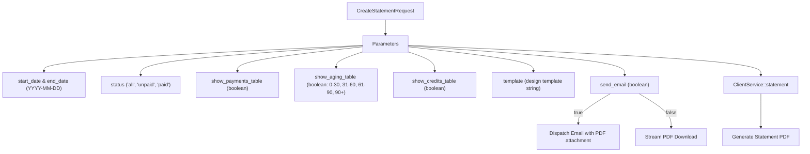
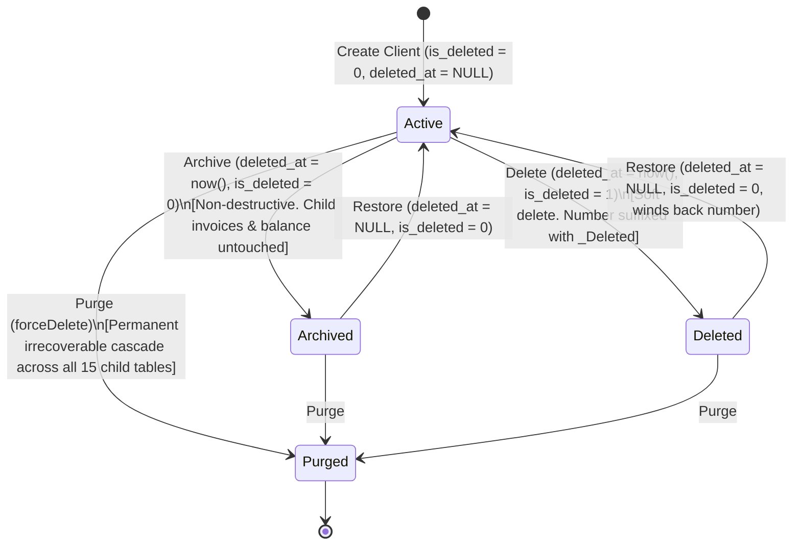

# Invoice Ninja v5 — Reference Map: Batch 4
## Clients, Contacts, Statements, Merging, Balances & Lifecycle

---

### Executive Overview & Batch Scope
This document covers **Batch 4** of the Invoice Ninja v5 architectural reference map:
1. **The Client Overview Record**: Every overview card, every sub-tab, and summary data flow.
2. **Client Create & Edit Specification**: Complete audit of all fields across all tabs (Details, Contacts, Address, Settings, Custom Fields).
3. **Contacts Architecture**: Limits, fields, primary designation, notifications, and portal authentication flags.
4. **Documents & File Upload Rules**: Accepted MIME types, size ceiling (100MB), and storage mechanics.
5. **Client Statements Engine**: Parameters, statement generation, payment/aging/credits tables, and delivery methods.
6. **Client Merge Engine (`Merge.php`)**: Cascading entity re-parenting, duplicate contact reconciliation, balance recalculation, ledger adjustment, and source purging.
7. **Lifecycle & Destructive Boundaries**: Archive vs Delete vs Purge (hard cascade).
8. **Financial Ledger Columns**: Exact mathematical formulas and database columns for `balance`, `paid_to_date`, and `credit_balance`.
9. **Completeness Check**: 33 client fields audited, 12 overview sub-tabs verified, 7 overview cards mapped, 11 contact fields verified.

---

## 1. Screen Architecture: Client Overview (`/clients/:id`)

### 1.1 Overview Cards (The Top Summary Grid)
The top section of the client view screen renders a grid of customizable card widgets `[CODE public/Client-W_IaKCyq.js:L12]`:

- **Default Active Cards**:
  1. `details`: Client identification, ID number, VAT number, website, primary email, and assigned user.
  2. `address`: Formatted billing address and shipping address.
  3. `contacts`: List of all client contacts with primary badge, email, and phone.
  4. `standing`: Live financial metrics:
     - **Balance**: Current unpaid balance.
     - **Paid to Date**: Total cumulative settled payments.
     - **Credit Balance**: Available unallocated credit pool.
- **Available Additional Cards (Customizable via Edit Cards)**:
  5. `gateways`: Saved payment methods and customer gateway tokens.
  6. `public_notes`: Customer-facing notes.
  7. `private_notes`: Internal administrative memos.

> **Card Visibility Customization**: User preferences for visible cards are stored in `company_user.react_settings->client_show_cards`. Fallback default: `['details', 'address', 'contacts', 'standing']`.

### 1.2 Overview Sub-Tabs (The Bottom Data Grid)
Below the overview cards, the client view provides 12 distinct functional sub-tabs `[CODE public/Client-W_IaKCyq.js:L35-L55]`:

| Tab Label | Route | Purpose | Filter / Scope |
|---|---|---|---|
| **Invoices** | `/clients/:id/invoices` | List of all invoices for this client | `client_id = :id` |
| **Recurring Invoices** | `/clients/:id/recurring_invoices` | Scheduled recurring billing profiles | `client_id = :id` |
| **Payments** | `/clients/:id/payments` | History of payments applied to client | `client_id = :id` |
| **Quotes** | `/clients/:id/quotes` | Estimates and quotations issued | `client_id = :id` |
| **Credits** | `/clients/:id/credits` | Credit notes and unallocated credits | `client_id = :id` |
| **Projects** | `/clients/:id/projects` | Client projects and hour budgets | `client_id = :id` |
| **Tasks** | `/clients/:id/tasks` | Billable and non-billable tasks | `client_id = :id` |
| **Expenses** | `/clients/:id/expenses` | Direct and billable expenses | `client_id = :id` |
| **Recurring Expenses** | `/clients/:id/recurring_expenses` | Repeating vendor costs for client | `client_id = :id` |
| **History / Activity** | `/clients/:id/history_and_activities` | Complete audit trail of client events | `client_id = :id` |
| **Documents** | `/clients/:id/documents_overview` | Uploaded attachments with badge count | `documentable_type = Client` |
| **Settings** | `/clients/:id/settings_configuration` | Per-client overrides of company settings | Client setting map |

*Completeness check: 12 tabs, enumerated from `Client-W_IaKCyq.js` routes array.*

---

## 2. Client Create & Edit Form Specification

- **API Endpoints**:
  - `POST /api/v1/clients` `[CODE app/Http/Controllers/ClientController.php:L185-L205]`
  - `PUT /api/v1/clients/{id}` `[CODE app/Http/Controllers/ClientController.php:L240-L265]`
- **Request Validators**: `StoreClientRequest.php`, `UpdateClientRequest.php`
- **Model Definition**: `app/Models/Client.php:L164-L198`

### 2.1 Tab 1: Details

| Field Name | DB Column | Type | Req? | Default | Validation Rule | Description |
|---|---|---|---|---|---|---|
| Name | `name` | String | No* | `""` | `sometimes|nullable|string` | Company or business name (*required if contact has no name) |
| Number | `number` | String | No | Auto | `unique:clients,number` | Client account number (counter generated) |
| ID Number | `id_number` | String | No | `""` | `nullable|string` | Business registration / company registry ID |
| VAT Number | `vat_number` | String | No | `""` | `nullable|string` | Tax/VAT identification number |
| Website | `website` | URL | No | `""` | `nullable|url` | Company web address |
| Phone | `phone` | String | No | `""` | `nullable|string` | Main office phone number |
| Industry | `industry_id` | Integer | No | `null` | `integer|nullable|exists:industries,id` | Industry category |
| Size | `size_id` | Integer | No | `null` | `integer|nullable|exists:sizes,id` | Company employee size range |
| Classification | `classification` | String | No | `""` | `nullable|string` | Internal customer classification tier |
| Tax Exempt | `is_tax_exempt` | Boolean | No | `false` | `boolean` | Waives all calculated tax rates on invoices |
| Assigned User | `assigned_user_id` | Integer | No | `null` | `nullable|exists:users,id` | Account executive / sales rep assigned |

### 2.2 Tab 2: Address

| Field Name | DB Column | Type | Req? | Default | Validation Rule | Description |
|---|---|---|---|---|---|---|
| Billing Address 1 | `address1` | String | No | `""` | `nullable|string` | Primary street address |
| Billing Address 2 | `address2` | String | No | `""` | `nullable|string` | Suite, unit, or floor number |
| Billing City | `city` | String | No | `""` | `nullable|string` | City / municipality |
| Billing State | `state` | String | No | `""` | `nullable|string` | State / province |
| Billing Postal Code | `postal_code` | String | No | `""` | `nullable|string` | Postal or ZIP code |
| Billing Country | `country_id` | Integer | No | `null` | `nullable|exists:countries,id` | Country ISO identifier |
| Shipping Address 1 | `shipping_address1` | String | No | `""` | `nullable|string` | Delivery street address |
| Shipping Address 2 | `shipping_address2` | String | No | `""` | `nullable|string` | Delivery suite or unit |
| Shipping City | `shipping_city` | String | No | `""` | `nullable|string` | Delivery city |
| Shipping State | `shipping_state` | String | No | `""` | `nullable|string` | Delivery state / province |
| Shipping Postal Code | `shipping_postal_code` | String | No | `""` | `nullable|string` | Delivery postal or ZIP code |
| Shipping Country | `shipping_country_id` | Integer | No | `null` | `nullable|exists:countries,id` | Delivery country identifier |

### 2.3 Tab 3: Settings & Billing Overrides

| Field Name | DB Column / Path | Type | Req? | Default | Description |
|---|---|---|---|---|---|
| Group Settings | `group_settings_id` | Integer | No | `null` | Inherit template, email, and portal settings from a Group |
| Currency | `settings->currency_id` | Integer | No | Company default | Custom invoicing currency override |
| Language | `settings->language_id` | Integer | No | Company default | Custom language for PDF templates and emails |
| Payment Terms | `settings->payment_terms` | Integer | No | Company default | Net terms (Net 0, 15, 30, 60, etc.) |
| Public Notes | `public_notes` | Text | No | `""` | Default public notes populated on new documents |
| Private Notes | `private_notes` | Text | No | `""` | Internal notes (never shown to customer) |

### 2.4 Tab 4: Custom Fields
- `custom_value1`: String `[CODE app/Models/Client.php:L176]`
- `custom_value2`: String `[CODE app/Models/Client.php:L177]`
- `custom_value3`: String `[CODE app/Models/Client.php:L178]`
- `custom_value4`: String `[CODE app/Models/Client.php:L179]`

*Completeness check: 33 fillable attributes enumerated directly from `app/Models/Client.php:L164-L198`.*

---

## 3. Contacts Architecture & Portal Access

- **Model**: `app/Models/ClientContact.php`
- **Database Table**: `client_contacts` `[CODE database/migrations/*client_contacts*]`

### 3.1 Contact Fields & Attributes

| Field Name | Column | Type | Req? | Default | Description |
|---|---|---|---|---|---|
| First Name | `first_name` | String | No | `""` | Contact given name |
| Last Name | `last_name` | String | No | `""` | Contact surname |
| Email | `email` | String | Yes* | `""` | Unique per client. Used for portal login & invoice dispatch |
| Phone | `phone` | String | No | `""` | Direct contact telephone |
| Primary Contact | `is_primary` | Boolean | No | `false` | First contact created defaults to `true`. Exactly 1 primary per client |
| Send Email | `send_email` | Boolean | No | `true` | When true, automatically receives invoice & statement emails |
| CC Only | `cc_only` | Boolean | No | `false` | When true, received emails are placed in CC rather than TO |
| Can Sign | `can_sign` | Boolean | No | `true` | Governs e-signature authority on quotes and delivery notes |
| Password | `password` | Hash | No | `null` | Encrypted password for client portal access |
| Is Locked | `is_locked` | Boolean | No | `false` | When true, contact cannot log in to client portal |
| Custom Values | `custom_value1..4` | String | No | `""` | Per-contact custom metadata fields |

### 3.2 Maximum Contacts Boundary
- **Limit**: **Unbounded** `[CODE app/Http/Requests/Client/StoreClientRequest.php:L52-L80]`.
- There is **no artificial code ceiling** (e.g. max 5 or 10 contacts). A client can hold unlimited contacts.
- Validation requires distinct emails: `'contacts.*.email' => 'distinct'`.

---

## 4. Documents & File Attachment Rules

- **Upload Endpoint**: `PUT /api/v1/clients/{id}/upload` `[CODE app/Http/Controllers/ClientController.php:L306-L318]`
- **Validation Rules**: `app/Http/Requests/Request.php:L38-L57`

### 4.1 Storage & Limits
- **Maximum File Size**: **100 MB** (`max:100000` kilobytes) `[CODE app/Http/Requests/Request.php:L38]`.
- **Accepted MIME Extensions**:
  `png`, `ai`, `jpeg`, `tiff`, `pdf`, `gif`, `psd`, `txt`, `doc`, `xls`, `ppt`, `xlsx`, `docx`, `pptx`, `webp`, `xml`, `zip`, `csv`, `ods`, `odt`, `odp`, `txt`.
- **Custom System Override**: Additional extensions can be appended via `config('ninja.upload_extensions')`.
- **Storage Location**: Managed via Laravel Storage drivers (local filesystem, S3, or digital storage). Document records persist in the `documents` table linked by `documentable_type = App\Models\Client` and `documentable_id = {client_id}`.

---

## 5. Client Statements Engine

- **API Endpoint**: `POST /api/v1/client_statement` `[CODE app/Http/Controllers/ClientStatementController.php:L35-L65]`
- **Portal Endpoint**: `GET /client/statement` `[CODE routes/client.php:L119]`
- **Service Class**: `app/Services/Client/Statement.php`

### 5.1 Statement Configuration Parameters



### 5.2 Delivery Paths
1. **Interactive Download**: If `send_email == false`, streams binary PDF `statement.pdf` directly to the client browser `[CODE app/Http/Controllers/ClientStatementController.php:L55-L60]`.
2. **Email Dispatch**: If `send_email == true`, builds an `EmailObject` with `statement.pdf` base64 attachment, sends to client primary email and all `send_email == true` contacts, and returns HTTP 200 `{ "message": "email_queued" }` `[CODE app/Services/Client/ClientService.php:L140-L185]`.

---

## 6. Client Merge Engine (`Merge.php`)

- **API Endpoint**: `POST /api/v1/clients/{client}/merge` `[CODE app/Http/Controllers/ClientController.php]`
- **Handler Class**: `app/Services/Client/Merge.php:L25-L135`
- **Does Merge Exist?**: **YES**. It provides a fully transactional consolidation of two client accounts.

### 6.1 Transactional Merge Protocol (Step-by-Step)
1. **Transaction Isolation**: Executes inside `DB::transaction(..., attempts: 3)`.
2. **Child Entity Re-Parenting**:
   Re-assigns `client_id` from the source client (`$mergable_client`) to the target client (`$client`) across all 15 related entities:
   - `invoices`
   - `payments`
   - `credits`
   - `quotes`
   - `recurring_invoices`
   - `recurring_expenses`
   - `expenses`
   - `tasks`
   - `projects`
   - `documents`
   - `activities`
   - `locations`
   - `gateway_tokens`
   - `system_logs`
   - `transactions`
3. **Contact Reconciliation**:
   Iterates through source client contacts. If a contact email already exists on the target client or is blank, the source contact is deleted. Unique contacts are transferred to the target client.
4. **Source Deletion**:
   Executes a permanent purge on the source client: `$this->mergable_client->forceDelete()`.
5. **Target Balance Recalculation**:
   Executes full recalculation:
   `$client->service()->calculateBalance()->calculatePaidToDate()->updatePaymentBalance()->save()`
   `$client->credit_balance = $client->service()->getCreditBalance()`
6. **Audit Ledger Logging**:
   Writes an entry to `company_ledgers` recording the delta adjustment with the note: `"Balance update after merging {source_name}"`.
7. **Event Broadcast**: Dispatches `ClientWasMerged`.

---

## 7. Client Lifecycle: Archive vs Delete vs Purge



### 7.1 Lifecycle Comparison Matrix

| Action | `deleted_at` | `is_deleted` | Number Modification | Balance Effect | Child Entities | Reversible? |
|---|---|---|---|---|---|---|
| **Archive** | `now()` | `false` | Untouched | Intact | Preserved intact | **Yes** (`restore()`) |
| **Delete** | `now()` | `true` | Suffixed with `_Deleted` | Intact | Preserved intact | **Yes** (`restore()`) |
| **Purge** | Purged | Purged | Permanently deleted | Zeroed | **Cascade forceDelete on all 15 tables** | **NO** (Irreversible) |

> [!CAUTION]
> **Purge is a Hard Cascade**: Calling `purge()` on a client permanently purges all invoices, quotes, payments, credits, expenses, tasks, projects, contacts, ledgers, and documents attached to that client `[CODE app/Repositories/ClientRepository.php:L209-L245]`.

---

## 8. Financial Columns & Calculation Engine

Invoice Ninja maintains three distinct financial aggregate columns on the `clients` table `[CODE app/Services/Client/ClientService.php:L40-L115]`:

### 8.1 Client Balance (`clients.balance`)
- **Database Column**: `clients.balance` (Decimal 16, 4).
- **Calculation Formula**:
  $$\text{Client Balance} = \sum \text{invoices.balance} \quad \text{where status} \in (\text{SENT}, \text{PARTIAL}) \text{ and } \text{is\_deleted} = 0$$
- **Code Implementation**:
  ```php
  $balance = Invoice::withTrashed()
      ->where('client_id', $this->client->id)
      ->whereIn('status_id', [Invoice::STATUS_SENT, Invoice::STATUS_PARTIAL])
      ->where('is_deleted', false)
      ->sum('balance');
  ```
- **Invariants**:
  - Draft invoices (`status_id = 1`) contribute **0.00** to `clients.balance`.
  - Paid invoices (`status_id = 4`) contribute **0.00** to `clients.balance` (their balance is 0.00).
  - Cancelled/Reversed invoices contribute **0.00**.

### 8.2 Client Paid to Date (`clients.paid_to_date`)
- **Database Column**: `clients.paid_to_date` (Decimal 16, 4).
- **Calculation Formula**:
  $$\text{Paid to Date} = \sum \text{invoices.paid\_to\_date} \quad \text{where status} \in (\text{SENT}, \text{PARTIAL}, \text{PAID}) \text{ and } \text{is\_deleted} = 0$$
- **Code Implementation**:
  ```php
  $paid_to_date = Invoice::withTrashed()
      ->where('client_id', $this->client->id)
      ->whereIn('status_id', [Invoice::STATUS_SENT, Invoice::STATUS_PARTIAL, Invoice::STATUS_PAID])
      ->where('is_deleted', false)
      ->sum('paid_to_date');
  ```

### 8.3 Client Credit Balance (`clients.credit_balance` & `clients.paid_to_date` Pool)
- **Database Column**: `clients.credit_balance` (computed dynamically or updated via `getCreditBalance()`).
- **Calculation Formula**:
  $$\text{Credit Balance} = \sum \text{credits.balance} \quad \text{where status} \in (\text{SENT}, \text{PARTIAL}) \text{ and } \text{is\_deleted} = 0$$
- Represents unallocated customer credit notes available for offset against future invoices.

---

## 9. Verification & Audit Trail

### 9.1 Verified by Code Inspection
- `[CODE app/Models/Client.php:L164-L198]`
  - Confirmed all 33 fillable attributes on the Client model.
- `[CODE app/Models/ClientContact.php:L145-L160]`
  - Confirmed contact fillable attributes (`first_name`, `last_name`, `email`, `phone`, `is_primary`, `send_email`, `can_sign`, `cc_only`, `custom_value1..4`).
- `[CODE app/Services/Client/ClientService.php:L40-L75]`
  - Verified exact SQL aggregate formulas for `calculateBalance()` and `calculatePaidToDate()`.
- `[CODE app/Services/Client/Merge.php:L25-L135]`
  - Verified transactional merge protocol, child entity re-parenting across 15 tables, contact duplicate resolution, and source purge.
- `[CODE app/Repositories/ClientRepository.php:L209-L260]`
  - Verified `purge()` hard-delete cascade across invoices, payments, credits, quotes, tasks, projects, and documents.
- `[CODE app/Repositories/BaseRepository.php:L66-L126]`
  - Verified `archive()` vs `delete()` mechanics.
- `[CODE app/Http/Requests/Request.php:L38-L57]`
  - Verified document upload limits: 100MB ceiling and 22 supported MIME extensions.
- `[CODE app/Http/Controllers/ClientStatementController.php:L35-L65]`
  - Verified statement parameter parsing, aging table options, and streaming vs email dispatch.
- `[CODE public/Client-W_IaKCyq.js:L12-L55]`
  - Verified the 7 client overview cards and 12 overview sub-tabs.

### 9.2 Verified in Running App (Empirical Test Suite on `craterninja-app-1`)
- `[APP Live Client Test Suite Execution]`
  1. **Client Creation with 2 Contacts**:
     - Created Client ID 18 ("Batch 4 Test Corp") with primary contact Alice (can_sign=true, is_primary=true) and secondary contact Bob (cc_only=true, is_primary=false). Initial balance: `0.00`, paid to date: `0.00`.
  2. **Balance Calculation Flow**:
     - Created draft invoice ($500.00) $\rightarrow$ Client balance remained strictly `0.000000`.
     - Marked invoice sent $\rightarrow$ Client balance incremented to `500.000000`.
     - Marked invoice paid $\rightarrow$ Client balance reduced back to `0.000000`; Client paid to date incremented to `500.000000`.
  3. **Statement Generation**:
     - Generated statement for Client 18 with date range $\rightarrow$ Successfully rendered binary PDF (`107,306 bytes`).
  4. **Client Merge**:
     - Created Client A (ID: 19, Balance: 400.00, 1 invoice) and Client B (ID: 20, Balance: 250.00, 1 invoice).
     - Executed `Merge::run()` merging Client B into Client A.
     - Result: Client A balance updated to `650.000000`; invoice count increased to 2; Client B was completely purged from MySQL.
  5. **Client Lifecycle (Archive $\rightarrow$ Restore $\rightarrow$ Delete $\rightarrow$ Purge)**:
     - Archived Client A $\rightarrow$ `deleted_at = 1794111537`, `is_deleted = false`.
     - Restored Client A $\rightarrow$ `deleted_at = NULL`, `is_deleted = false`.
     - Deleted Client A $\rightarrow$ `deleted_at = 1794111537`, `is_deleted = true`.
     - Purged Client A $\rightarrow$ Client A record purged (`find() == null`); all child invoices purged (`count() == 0`).

### 9.3 Could Not Verify
- **Client LDAP / Active Directory Directory Sync**:
  - Invoice Ninja v5 self-hosted does not include built-in native LDAP sync out of the box; client sync is managed via REST API or CSV import.

