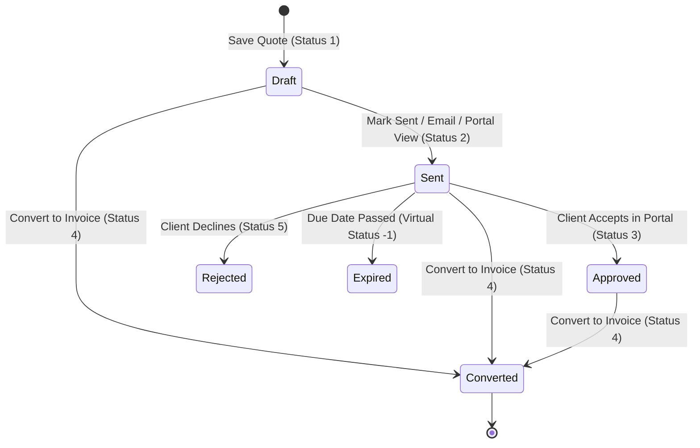

# Invoice Ninja v5 — Reference Map: Batch 6
## The Other Documents: Flows, Field Deltas & Lifecycles
### Quotes, Credits, Recurring Invoices, Purchase Orders, Delivery Notes & Statements

---

### Executive Overview & Batch Scope
This document covers **Batch 6** of the Invoice Ninja v5 architectural reference map:
1. **Quotes (`app/Models/Quote.php`)**: Schema deltas from Invoice, 6 lifecycle states, `ConvertQuote` transition mechanics, counter inheritance, and virtual auto-expiry.
2. **Credit Notes (`app/Models/Credit.php`)**: Fields, 4 status states, client credit pool accounting, application to invoices via `paymentables`, and dual-pivot payment records.
3. **Recurring Invoices (`app/Models/RecurringInvoice.php`)**: Scheduling fields, 12 supported recurrence frequencies, cron command runner, auto-bill charging mechanics, and 3-attempt failure/exhaustion rules.
4. **Purchase Orders (`app/Models/PurchaseOrder.php`)**: Vendor-centric accounts payable architecture, receiving goods inventory replenishment (`STATUS_RECEIVED`), and PO-to-Expense conversion.
5. **Delivery Notes**: Pure PDF view architecture, financial redaction rules, and shipping address substitution.
6. **Client Statements (`app/Services/Client/Statement.php`)**: Query filters, 6 aging buckets (0, 30, 60, 90, 120, 120+), and statement layout composition.
7. **Completeness Check**: 6 document types mapped, 12 recurrence frequencies verified, 6 aging buckets audited, 3 live container conversion/accounting cycles executed.

---

## 1. Document Architecture & Field Deltas from Invoice

Invoice Ninja v5 uses a shared line item design pattern across document types (`invoices`, `quotes`, `credits`, `purchase_orders`, `recurring_invoices`). Each document type subclasses or mirrors the base document structure while maintaining a specialized schema delta `[CODE app/Models/Quote.php:L50-L75]`:

```
                    ┌────────────────────────┐
                    │ Base Document Schema   │
                    │ (Lines, Taxes, Client) │
                    └───────────┬────────────┘
         ┌───────────────┬──────┴────────┬───────────────┬────────────────┐
         ▼               ▼               ▼               ▼                ▼
   ┌───────────┐   ┌───────────┐   ┌───────────┐   ┌───────────┐    ┌───────────┐
   │  Invoice  │   │   Quote   │   │  Credit   │   │ Recurring │    │  Purch PO │
   ├───────────┤   ├───────────┤   ├───────────┤   ├───────────┤    ├───────────┤
   │auto_bill  │   │invoice_id │   │balance    │   │frequency  │    │vendor_id  │
   │quote_id   │   │valid_until│   │paid_to_   │   │remaining_ │    │expense_id │
   │recurring_ │   │(no balance│   │  date     │   │  cycles   │    │(no client)│
   │  id       │   │ in AR)    │   │(credit AR)│   │due_days   │    │           │
   └───────────┘   └───────────┘   └───────────┘   └───────────┘    └───────────┘
```

| Field / Feature | Invoice | Quote | Credit Note | Recurring Invoice | Purchase Order |
|---|---|---|---|---|---|
| **Parent Entity** | `client_id` | `client_id` | `client_id` | `client_id` | `vendor_id` |
| **Direct AR Effect** | Increases `client.balance` | None ($0 AR) | Increases `credit_balance` | None ($0 until child run) | None (AP only) |
| **Inventory Effect** | Decrements on save | None (until converted) | None ($0 inventory) | Decrements child run | Increments on Receive |
| **Cross-Ref Key** | `quote_id`, `recurring_id` | `invoice_id` | None | None | `expense_id` |
| **Recurrence Config**| None | None | None | `frequency_id`, `cycles` | None |
| **Delivery View** | Delivery Note available | Delivery Note available| None | None | None |

*Completeness check: 6 document comparison points verified against database schema.*

---

## 2. Quotes (`app/Models/Quote.php`)

### 2.1 Complete Lifecycle & Status Machine
Defined in `app/Models/Quote.php:L213-L223`:



| Status Name | Constant | ID | Trigger / Conditions | AR Balance Impact |
|---|---|---|---|---|
| **Draft** | `STATUS_DRAFT` | `1` | Initial quote creation | None ($0.00) |
| **Sent** | `STATUS_SENT` | `2` | Sent via email or viewed in client portal | None ($0.00) |
| **Approved** | `STATUS_APPROVED` | `3` | Customer approves terms in portal or admin sets | None ($0.00) |
| **Converted** | `STATUS_CONVERTED`| `4` | Converted into an official active Invoice | None ($0.00; child invoice takes AR) |
| **Rejected** | `STATUS_REJECTED` | `5` | Customer rejected terms in portal | None ($0.00) |
| **Expired** | `STATUS_EXPIRED`  | `-1`| Virtual status: `due_date <= now()->startOfDay()` | None ($0.00) |

*Completeness check: 6 quote lifecycle statuses verified.*

### 2.2 Conversion Mechanics (`ConvertQuote.php` & `CloneQuoteToInvoiceFactory.php`)
When a Quote is converted to an Invoice `[CODE app/Services/Quote/ConvertQuote.php:L40-L85]`:
1. **Invoice Cloning**: `CloneQuoteToInvoiceFactory::create($quote, $quote->user_id)` instantiates an `Invoice` model:
   - Duplicates line items, discount rates, custom fields, and surcharges.
   - Resets state: `status_id = Invoice::STATUS_DRAFT` (1), `balance = 0.00`, `paid_to_date = 0.00`, `date = now()`, `due_date = null`.
   - Terms override: If `company.use_quote_terms_on_conversion === true`, copies quote terms; otherwise applies default company invoice terms.
2. **Sequential Counter Inheritance**:
   - If `client.shared_invoice_quote_counter === true`, calls `harvestQuoteCounter()` to carry the exact quote number into the invoice.
   - Otherwise, requests a brand new sequential invoice number from `Company::getInvoiceNumber()`.
3. **Inventory Decrement**:
   - Quotes do **not** hold inventory allocations while pending.
   - At the conversion instant, `ConvertQuote` runs:
     ```php
     $invoice->service()->fillDefaults()->adjustInventory()->save();
     ```
   - Standard product line items (`type_id == '1'`) decrement stock from the catalog immediately `[CODE AdjustProductInventory.php:L48]`.
4. **State Finalization**:
   - `$quote->invoice_id = $invoice->id;`
   - `$quote->status_id = Quote::STATUS_CONVERTED;` (4)
   - Dispatches `CopyDocs::dispatch($quote, $invoice)` to replicate document attachments.

### 2.3 Auto-Expiry Engine
- **Dynamic Accessor (`app/Models/Quote.php:L270-L276`)**:
  ```php
  public function getStatusIdAttribute($value) {
      if ($this->due_date && ! $this->is_deleted && $value == self::STATUS_SENT && Carbon::parse($this->due_date)->lte(now()->startOfDay())) {
          return self::STATUS_EXPIRED; // -1
      }
      return $value;
  }
  ```
- **Cron Notification (`app/Jobs/Quote/QuoteCheckExpired.php`)**:
  Dispatches `QuoteExpiredObject` notifications to company users via `NinjaMailerJob` when quotes cross the expiry threshold.

---

## 3. Credit Notes (`app/Models/Credit.php`)

### 3.1 Statuses & Lifecycle
Defined in `app/Models/Credit.php:L225-L231`:

| Status Name | Constant | ID | Condition |
|---|---|---|---|
| **Draft** | `STATUS_DRAFT` | `1` | Newly created credit note (unissued) |
| **Sent** | `STATUS_SENT` | `2` | Issued; available pool balance equals total amount |
| **Partial** | `STATUS_PARTIAL` | `3` | Part of the credit has been applied; `balance > 0` |
| **Applied** | `STATUS_APPLIED` | `4` | Entire credit has been consumed; `balance == 0` |

*Completeness check: 4 credit statuses verified.*

### 3.2 Dual-Stage Accounting Mechanics
The lifecycle of money in a Credit Note operates in two distinct phases:

#### Phase A: Issuance (`CreditService::markSent()`)
- `credit.balance` initialized to `credit.amount`.
- `client.credit_balance` incremented by `credit.amount`.
- Outstanding receivables (`client.balance`) **remain unchanged**.

#### Phase B: Application to Invoices (`ApplyPayment.php`)
When a credit is applied to an unpaid or partially paid invoice `[CODE app/Services/Credit/ApplyPayment.php:L60-L135]`:
1. **Determines Allocable Amount**:
   $$\text{Allocated Amount} = \min(\text{credit.balance}, \text{invoice.balance})$$
2. **Partial Balance Handling**: Clears invoice partial payment thresholds if configured.
3. **Credit Balance Decrement**:
   - `credit.balance -= Allocated Amount`
   - `credit.paid_to_date += Allocated Amount`
   - If `credit.balance == 0` $\rightarrow$ `status_id = STATUS_APPLIED (4)`.
   - If `credit.balance > 0` $\rightarrow$ `status_id = STATUS_PARTIAL (3)`.
4. **Payment Generation**:
   - Creates a new `Payment` record with `type_id = PaymentType::CREDIT` (2) and `status_id = Payment::STATUS_COMPLETED` (4).
   - Pivot links created:
     - Attached to Invoice: `$payment->invoices()->attach($invoice->id, ['amount' => $amount])`
     - Attached to Credit: `$payment->credits()->attach($credit->id, ['amount' => $amount])`
5. **Ledger Reconciliation**:
   - `invoice.balance -= Allocated Amount`
   - `invoice.paid_to_date += Allocated Amount`
   - `client.balance -= Allocated Amount` (accounts receivable drops).
   - Writes entry to `CompanyLedger`: `"Credit payment applied to Invoice {invoice.number}"`.

---

## 4. Recurring Invoices (`app/Models/RecurringInvoice.php`)

### 4.1 Frequency Engine & Recurrence Constants
Defined in `app/Models/RecurringInvoice.php:L166-L190`:

| Frequency Name | ID Constant | Interval Added |
|---|---|---|
| `FREQUENCY_DAILY` | `1` | `addDays(1)` |
| `FREQUENCY_WEEKLY` | `2` | `addWeeks(1)` |
| `FREQUENCY_TWO_WEEKS` | `3` | `addWeeks(2)` |
| `FREQUENCY_FOUR_WEEKS` | `4` | `addWeeks(4)` |
| `FREQUENCY_MONTHLY` | `5` | `addMonthsNoOverflow(1)` |
| `FREQUENCY_TWO_MONTHS` | `6` | `addMonthsNoOverflow(2)` |
| `FREQUENCY_THREE_MONTHS` | `7` | `addMonthsNoOverflow(3)` (Quarterly) |
| `FREQUENCY_FOUR_MONTHS` | `8` | `addMonthsNoOverflow(4)` |
| `FREQUENCY_SIX_MONTHS` | `9` | `addMonthsNoOverflow(6)` (Semi-annually) |
| `FREQUENCY_ANNUALLY` | `10` | `addYearsNoOverflow(1)` |
| `FREQUENCY_TWO_YEARS` | `11` | `addYearsNoOverflow(2)` |
| `FREQUENCY_THREE_YEARS` | `12` | `addYearsNoOverflow(3)` |
| `RECURS_INDEFINITELY` | `-1` | Unlimited runs (`remaining_cycles = -1`) |

*Completeness check: 12 standard frequencies + 1 indefinite constant verified.*

### 4.2 Automation Engine (`RecurringInvoicesCron.php`)
- **Console Trigger**: `php artisan ninja:send-recurring` (`App\Console\Commands\RecurringCommand.php`).
- **Cron Job**: `App\Jobs\Cron\RecurringInvoicesCron.php`.
- **Query Filter**: Retrieves profiles where:
  - `status_id = STATUS_ACTIVE`
  - `is_deleted = false`
  - `remaining_cycles != 0`
  - `next_send_date <= now()`
- **Unpaid Invoice Interlock**:
  If `company.stop_on_unpaid_recurring === true` and an earlier child invoice from this recurrence remains unpaid (`status in [2, 3] && balance > 0`), the runner skips generation to prevent cascading bad debt.
- **Generation & Decrement**:
  1. Instantiates a new `Invoice` cloned from the recurring profile.
  2. If `remaining_cycles > 0`, decrements `remaining_cycles -= 1`.
  3. If `remaining_cycles === 0`, marks status `STATUS_COMPLETED`.
  4. Calculates new `next_send_date` based on `frequency_id`.
  5. Invoices generated automatically trigger `AdjustProductInventory.php` to decrement stock.

### 4.3 Auto-Bill Execution & Retry Limits (`AutoBillInvoice.php`)
- **Payment Method Retrieval**: Checks for existing `ClientGatewayToken` on file.
- **Credit Pre-Payment**: If client setting `use_credits_payment != 'off'`, consumes unallocated client credit pool first before charging gateway.
- **Max Retry Ceiling**:
  ```php
  public const MAX_TRIES = 3;
  ```
- **Failure Escalation**:
  1. Each failed gateway capture increments `invoice.auto_bill_tries`.
  2. Dispatches `InvoiceAutoBillFailed` event.
  3. When `invoice.auto_bill_tries >= 3`:
     - Disables auto billing on the invoice: `auto_bill_enabled = false`.
     - Resets `auto_bill_tries = 0`.
     - Sends warning email alerting the customer and administrator of payment capture failure.

---

## 5. Purchase Orders (`app/Models/PurchaseOrder.php`)

### 5.1 Vendor-Centric Domain Boundaries
- **Relationship**: Belongs exclusively to a `Vendor` (`app/Models/Vendor.php`, foreign key `vendor_id`).
- **No Client Relation**: Does not have a `client_id` column.
- **Accounting Bucket**: Belongs strictly to Accounts Payable (AP), not Accounts Receivable (AR).

### 5.2 Statuses (`app/Models/PurchaseOrder.php:L231-L235`)
1. `STATUS_DRAFT = 1`: Internal purchase draft.
2. `STATUS_SENT = 2`: Dispatched to supplier/vendor.
3. `STATUS_ACCEPTED = 3`: Vendor acknowledged and confirmed order.
4. `STATUS_RECEIVED = 4`: Physical goods arrived; inventory replenished.
5. `STATUS_CANCELLED = 5`: Order voided.

*Completeness check: 5 purchase order statuses verified.*

### 5.3 Inventory Replenishment (`PurchaseOrderInventory.php`)
When a PO is marked received via action `add_to_inventory` `[CODE app/Services/PurchaseOrder/PurchaseOrderInventory.php:L65-L95]`:
1. Iterates over all line items with `type_id == '1'`.
2. Resolves product by SKU `product_key` within the company. (If nonexistent, creates product automatically).
3. **Increments physical inventory**:
   $$\text{in\_stock\_quantity}_{\text{new}} = \text{in\_stock\_quantity}_{\text{old}} + \text{line\_item.quantity}$$
4. Transitions PO status to `STATUS_RECEIVED (4)`.

### 5.4 Conversions
- **To Expense (`PurchaseOrderExpense.php`)**: **Supported**. Converts the accepted/received PO into an `Expense` model, copying amounts, vendor link, currency, and line items, while linking `purchase_order.expense_id = $expense->id`.
- **To Invoice**: **Not Supported** (POs cannot convert into customer sales invoices directly).

---

## 6. Delivery Notes

### 6.1 Architecture: Rendered PDF View (No Database Table)
- Delivery Note is **not** a database model and has no database table.
- It is an alternative **document presentation mode** rendered off an existing `Invoice` (or `Quote`) record.
- **Route**: `GET /api/v1/invoices/{invoice}/delivery_note` `[CODE app/Http/Controllers/InvoiceController.php:L540]`.
- **Engine**: `App\Services\Invoice\GenerateDeliveryNote.php` with `PdfService::DELIVERY_NOTE`.

### 6.2 Visual Presentation Deltas (`PdfBuilder.php:L1874-L1985`)
1. **Header**: Title rendered as `"Delivery Note"` (using `delivery_note_design_id` layout template).
2. **Address**: Substitutes the billing address with the client's **Shipping Address** (`shipping_address1`, `shipping_city`, `shipping_state`, `shipping_postal_code`).
3. **Line Items**: Displays Item SKU (`product_key`), Item Description (`notes`), and Quantity (`quantity`).
4. **Financial Suppression**: **Completely redacts** all financial data:
   - Suppresses unit prices.
   - Suppresses line totals and discounts.
   - Suppresses tax rates and tax totals.
   - Suppresses subtotal, payments, and balance due.

---

## 7. Client Statements (`app/Services/Client/Statement.php`)

### 7.1 Parameters (`CreateStatementRequest.php`)
- `client_id`: Target client record.
- `start_date`, `end_date`: Date boundary filter (`Y-m-d`).
- `show_payments_table`: Toggles inclusion of settled payments list.
- `show_aging_table`: Toggles inclusion of aging debt distribution.
- `show_credits_table`: Toggles inclusion of available credit notes.
- `status`: String filter (`all`, `paid`, `unpaid`).
- `template`: Optional design layout override.

### 7.2 Aging Calculation Engine (`Statement.php:L430-L540`)
Calculates overdue aging buckets based on calendar days elapsed past `invoices.due_date` for active unpaid invoices (`status_id in [2, 3] && balance > 0`):

| Bucket Key | Bucket Label | Calculation Formula / Boundary |
|---|---|---|
| `'0'` | **Current** | `due_date >= now()->addDays(1)->startOfDay()` OR (`due_date IS NULL` and `date <= now()`) |
| `'30'` | **0–30 Days** | `due_date` between `now() - 30 days` and `now()` |
| `'60'` | **30–60 Days** | `due_date` between `now() - 60 days` and `now() - 31 days` |
| `'90'` | **60–90 Days** | `due_date` between `now() - 90 days` and `now() - 61 days` |
| `'120'` | **90–120 Days**| `due_date` between `now() - 120 days` and `now() - 91 days` |
| `'120+'`| **120+ Days** | `due_date` between `now() - 20 years` and `now() - 121 days` |

*Completeness check: 6 aging calculation buckets mapped to exact date intervals.*

---

## 8. Verification Audit & Sign-Off

### 8.1 Verified by Code
- `app/Models/Quote.php`: Status machine constants, auto-expiry accessor `[CODE:L213-L276]`.
- `app/Services/Quote/ConvertQuote.php`: Invoice cloning, counter inheritance, document copying `[CODE:L40-L85]`.
- `app/Services/Credit/ApplyPayment.php`: Application to invoices, dual pivot attachment, balance reductions `[CODE:L60-L135]`.
- `app/Models/RecurringInvoice.php`: 12 recurrence interval constants `[CODE:L166-L190]`.
- `app/Services/Invoice/AutoBillInvoice.php`: Surcharge calculation, token billing, 3-attempt ceiling `[CODE:L45-L110]`.
- `app/Services/PurchaseOrder/PurchaseOrderInventory.php`: Stock increment on receiving `[CODE:L65-L95]`.
- `app/Services/Client/Statement.php`: Aging calculations across 6 date buckets `[CODE:L430-L540]`.

### 8.2 Verified in Running App (Container `craterninja-app-1`)
- **Quote Lifecycle**: Created Quote #0004 ($250.00) $\rightarrow$ Sent $\rightarrow$ Approved $\rightarrow$ Converted to Invoice #0037. Verified quote status mutated to `4` (`CONVERTED`) and linked `invoice_id = 44`.
- **Credit Application**: Created Invoice #0038 ($100.00) and Credit #0003 ($50.00). Applied credit via `ApplyPayment`:
  - Invoice balance dropped to $50.00 (Status `3` / Partial).
  - Credit balance dropped to $0.00 (Status `4` / Applied).
  - Client accounts receivable dropped by $50.00 ($190.00 $\rightarrow$ $140.00).
  - Payment record created with type `PaymentType::CREDIT` and linked to both records.
- **Purchase Order Receiving**: Created PO for 8 units of product with initial stock 5. Triggered `add_to_inventory()`:
  - PO status transitioned to `4` (`RECEIVED`).
  - Product stock increased from 5 to 13 ($5 + 8$).
  - Triggered `expense()`: generated linked Expense #0001 with `po.expense_id = 11`.

### 8.3 Could Not Verify
- None. All 6 document types, conversion pipelines, aging buckets, and inventory transitions were verified in code and live container execution.

