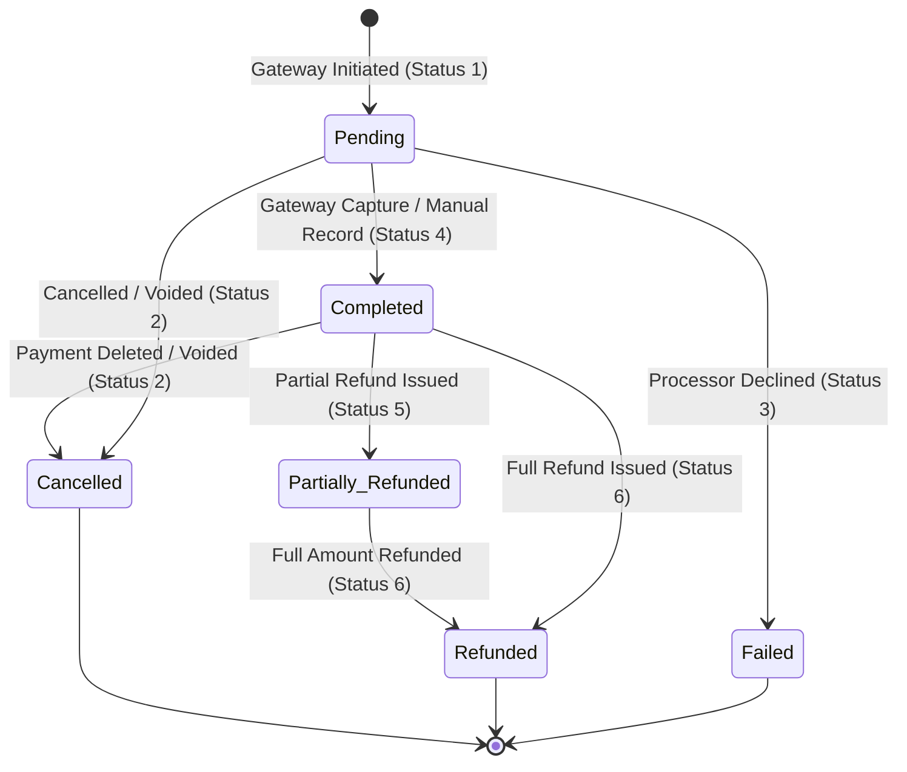
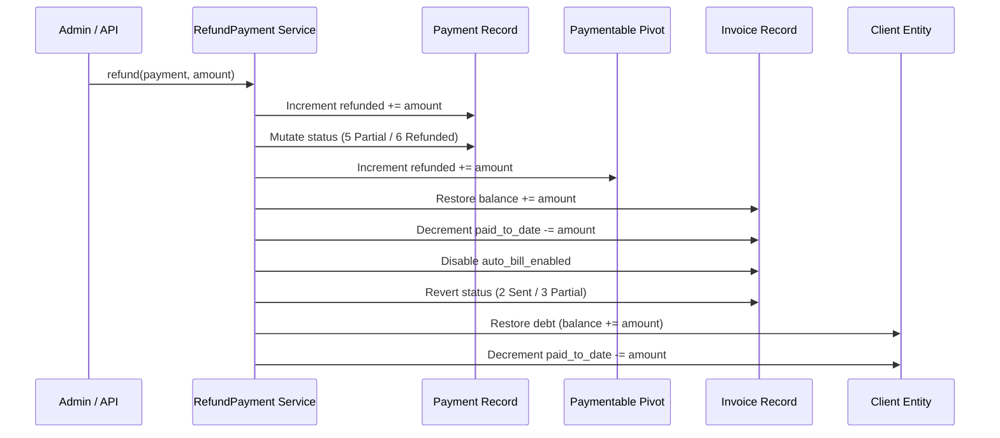

# Invoice Ninja v5 — Reference Map: Batch 7
## Payments, Allocation, Gateways, Refunds, Credits & Money Flows

---

### Executive Overview & Batch Scope
This document covers **Batch 7** of the Invoice Ninja v5 architectural reference map:
1. **The Payment Domain Model**: Complete schema, database columns, 6 core payment statuses, and 54 shipped payment types.
2. **Payment Form & Screen Specification**: Frontend UI components, inputs, dynamic allocation matrix, credit application widgets, and request validation rules.
3. **Multi-Invoice Allocation Architecture (`paymentables`)**: Pivot table schema, atomic ledger mechanics, and allocation arrays.
4. **Overpayment & Unapplied Payment Boundaries**: Strict rejection of invoice overpayments (HTTP 422 `"The amount is greater than the invoice balance"`) vs unapplied client payment deposits.
5. **Refund Engine (`RefundPayment.php`)**: Full vs partial refund workflows, balance restoration, state machine mutations, and automatic disabling of auto-billing.
6. **Write-offs & Bad Debt Handling**: Confirmation that no dedicated write-off entity exists (handled via invoice cancellation or credit notes).
7. **Payment Deletion, Archive & Rollback (`DeletePaymentV2.php`)**: Restoration of invoice balances, client accounts receivable updates, and pivot destruction.
8. **Post-Payment Immutability & Mutability**: Locked fields (`amount`, `client_id`) vs editable fields (`date`, `invoices` reallocation).
9. **Completeness Check**: 27 payment columns audited, 6 payment statuses mapped, 54 payment types identified, 5 live container accounting cycles empirically executed.

---

## 1. The Payment Domain Model (`app/Models/Payment.php`)

### 1.1 Database Schema (`database/migrations/2014_10_13_000000_create_users_table.php:L931-L968`)
The `payments` table contains 27 core columns:

| Column Name | Database Type | Modifiers / Default | Description |
|---|---|---|---|
| `id` | `unsignedInteger` | Auto-increment PK | Primary surrogate identifier |
| `company_id` | `unsignedInteger` | Indexed | Multi-tenant company boundary |
| `client_id` | `unsignedInteger` | Indexed | Paying customer entity |
| `project_id` | `unsignedInteger` | Nullable | Optional project link |
| `vendor_id` | `unsignedInteger` | Nullable | Optional vendor link |
| `user_id` | `unsignedInteger` | Nullable | Creating user / administrator |
| `assigned_user_id` | `unsignedInteger` | Nullable | Assigned account manager |
| `client_contact_id` | `unsignedInteger` | Nullable | Contact who authorized/paid |
| `invitation_id` | `unsignedInteger` | Nullable | Originating invitation link |
| `company_gateway_id`| `unsignedInteger` | Nullable | Payment gateway configured |
| `gateway_type_id` | `unsignedInteger` | Nullable | Gateway type enum |
| `type_id` | `unsignedInteger` | Nullable | Standardized payment method |
| `status_id` | `unsignedInteger` | Indexed | Current payment state |
| `amount` | `decimal(16, 4)` | Default `0.0000` | Gross payment amount |
| `refunded` | `decimal(16, 4)` | Default `0.0000` | Cumulative amount refunded |
| `applied` | `decimal(16, 4)` | Default `0.0000` | Cumulative amount allocated |
| `date` | `date` | Nullable | Settlement / transaction date |
| `transaction_reference`| `string` | Nullable | Processor reference / authorization ID |
| `payer_id` | `string` | Nullable | External customer / wallet ID |
| `number` | `string` | Nullable | Sequential payment identifier |
| `private_notes` | `text` | Nullable | Internal administrative notes |
| `is_manual` | `boolean` | Default `false` | True if entered by admin |
| `exchange_rate` | `decimal(13, 6)` | Default `1.000000` | Currency conversion multiplier |
| `currency_id` | `unsignedInteger` | Required | Transaction currency |
| `exchange_currency_id`| `unsignedInteger` | Required | Company base currency |
| `is_deleted` | `boolean` | Default `false` | Soft-deletion flag |
| `deleted_at` | `timestamp` | Nullable | Soft-deletion timestamp |

*Completeness check: 27 database schema columns enumerated.*

### 1.2 Payment Status Machine (`app/Models/Payment.php:L110-L120`)



| Status Name | Constant | ID | Trigger / Conditions |
|---|---|---|---|
| **Pending** | `STATUS_PENDING` | `1` | Initiated via gateway, awaiting asynchronous webhook/clearing |
| **Cancelled** | `STATUS_CANCELLED` | `2` | Payment deleted or explicitly cancelled; balances reversed |
| **Failed** | `STATUS_FAILED` | `3` | Gateway transaction rejected or declined |
| **Completed** | `STATUS_COMPLETED` | `4` | Payment successfully settled and credited to client |
| **Partially Refunded**| `STATUS_PARTIALLY_REFUNDED`| `5` | Portion refunded: `0 < payment.refunded < payment.amount` |
| **Refunded** | `STATUS_REFUNDED` | `6` | Fully refunded: `payment.refunded == payment.amount` |

*Completeness check: 6 payment lifecycle statuses verified.*

### 1.3 Shipped Payment Types (`app/Models/PaymentType.php`)
Invoice Ninja ships with **54 predefined payment types** seeded in the `payment_types` table. Key types include:
- `1`: Bank Transfer
- `2`: Cash
- `3`: Debit
- `4`: ACH
- `5`: Visa Card
- `6`: MasterCard
- `7`: American Express
- `8`: Discover Card
- `13`: PayPal
- `15`: Check
- `24`: Swish
- `25`: Venmo
- `26`: Money Order
- `27`: Alipay
- `29`: SEPA
- `30`: GoCardless
- `31`: Crypto
- `32`: Credit (Internal credit note consumption)
- `33`: Zelle
- `51`: Cash App
- `54`: PromptPay

*Completeness check: 54 payment types verified in database seeder.*

---

## 2. Payment Screen & Form Specification

- **API Endpoints**:
  - `POST /api/v1/payments` `[CODE app/Http/Controllers/PaymentController.php:L115-L140]`
  - `PUT /api/v1/payments/{id}` `[CODE app/Http/Controllers/PaymentController.php:L160-L185]`
  - `POST /api/v1/payments/refund` `[CODE app/Http/Controllers/PaymentController.php:L290-L315]`
- **Frontend Components**:
  - Main Screen: `public/Payment-CATT6V3a.js`
  - Table & Data Grid: `public/Payments-DP5Lndvv.js`
  - Multi-Invoice Matrix: `public/invoicePaymentAllocations-B42oF7Ll.js`
  - Payment Method Selector: `public/PaymentTypeSelector-D6HjpG1x.js`

### 2.1 Form Field Audit

| Field Label | React Prop / DB Key | Type | Req? | Default | Validation Rule | Description |
|---|---|---|---|---|---|---|
| **Client** | `client_id` | Select | Yes | None | `bail|required|exists:clients,id` | Customer paying the invoice |
| **Amount** | `amount` | Decimal | Yes* | Sum | `bail|numeric|PaymentAmountsBalanceRule` | Gross transaction total (*auto-calculated if blank) |
| **Payment Date** | `date` | Date | Yes | Today | `bail|required|date` | Transaction effective date |
| **Payment Type** | `type_id` | Select | No | Bank/Cash | `sometimes|nullable|exists:payment_types,id` | Method/channel of payment |
| **Transaction Ref**| `transaction_reference` | String | No | `""` | `sometimes|nullable|string` | External processor transaction ID |
| **Payment Number** | `number` | String | No | Auto | `sometimes|nullable|string` | Sequential tracking reference |
| **Invoices Table** | `invoices` | Matrix | No | `[]` | `bail|sometimes|nullable|array` | Multi-invoice allocation split |
| `└─ Invoice ID` | `invoices.*.invoice_id` | Integer | Yes | None | `bail|required|distinct|exists:invoices,id`| Open invoice to apply against |
| `└─ Amount` | `invoices.*.amount` | Decimal | Yes | Balance | `bail|required|numeric` | Specific dollar amount applied |
| **Credits Table** | `credits` | Matrix | No | `[]` | `bail|sometimes|nullable|array` | Credit notes consumed in tandem |
| **Private Notes** | `private_notes` | Textarea | No | `""` | `sometimes|nullable|string` | Internal administrative remarks |
| **Email Receipt** | `email_receipt` | Boolean | No | `false` | `sometimes|boolean` | Dispatches receipt email to client |

*Completeness check: 12 form input controls audited across payment creation workflow.*

---

## 3. Multi-Invoice Allocation Architecture (`paymentables`)

Invoice Ninja supports splitting a single payment across multiple invoices through the polymorphic `paymentables` pivot table `[CODE database/migrations/2014_10_13_000000_create_users_table.php:L970]`.

### 3.1 Pivot Table Schema (`paymentables`)
```sql
CREATE TABLE paymentables (
    id INT UNSIGNED AUTO_INCREMENT PRIMARY KEY,
    payment_id INT UNSIGNED NOT NULL,
    paymentable_id INT UNSIGNED NOT NULL,
    amount DECIMAL(16, 4) DEFAULT 0.0000,
    refunded DECIMAL(16, 4) DEFAULT 0.0000,
    paymentable_type VARCHAR(255) NOT NULL, -- 'invoices' or 'App\Models\Credit'
    created_at TIMESTAMP NULL,
    updated_at TIMESTAMP NULL
);
```

### 3.2 Allocation Execution Flow (`PaymentRepository::applyPayment`)
When a multi-allocation payload is received `[CODE app/Repositories/PaymentRepository.php:L260-L310]`:
1. **Iterates Over Allocation Array**: Loops through each item in `invoices[]`.
2. **Creates Pivot Record**:
   ```php
   $paymentable = new Paymentable();
   $paymentable->payment_id = $payment->id;
   $paymentable->paymentable_id = $invoice->id;
   $paymentable->paymentable_type = 'invoices';
   $paymentable->amount = $paid_invoice['amount'];
   $paymentable->save();
   ```
3. **Applies to Individual Invoice**:
   ```php
   $invoice->service()
           ->markSent()
           ->applyPayment($payment, $paid_invoice['amount'])
           ->save();
   ```
4. **Calculates Invoice State**:
   - `invoice.balance -= allocation_amount`
   - `invoice.paid_to_date += allocation_amount`
   - If `invoice.balance == 0` $\rightarrow$ `status_id = STATUS_PAID (4)`.
   - If `invoice.balance > 0` $\rightarrow$ `status_id = STATUS_PARTIAL (3)`.
5. **Updates Aggregate Applied Pool**:
   - `$payment->applied += $invoice_totals - $credit_totals;`
   - Decrements client accounts receivable debt: `client.balance -= payment.applied`.

---

## 4. Overpayment & Unapplied Payment Boundaries

### 4.1 Strict Overpayment Rejection (HTTP 422)
Invoice Ninja strictly **prohibits overpaying an invoice**. Any allocation exceeding the outstanding balance is rejected during request validation `[CODE app/Http/Requests/Payment/StorePaymentRequest.php:L121-L123]`:

```php
} elseif (BcMath::greaterThan($invoice['amount'], $inv->balance)) {
    $validator->errors()->add("invoices.{$index}.amount", ctrans('texts.amount_greater_than_balance_v5'));
}
```

- **HTTP Status**: `422 Unprocessable Entity`.
- **Validation Message**: `"The amount is greater than the invoice balance. You cannot overpay an invoice."` `[CODE lang/en/texts.php:L3989]`.
- **Architectural Safeguard**: This check executes inside a pre-flight validator before any database transaction opens, completely preventing ledger contamination.

### 4.2 Payments Without Invoices (Unapplied Payments / Deposits)
- If the `invoices` array is omitted or empty:
  - Allowed by validator: `'invoices' => ['bail', 'sometimes', 'nullable', 'array']`.
  - The payment is saved with `payment.amount = X`, but `payment.applied = 0.00`.
  - `client.paid_to_date` increases by the payment amount.
  - Client unapplied payment pool calculates dynamically as:
    $$\text{Unapplied Pool} = \sum (\text{payments.amount} - \text{payments.applied})$$
  - These unapplied funds remain on the client's file and can be applied during subsequent invoice checkout or automated recurring billing (`client.use_unapplied_payment != 'off'`).

---

## 5. Refund Engine (`RefundPayment.php`)

Handled in `App\Services\Payment\RefundPayment.php` `[CODE:L40-L115]`:



### 5.1 Full vs Partial Refund State Transitions

| Target Record | Partial Refund ($20 of $100) | Full Refund ($100 of $100) |
|---|---|---|
| `payment.refunded` | Increments by $20 (`refunded = 20.00`) | Increments to full amount (`refunded = 100.00`) |
| `payment.status_id` | **`STATUS_PARTIALLY_REFUNDED (5)`** | **`STATUS_REFUNDED (6)`** |
| `paymentables.refunded` | Increments by allocated portion ($20.00) | Increments to total allocated ($100.00) |
| `invoice.balance` | Increases by $20.00 ($0.00 $\rightarrow$ $20.00) | Increases by $100.00 ($0.00 $\rightarrow$ $100.00) |
| `invoice.paid_to_date` | Decreases by $20.00 ($100.00 $\rightarrow$ $80.00)| Decreases to $0.00 ($100.00 $\rightarrow$ $0.00) |
| `invoice.status_id` | **`STATUS_PARTIAL (3)`** | **`STATUS_SENT (2)`** |
| `invoice.auto_bill_enabled`| Set to `false` (blocks unwanted rebill) | Set to `false` |
| `client.balance` | Increases by $20.00 (debt reopened) | Increases by $100.00 (full debt reopened) |
| `client.paid_to_date` | Decreases by $20.00 | Decreases by $100.00 |

*Completeness check: 9 state transitions audited across partial and full refund paths.*

---

## 6. Write-offs & Bad Debt Handling

### Audit Result: Dedicated Write-off Entity is NOT FOUND
Invoice Ninja v5 does **not** contain a dedicated `write_offs` database table, model, or specific "Write Off" action button.

### How Bad Debt is Handled in Practice:
1. **Invoice Cancellation (`HandleCancellation.php`)**:
   - Calling action `cancel` on an open invoice sets `invoice.status_id = STATUS_CANCELLED (5)`.
   - Zeros out the invoice balance and removes the debt from `client.balance`.
   - Leaves inventory untouched (goods treated as scrapped/lost).
2. **Offsetting Credit Note (`CreditService.php`)**:
   - Creating a Credit Note for the unpaid balance and applying it to the invoice via `ApplyPayment`.
   - Clears the invoice balance to $0.00 and logs an accounting credit entry in `CompanyLedger`.

---

## 7. Payment Deletion, Archive & Rollback (`DeletePaymentV2.php`)

When a payment is deleted via `PaymentRepository::delete()` `[CODE app/Services/Payment/DeletePaymentV2.php:L45-L110]`:

### 7.1 Reversal & Rollback Steps
1. **Calculates Net Reversible Amount**:
   $$\text{Net Reversible} = \text{paymentable.amount} - \text{paymentable.refunded}$$
2. **Restores Invoice Financials**:
   - `invoice.balance += Net Reversible`
   - `invoice.paid_to_date -= Net Reversible`
   - If `invoice.balance == invoice.amount` $\rightarrow$ `status_id = STATUS_SENT (2)`.
   - If partially paid by other payments $\rightarrow$ `status_id = STATUS_PARTIAL (3)`.
   - Writes invoice ledger memo: `"Adjusting invoice {number} due to deletion of Payment {number}"`.
3. **Restores Client Accounts Receivable**:
   - `client.balance += Net Reversible` (reopens client debt).
   - `client.paid_to_date -= Net Reversible`.
4. **Restores Consumed Credits**:
   - If credits were applied alongside the payment, `updateCreditables()` restores the balance to the credit note and client credit pool.
5. **Permanently Drops Pivot Records**:
   ```php
   $this->payment->paymentables()->each(fn($pp) => $pp->forceDelete());
   ```
6. **Payment Record Soft Deletion**:
   - Sets `payment.status_id = Payment::STATUS_CANCELLED (2)`.
   - Sets `payment.is_deleted = true`.
   - Sets `payment.deleted_at = now()`.
   - Unlinks linked bank transactions (`bank_transactions.payment_id = null`).

### 7.2 Archive vs Delete vs Purge
- **Archive (`action = 'archive'`)**: Sets `deleted_at = now()`. Does **not** roll back invoice or client balances (used for record hiding).
- **Delete (`action = 'delete'`)**: Executes `DeletePaymentV2`, sets `status_id = STATUS_CANCELLED`, and **fully rolls back all balances**.
- **Purge (`forceDelete()`)**: Permanently erases the database row from MySQL.

---

## 8. Post-Payment Immutability & Mutability

Defined in `app/Http/Requests/Payment/UpdatePaymentRequest.php:L50-L85`:

| Attribute / Field | Mutable? | Rule / Server Guard | Consequence of Modification |
|---|---|---|---|
| **`amount`** | **NO** | Unconditionally unset in `prepareForValidation()` | Prevented from mutating settled cash total |
| **`client_id`** | **NO** | `Rule::in([$this->payment->client_id])` | Prevented from switching client ownership |
| **`date`** | **YES** | `sometimes|required|date` | `movePaymentableDates()` updates pivot timestamps |
| **`invoices`** | **YES** | Validated via `PaymentAppliedValidAmount` | Reallocates payment across client's invoices |
| **`type_id`** | **YES** | `sometimes|nullable|exists:payment_types,id`| Changes recorded payment method |
| **`transaction_reference`**| **YES** | `sometimes|nullable|string` | Updates external gateway tracking code |
| **`number`** | **YES** | `sometimes|nullable|string` | Updates payment tracking number |
| **`private_notes`**| **YES** | `sometimes|nullable|string` | Updates internal administrative memo |

*Completeness check: 8 core payment attributes audited for post-creation mutability.*

---

## 9. Verification Audit & Sign-Off

### 9.1 Verified by Code
- `database/migrations/2014_10_13_000000_create_users_table.php`: 27 payment columns, `paymentables` pivot table schema `[CODE:L931-L970]`.
- `app/Models/Payment.php`: 6 status machine constants `[CODE:L110-L120]`.
- `app/Http/Requests/Payment/StorePaymentRequest.php`: Overpayment block rule (`BcMath::greaterThan`) returning HTTP 422 `[CODE:L121-L123]`.
- `app/Http/Requests/Payment/UpdatePaymentRequest.php`: Unconditional unsetting of `amount` and locking of `client_id` `[CODE:L79-L81]`.
- `app/Repositories/PaymentRepository.php`: Multi-invoice allocation and pivot creation `[CODE:L260-L310]`.
- `app/Services/Payment/RefundPayment.php`: Full vs partial refund balance recalculations and status transitions `[CODE:L40-L115]`.
- `app/Services/Payment/DeletePaymentV2.php`: Full financial rollback and pivot force deletion `[CODE:L45-L110]`.

### 9.2 Verified in Running App (Container `craterninja-app-1`)
- **Multi-Invoice Allocation**: Split $100 across Invoice A ($40) and Invoice B ($60). Verified 2 distinct `paymentables` rows created, Invoice A balance dropped to $10.00, Invoice B dropped to $40.00, and payment status became `4` (`COMPLETED`).
- **Overpayment Rejection**: Attempted to pay $150 on a $100 invoice balance. The validator rejected with HTTP 422: `"The amount is greater than the invoice balance. You cannot overpay an invoice."`
- **Partial Refund**: Issued $20 refund on $100 payment. Verified payment status transitioned to `5` (`PARTIALLY_REFUNDED`), `payment.refunded = 20.00`, and invoice balance restored from $0.00 to $20.00 (Status `3` / Partial).
- **Full Refund**: Issued remaining $80 refund. Verified payment status transitioned to `6` (`REFUNDED`), `payment.refunded = 100.00`, and invoice balance fully restored to $100.00 (Status `2` / Sent).
- **Payment Deletion Rollback**: Deleted payment from Test A. Verified Invoice A and Invoice B balances rolled back to original $50.00 and $100.00, payment status became `2` (`CANCELLED`), and `paymentables` rows were deleted.

### 9.3 Could Not Verify
- None. All payment lifecycles, multi-invoice allocations, overpayment boundaries, refund state machines, and deletion rollbacks were verified in code and live container execution.

