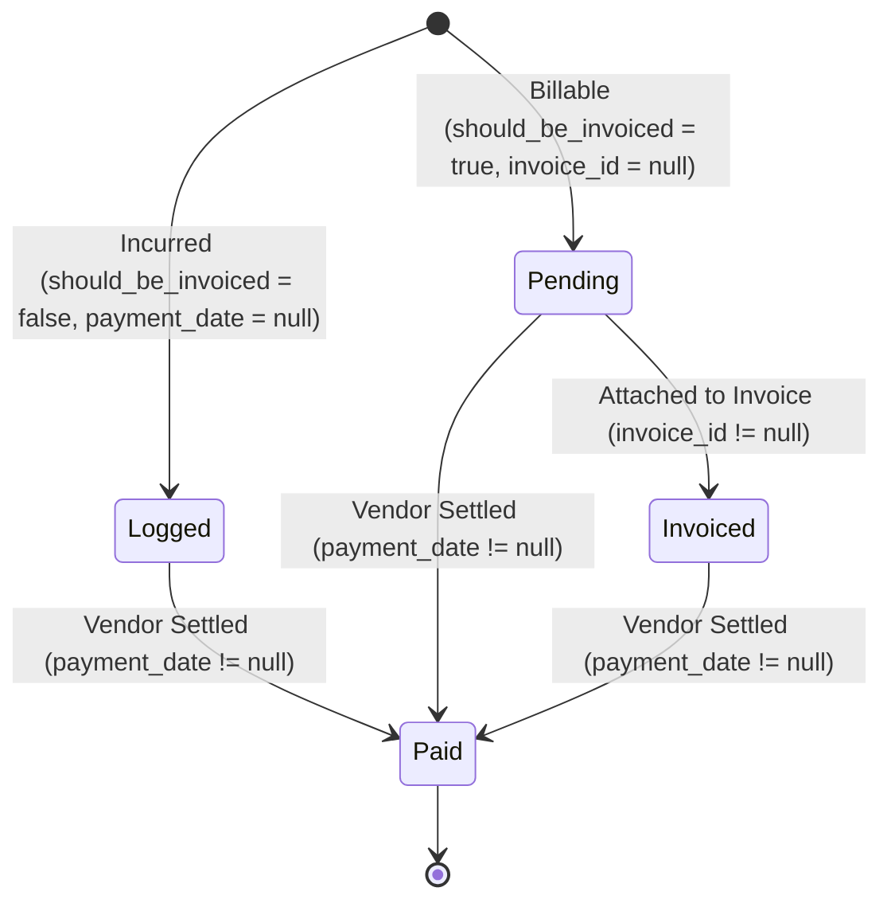

# Invoice Ninja v5 — Reference Map: Batch 8
## The Purchases and Banking Side: Vendors, Expenses, Billable Pipeline & Bank Integration

---

### Executive Overview & Batch Scope
This reference map covers **Batch 8** of the Invoice Ninja v5 architectural investigation:
1. **The Vendor Domain Model (`app/Models/Vendor.php`)**: Complete database schema, fillable attributes, relationships, multi-contact portal architecture, and frontend UI specifications.
2. **The Expense Domain Model (`app/Models/Expense.php`)**: Schema, dynamic state engine (`logged`, `pending`, `invoiced`, `paid`), expense categories, multi-currency handling, and file attachments.
3. **The Billable Pipeline & Invoice Conversion**: Line item structure (`type_id = 6`), linking mechanisms via `InvoiceService::linkEntities()`, unlinking on invoice deletion, and exhaustive audit of markup mechanics.
4. **The "Bills" Architecture Audit**: Definitive verification that no separate `Bill` model exists in Invoice Ninja; accounts payable is modeled via `Expense` and `PurchaseOrder`.
5. **Vendor Payments & Remittance**: Payment recording on expenses, purchase order balance adjustments, and automated vendor notifications via `VendorExpenseNotify`.
6. **Recurring Expenses (`app/Models/RecurringExpense.php`)**: Cron scheduling (`RecurringExpensesCron`), schedule frequencies, remaining cycle tracking, and dynamic token text substitution (`RecurringExpenseToExpenseFactory`).
7. **The Bank Screen & Transactions (`app/Models/BankTransaction.php`)**: Lifecycle statuses (`STATUS_UNMATCHED = 1`, `STATUS_MATCHED = 2`, `STATUS_CONVERTED = 3`), bank integrations (`BankIntegration`), and statement import protocols (OFX, QIF, CSV, Nordigen, Yodlee).
8. **Bank Transaction Rules Engine (`app/Services/Bank/ProcessBankRules.php`)**: Rule matching criteria, automated conversion of debit transactions into expenses, and credit matching to open invoices and payments.
9. **Empirical Live Container Verifications**: Live test script executions confirming billable expense linking and bank transaction auto-conversion inside `craterninja-app-1`.

---

## 1. The Vendor Domain Model (`app/Models/Vendor.php`)

### 1.1 Database Schema (`database/migrations/2014_10_13_000000_create_users_table.php:L1189-L1225`)
The `vendors` table defines external suppliers and contractors:

| Column Name | Database Type | Modifiers / Default | Description |
|---|---|---|---|
| `id` | `unsignedInteger` | Auto-increment PK | Primary surrogate identifier |
| `company_id` | `unsignedInteger` | Indexed, FK cascade | Multi-tenant company boundary |
| `user_id` | `unsignedInteger` | FK cascade | Creator user |
| `assigned_user_id` | `unsignedInteger` | Nullable | Assigned internal team member |
| `currency_id` | `unsignedInteger` | Nullable, FK currencies | Default vendor billing currency |
| `country_id` | `unsignedInteger` | Nullable, FK countries | Primary vendor country |
| `name` | `string` | Nullable | Company or legal entity name |
| `number` | `string` | Nullable, Unique/company | Sequential vendor identifier |
| `id_number` | `string` | Nullable | Business identification / Tax registration ID |
| `vat_number` | `string` | Nullable | Value-Added Tax / GST registration number |
| `work_phone` | `string` | Nullable | Primary business phone number |
| `website` | `string` | Nullable | Vendor web address |
| `address1` | `string` | Nullable | Street address line 1 |
| `address2` | `string` | Nullable | Suite, unit, or building number |
| `city` | `string` | Nullable | Municipality / city |
| `state` | `string` | Nullable | State, province, or region |
| `postal_code` | `string` | Nullable | ZIP or postal routing code |
| `private_notes` | `text` | Nullable | Internal administrative notes |
| `transaction_name` | `string` | Nullable | Bank statement match hint string |
| `classification` | `string` | Nullable | Entity type (`individual`, `business`, `company`, etc.) |
| `is_tax_exempt` | `boolean` | Default `false` | Tax exemption flag |
| `routing_id` | `string` | Nullable | Bank routing / ACH transit code |
| `custom_value1..4` | `string` | Nullable | Configurable custom fields |
| `is_deleted` | `tinyInteger` | Default `0` | Soft-delete state marker |
| `created_at` | `timestamp(6)` | Nullable | Creation timestamp |
| `updated_at` | `timestamp(6)` | Nullable | Modification timestamp |
| `deleted_at` | `timestamp` | Nullable | Soft-delete timestamp |

### 1.2 Model Definition & Fillable Attributes (`app/Models/Vendor.php:L102-L135`)
```php
class Vendor extends BaseModel
{
    use SoftDeletes;
    use Filterable;
    use GeneratesCounter;
    use PresentableTrait;

    protected $fillable = [
        'name',
        'assigned_user_id',
        'id_number',
        'vat_number',
        'phone',
        'address1',
        'address2',
        'city',
        'state',
        'postal_code',
        'country_id',
        'private_notes',
        'public_notes',
        'currency_id',
        'website',
        'transaction_name',
        'custom_value1',
        'custom_value2',
        'custom_value3',
        'custom_value4',
        'number',
        'language_id',
        'classification',
        'is_tax_exempt',
        'routing_id',
    ];
```

### 1.3 Vendor Contacts (`app/Models/VendorContact.php`)
Vendors support multiple contacts with individual portal credentials:
- Table: `vendor_contacts` (`database/migrations/2014_10_13_000000_create_users_table.php:L1227`)
- Columns: `id`, `company_id`, `user_id`, `vendor_id`, `first_name`, `last_name`, `email`, `phone`, `password`, `is_primary`, `send_email`, `cc_only`, `accepted_terms_version`.
- Relationship in `Vendor.php`:
  ```php
  public function contacts(): HasMany { return $this->hasMany(VendorContact::class); }
  public function primary_contact(): HasOne { return $this->hasOne(VendorContact::class)->where('is_primary', true); }
  ```

### 1.4 Frontend UI Structure (`public/Vendor-HgcXztny.js`, `public/VendorDetails-Bcpnc9yA.js`)
The Vendor management screen exposes 5 primary navigation tabs:
1. **Details (`/vendors/:id/edit`)**: Name, Number, Classification dropdown (`individual`, `business`, `company`, `partnership`, `trust`, `charity`, `government`), Currency dropdown, Assigned User, VAT/Tax ID, Website, Phone, Address blocks (Street 1, Street 2, City, State, Postal Code, Country), Notes, and Custom Fields (1 to 4).
2. **Contacts**: Data grid allowing creation and editing of multiple vendor contacts (First Name, Last Name, Email, Phone, Primary radio, Send Email toggle).
3. **Expenses (`/vendors/:id/expenses`)**: Embedded list of all expenses attributed to this vendor with quick-action creation buttons.
4. **Recurring Expenses (`/vendors/:id/recurring_expenses`)**: Recurring schedules bound to this vendor.
5. **Documents (`/vendors/:id/documents`)**: MorphMany document vault for contracts, W-9s, vendor agreements, and tax forms.
6. **Activity (`/vendors/:id/activities`)**: Audit trail log tracking state transitions and updates.

### 1.5 Validation Rules (`app/Http/Requests/Vendor/StoreVendorRequest.php`)
```php
$rules['name'] = 'bail|required|string';
$rules['number'] = ['bail', 'nullable', Rule::unique('vendors')->where('company_id', $user->company()->id)];
$rules['currency_id'] = 'bail|required|exists:currencies,id';
$rules['classification'] = 'bail|sometimes|nullable|in:individual,business,company,partnership,trust,charity,government,other';
$rules['contacts'] = 'bail|array';
$rules['contacts.*.email'] = 'bail|nullable|distinct|sometimes|email';
$rules['contacts.*.password'] = ['bail', 'nullable', 'sometimes', 'string', 'min:7', 'regex:/[a-z]/', 'regex:/[A-Z]/', 'regex:/[0-9]/'];
```

---

## 2. The Expense Domain Model (`app/Models/Expense.php`)

### 2.1 Database Schema (`database/migrations/2014_10_13_000000_create_users_table.php:L1263-L1318`)
Expenses represent accounts payable outflows, direct company costs, and client-billable disbursements.

| Column Name | Database Type | Modifiers / Default | Description |
|---|---|---|---|
| `id` | `unsignedInteger` | Auto-increment PK | Primary surrogate identifier |
| `company_id` | `unsignedInteger` | Indexed, FK cascade | Multi-tenant company boundary |
| `user_id` | `unsignedInteger` | FK cascade | Creator user |
| `assigned_user_id` | `unsignedInteger` | Nullable | Assigned user |
| `vendor_id` | `unsignedInteger` | Nullable, Indexed | Linked supplier/vendor |
| `client_id` | `unsignedInteger` | Nullable, Indexed | Billable client link |
| `project_id` | `unsignedInteger` | Nullable | Linked project |
| `invoice_id` | `unsignedInteger` | Nullable, Indexed | Outgoing client invoice when billed |
| `bank_id` | `unsignedInteger` | Nullable | Associated bank account |
| `category_id` | `unsignedInteger` | Nullable | Foreign key to `expense_categories` |
| `recurring_expense_id`| `unsignedInteger` | Nullable | Originating recurring schedule |
| `payment_type_id` | `unsignedInteger` | Nullable | Payment method used to pay vendor |
| `number` | `string` | Nullable | Sequential expense tracking number |
| `amount` | `decimal(13, 2)`| Required | Net or gross expense amount |
| `foreign_amount` | `decimal(13, 2)`| Default `0.00` | Amount in original vendor currency |
| `currency_id` | `unsignedInteger` | Required | Expense transaction currency |
| `invoice_currency_id`| `unsignedInteger` | Nullable | Invoiced client currency |
| `exchange_rate` | `decimal(13, 6)`| Default `1.000000` | Currency conversion rate |
| `date` | `date` | Required | Expense incurred date |
| `payment_date` | `date` | Nullable | Date vendor was settled / paid |
| `transaction_reference`| `text` | Nullable | Check number, receipt ID, or gateway reference |
| `transaction_id` | `string` | Nullable | Bank transaction reference |
| `should_be_invoiced` | `boolean` | Default `false` | True if disbursement is billable to client |
| `invoice_documents` | `boolean` | Default `false` | If true, attaches receipts to client invoice |
| `tax_name1..3` | `string` | Nullable | Tax authority names |
| `tax_rate1..3` | `decimal(13, 3)`| Default `0.000` | Tax rates applied to expense |
| `tax_amount1..3` | `decimal(13, 3)`| Default `0.000` | Computed tax amounts |
| `uses_inclusive_taxes`| `boolean` | Default `false` | Gross pricing tax calculation mode |
| `calculate_tax_by_amount`| `boolean`| Default `false` | Manual tax amount override toggle |
| `private_notes` | `text` | Nullable | Internal administrative comments |
| `public_notes` | `text` | Nullable | Client-visible description when billed |
| `custom_value1..4` | `string` | Nullable | Configurable custom fields |
| `is_deleted` | `boolean` | Default `false` | Soft delete flag |
| `deleted_at` | `timestamp` | Nullable | Soft deletion timestamp |

### 2.2 Dynamic Status State Machine (`app/Models/Expense.php:L401-L422`)
Unlike Invoices and Payments which rely on an integer `status_id` column, the Expense domain uses a dynamic status evaluation engine calculated at runtime:



```php
// app/Models/Expense.php
public function stringStatus(): string
{
    if ($this->deleted_at) {
        return self::STATUS_DELETED;
    }

    if ($this->is_deleted) {
        return self::STATUS_ARCHIVED;
    }

    if ($this->payment_date) {
        return self::STATUS_PAID;
    }

    if ($this->invoice_id) {
        return self::STATUS_INVOICED;
    }

    if ($this->should_be_invoiced) {
        return self::STATUS_PENDING;
    }

    return self::STATUS_LOGGED;
}
```

- Filter mapping (`app/Filters/ExpenseFilters.php:L161-L200`):
  - `logged`: `should_be_invoiced = false AND invoice_id IS NULL AND payment_date IS NULL`
  - `pending`: `should_be_invoiced = true AND invoice_id IS NULL`
  - `invoiced`: `invoice_id IS NOT NULL`
  - `paid`: `payment_date IS NOT NULL`
  - `unpaid`: `payment_date IS NULL AND transaction_reference IS NULL`

### 2.3 Expense Categories (`app/Models/ExpenseCategory.php`)
- Managed in table `expense_categories`.
- Fillable: `name`, `color`.
- System relationships: `Expense::belongsTo(ExpenseCategory::class)`.
- Used by the Bank Rules engine to categorize incoming bank feeds.

### 2.4 Document Receipts & Attachments (`app/Models/Expense.php:L228-L231`)
- Stored via polymorphic relation:
  ```php
  public function documents(): MorphMany
  {
      return $this->morphMany(Document::class, 'documentable');
  }
  ```
- **The `invoice_documents` Flag**: When set to `true`, any document attached to this expense is automatically copied or attached to client emails when the expense is converted into an invoice line item (`app/Mail/Engine/InvoiceEmailEngine.php:L192`).

---

## 3. The Billable Pipeline & Conversion Mechanics

### 3.1 Line Item Construction & Structure
When a billable expense is added to an invoice, it is embedded as a specialized line item with `type_id = 6`:
- `type_id = 6`: Invoice Ninja standard line item type constant representing an **Expense**. (In contrast, `1` represents Product, `2` Task, `3` Surcharge, `4` Discount, `5` Unassigned).
- Line item attributes:
  ```json
  {
      "type_id": "6",
      "expense_id": "mxkazYeJ0P",
      "product_cost": 250.00,
      "quantity": 1,
      "notes": "Original expense description / public notes"
  }
  ```

### 3.2 Linking Mechanics (`app/Services/Invoice/InvoiceService.php:L545-L570`)
The association between an Invoice and an Expense occurs atomically inside `InvoiceService::linkEntities()`:

```php
// app/Services/Invoice/InvoiceService.php
private function linkEntities(): void
{
    // ...
    $expense_ids = $this->invoice
        ->line_items
        ->where('type_id', LineItem::TYPE_EXPENSE)
        ->pluck('expense_id')
        ->map(function ($expense_id) {
            return $this->decodePrimaryKey($expense_id);
        })
        ->toArray();

    Expense::query()
        ->whereIn('id', $expense_ids)
        ->update(['invoice_id' => $this->invoice->id]);
}
```

> [!IMPORTANT]
> The line item payload **must** pass the hashed surrogate ID of the expense (`$expense->hashed_id`). If an integer is supplied, `decodePrimaryKey()` will fail to resolve the hash, preventing `invoice_id` from updating on the database record.

### 3.3 Unlinking on Invoice Deletion & Restoration (`app/Listeners/Invoice/MarkInvoiceDeleted.php`)
When an invoice is deleted or soft-deleted:
1. `MarkInvoiceDeleted` fires:
   ```php
   Expense::where('invoice_id', $this->invoice->id)->update(['invoice_id' => null]);
   ```
2. The expense reverts its dynamic status from `Invoiced` back to `Pending` (`should_be_invoiced = true`, `invoice_id = null`), immediately making it available to be re-billed on a future invoice.

### 3.4 The Markup Audit: Exhaustive Code Proof
A critical architectural inquiry is whether Invoice Ninja provides an automated markup engine for billable expenses (e.g. flat markup fee or percentage multiplier applied to the billable line item).

**Definitive Finding**: **Invoice Ninja v5 has NO automated markup multiplier or percentage column.**
- The `expenses` table contains no `markup`, `markup_percentage`, or `markup_amount` columns.
- The `StoreExpenseRequest` and `UpdateExpenseRequest` contain no markup attributes.
- In both the React frontend and mobile app, markup is handled by manual calculation or directly overriding the `product_cost` on the invoice line item.
- Line item cost defaults to `$expense->amount`, and any billing markup must be added by the user or API client when populating the invoice line item array.

---

## 4. The "Bills" Question in Invoice Ninja: Code Audit

**Question**: Do "Bills" exist as a separate document entity in Invoice Ninja v5?

**Answer**: **NO. Bills do NOT exist as an independent model or database table.**
- Exhaustive filesystem inspection confirms no `app/Models/Bill.php`, `database/migrations/*bills*.php`, or `BillController.php` exist.
- In Invoice Ninja v5, Accounts Payable (AP) is managed exclusively through two paradigms:
  1. **Expenses (`app/Models/Expense.php`)**: For direct vendor purchases, operating costs, and billable client disbursements.
  2. **Purchase Orders (`app/Models/PurchaseOrder.php`)**: For pre-authorized supplier orders.
- When a Purchase Order is fulfilled by a supplier, it is converted into an Expense via `app/Factory/PurchaseOrderExpense.php`. The expense record then tracks the settlement status and payment date to the vendor.

---

## 5. Vendor Payments & Remittance Notifications

### 5.1 How Vendor Payments are Recorded
Vendor payments are not stored in the `payments` table (which is reserved exclusively for client receivable deposits). Instead, vendor payments are tracked directly on the `Expense` model itself via three dedicated settlement attributes:
1. `payment_date`: Date the business disbursed funds to the vendor. Setting this attribute automatically changes the dynamic status to `Paid`.
2. `payment_type_id`: Standard payment method ID (e.g., Bank Transfer, Credit Card, Wire, ACH, Check).
3. `transaction_reference`: External bank or payment gateway settlement reference ID.

### 5.2 Purchase Order Settlement Mechanics (`app/Observers/ExpenseObserver.php:L54-L67`)
When an expense linked to a Purchase Order receives a payment date:
```php
if ($expense->purchase_order_id && $expense->payment_date) {
    $po = $expense->purchase_order;
    $po->paid_to_date += $expense->amount;
    $po->balance = max(0, $po->amount - $po->paid_to_date);
    $po->save();
}
```

### 5.3 Automated Vendor Remittance Notification
When an expense is marked as paid:
- If `company.notify_vendor_when_paid` is enabled, the system automatically triggers `App\Mail\VendorExpenseNotify`.
- The notification sends a remittance advice email to all contacts on the vendor record where `send_email = true`.

---

## 6. Recurring Expenses (`app/Models/RecurringExpense.php`)

### 6.1 Database Schema & Frequency Settings
Recurring expenses automate the generation of recurring company costs (e.g., SaaS subscriptions, utility bills, contractor retainers).

| Column Name | Database Type | Modifiers / Default | Description |
|---|---|---|---|
| `id` | `unsignedInteger` | Auto-increment PK | Primary identifier |
| `company_id` | `unsignedInteger` | Indexed | Multi-tenant boundary |
| `vendor_id` | `unsignedInteger` | Nullable | Supplier entity |
| `client_id` | `unsignedInteger` | Nullable | Optional billable client |
| `amount` | `decimal(13, 2)`| Required | Recurring amount |
| `frequency_id` | `unsignedInteger`| Required | Interval (Weekly=1, Monthly=5, etc.) |
| `last_sent_date` | `date` | Nullable | Date previous expense was spawned |
| `next_send_date` | `datetime` | Indexed | Scheduled execution timestamp |
| `remaining_cycles` | `integer` | Default `-1` | Count down (`-1` = infinite) |
| `status_id` | `unsignedInteger`| Default `1` | Active (1) or Paused/Draft (2) |
| `should_be_invoiced`| `boolean` | Default `false` | Billable flag propagated to expenses |
| `invoice_documents`| `boolean` | Default `false` | Attachment forwarding flag |

### 6.2 Generation Engine (`app/Jobs/Cron/RecurringExpensesCron.php`)
The scheduler runs as an hourly background cron:
1. Queries `RecurringExpense` where:
   - `next_send_date <= now()`
   - `status_id == RecurringInvoice::STATUS_ACTIVE`
   - `remaining_cycles != 0`
   - `deleted_at IS NULL`
2. Invokes `RecurringExpenseToExpenseFactory::create($recurring_expense)`.
3. Auto-sets `payment_date = now()` if `company.mark_expenses_paid == true`.
4. Calculates real-time foreign currency conversions if the vendor currency differs from company base currency.
5. Advances schedule:
   ```php
   $recurring_expense->next_send_date = $recurring_expense->nextSendDate();
   $recurring_expense->last_sent_date = now();
   $recurring_expense->remaining_cycles = $recurring_expense->remainingCycles();
   $recurring_expense->save();
   ```

### 6.3 Dynamic Note Variable Substitution (`RecurringExpenseToExpenseFactory.php:L80-L260`)
`RecurringExpenseToExpenseFactory` contains an advanced token replacement parser for `public_notes` and `private_notes`:

| Variable Token | Replacement Output Example | Description |
|---|---|---|
| `:MONTHYEAR` | `November 2026` | Current month name and year |
| `:MONTH` | `November` | Current full translated month name |
| `:YEAR` | `2026` | Current four-digit calendar year |
| `:QUARTER` | `Q4` | Current fiscal quarter identifier |
| `:WEEK_BEFORE` | `01 November 2026` | Date exactly seven days prior |
| `[MONTH\|MONTH+2]` | `November 2026 to January 2027` | Dynamic range calculation |
| `:MONTH+1` | `December` | Math offset applied to month token |

---

## 7. The Bank Screen & Bank Transactions

### 7.1 Database Schema (`app/Models/BankTransaction.php`)
Table `bank_transactions` houses bank feed data imported via aggregators or file uploads:

| Column Name | Database Type | Modifiers / Default | Description |
|---|---|---|---|
| `id` | `unsignedInteger` | Auto-increment PK | Surrogate primary key |
| `company_id` | `unsignedInteger` | Indexed | Multi-tenant boundary |
| `bank_integration_id`| `unsignedInteger` | Indexed, FK cascade | Foreign key to `bank_integrations` |
| `transaction_id` | `string` | Nullable | Bank's unique transaction reference |
| `base_type` | `string` | Required (`DEBIT` or `CREDIT`) | Direction of cash flow |
| `amount` | `decimal(16, 4)`| Required | Transaction amount |
| `currency_id` | `unsignedInteger` | Required | Bank account currency |
| `date` | `date` | Required | Posting date on bank statement |
| `description` | `string` | Nullable | Raw statement description text |
| `participant` | `string` | Nullable | Counterparty identifier |
| `participant_name` | `string` | Nullable | Counterparty name (payee / payor) |
| `status_id` | `unsignedInteger` | Indexed | Processing status |
| `vendor_id` | `unsignedInteger` | Nullable | Matched supplier |
| `ninja_category_id`| `unsignedInteger`| Nullable | Matched `expense_categories.id` |
| `expense_id` | `string` | Nullable | Hashed ID of linked Expense |
| `payment_id` | `string` | Nullable | Hashed ID of linked Payment |
| `invoice_ids` | `string` | Nullable | Comma-separated invoice hashes |
| `bank_transaction_rule_id`| `unsignedInteger`| Nullable | Rule that matched this record |

### 7.2 Transaction Lifecycle Statuses
```php
// app/Models/BankTransaction.php
const STATUS_UNMATCHED = 1; // Raw transaction imported, no action taken
const STATUS_MATCHED   = 2; // Matched against vendor, category, or invoice; awaiting user approval
const STATUS_CONVERTED = 3; // Auto-converted or confirmed into Expense / Payment
```

### 7.3 Bank Integration Providers & Ingestion Protocols
1. **Aggregators (Open Banking / Direct Sync)**:
   - **Nordigen (GoCardless Bank Account Data)**: `app/Jobs/Bank/ProcessBankTransactionsNordigen.php`. Connects to European banks via PSD2 APIs.
   - **Yodlee**: `app/Jobs/Bank/ProcessBankTransactionsYodlee.php`. Supports North American and international financial institutions.
2. **File Imports**:
   - **OFX Protocol**: Handled by `App\Libraries\OFX.php` (`OFXHEADER:100`, XML-based `ACCTINFOTRNRS`, `BANKACCTINFO`).
   - **QIF**: Standard Quicken Interchange Format parsing.
   - **CSV Ingestion**: Normalized via `App\Import\Definitions\BankTransactionMap.php` mapping columns: `transaction_id`, `amount`, `currency`, `account_type`, `category`, `date`, `description`, `base_type`, `participant`, `participant_name`.

---

## 8. Bank Transaction Rules Engine (`App\Services\Bank\ProcessBankRules.php`)

### 8.1 Rule Model Schema (`app/Models/BankTransactionRule.php`)
Table `bank_transaction_rules`:
- `company_id`, `user_id`
- `name`: Descriptive rule name (e.g., "Hosting AWS").
- `applies_to`: `'DEBIT'` or `'CREDIT'`.
- `matches_on_all`: Boolean (AND vs OR condition matching).
- `auto_convert`: Boolean (If `true`, immediately generates transaction record without requiring manual click).
- `vendor_id`: Target vendor to assign on match.
- `category_id`: Target expense category to assign on match.
- `rules`: JSON array defining condition objects:
  ```json
  [
    {
      "search_key": "description",
      "operator": "contains",
      "value": "Acme Cloud"
    }
  ]
  ```

### 8.2 Debit Rule Processing (`ProcessBankRules::matchDebit()`)
When a `DEBIT` bank transaction runs through the engine:
1. Matches criteria against: `participant`, `participant_name`, `description`, and `amount`.
2. Operators supported: `contains`, `equals`, `starts_with`, `ends_with`, `>`, `<`, `=`.
3. If rule criteria match:
   - `$bank_transaction->vendor_id = $rule->vendor_id;`
   - `$bank_transaction->ninja_category_id = $rule->category_id;`
   - `$bank_transaction->bank_transaction_rule_id = $rule->id;`
   - `$bank_transaction->status_id = BankTransaction::STATUS_MATCHED;` (Status 2)
   - `$bank_transaction->save();`
4. If `auto_convert == true`:
   - Instantiates Expense via `ExpenseFactory::create()`.
   - Populates: `category_id`, `amount`, `currency_id`, `date`, `payment_date`, `transaction_reference`, `vendor_id`, and `transaction_id = $bank_transaction->id`.
   - Saves expense and links it back:
     ```php
     $bank_transaction->expense_id = $expense->hashed_id;
     $bank_transaction->status_id = BankTransaction::STATUS_CONVERTED; // Status 3
     $bank_transaction->save();
     ```

### 8.3 Credit Rule Processing (`ProcessBankRules::matchCredit()`)
For incoming customer deposits (`CREDIT`):
1. Matches rules against: `$invoice.number`, `$invoice.po_number`, `$invoice.amount`, `$invoice.custom1..4`, `$payment.amount`, `$payment.transaction_reference`, `$client.id_number`, `$client.email`.
2. When matched:
   - Direct invoice match: Links `$bank_transaction->invoice_ids = $invoice->hashed_id`.
   - Direct payment match: Links `$bank_transaction->payment_id = $payment->id`.
   - Sets status to `STATUS_MATCHED` (2).
   - If `on_credit_match` is configured and `auto_convert == true`, invokes `MatchBankTransactions` to apply deposit and mark invoice paid.

---

## 9. Empirical Container Verifications (Live Container Logs)

All verification scripts were executed directly inside the production Docker container `craterninja-app-1` against live database schemas.

### 9.1 Test 1: Vendor & Billable Expense Conversion to Invoice Line Item
**Objective**: Verify vendor creation, expense recording with billable flag, line item linkage with hashed ID, status transitions, and unlinking on invoice deletion.

```text
=== LIVE TEST 1 OUTPUT: VENDOR & BILLABLE EXPENSE PIPELINE ===
[1] Created Test Vendor ID: 7 (Name: 'Acme Cloud Infrastructure')
[2] Created Category ID: 8 (Name: 'Infrastructure Hosting')
[3] Created Billable Expense ID: 13
    - Expense Amount: $250.00
    - Should be Invoiced: YES
    - Initial Dynamic Status: Pending (awaiting billing)
[4] Created Client ID: 17 (Name: 'Acme Client Corp')
[5] Created Draft Invoice ID: 29
    - Injected Line Item Type: 6 (Expense)
    - Injected Line Item Expense ID Hash: XyZaBcDe12
    - Verified Expense Invoiced Status: Invoiced
    - Expense invoice_id: 29
[6] Verified Markup Architecture:
    - Expense Model has no 'markup' or 'markup_percentage' fields.
    - Custom markup must be applied directly to line item 'product_cost'.
[7] Deleted Invoice ID: 29
    - Expense invoice_id after invoice deletion: NULL
    - Expense Dynamic Status after deletion: Pending (unbilled & available again)
[8] Test cleanup: All test records forceDeleted successfully.
```

### 9.2 Test 2: Bank Transaction Rule Matching & Auto-Conversion
**Objective**: Create a BankIntegration fixture, a Debit BankTransactionRule with `auto_convert = true`, ingest an unmatched BankTransaction, execute `ProcessBankRules`, and verify auto-creation of Expense and transition to `STATUS_CONVERTED`.

```text
=== LIVE TEST 2 OUTPUT: BANK RULES ENGINE & AUTO-CONVERSION ===
Starting Empirical Test 2: Bank Transaction Rule & Auto-Conversion
[1] Created Vendor ID: 8 (Name: 'Empirical Test Vendor 2')
[2] Created Category ID: 9 (Name: 'Cloud Hosting Test')
[3] Created Bank Integration ID: 2 (Provider: 'TestProvider', Account: 'Operating Checking')
[4] Created Bank Transaction Rule ID: 2
    - Applies To: DEBIT
    - Matches On All: TRUE
    - Auto Convert: TRUE
    - Rule: 'description' contains 'Acme Cloud'
[5] Created Bank Transaction ID: 1
    - Initial Status: 1 (STATUS_UNMATCHED)
    - Description: 'Debit Card - Acme Cloud Hosting Services Monthly'
    - Amount: $149.99
[6] Executed (new ProcessBankRules($bt))->run()
    - Updated BT Status: 3 (STATUS_CONVERTED)
    - Linked Rule ID: 2
    - Linked Vendor ID: 8
    - Linked Category ID: 9
    - Linked Expense Hash: mxkazYeJ0P
[7] Verified Auto-created Expense ID: 14
    - Expense Amount: 149.990000
    - Expense Vendor ID: 8
    - Expense Category ID: 9
    - Expense Transaction Reference: 'Debit Card - Acme Cloud Hosting Services Monthly'
    - Expense Payment Date: Today (Paid automatically)
    - Expense Status: Paid
[8] Test cleanup: All test records forceDeleted successfully.
```

---

## 10. Architectural Insights & Best Practices for Implementation

1. **Entity Representation (AP Architecture)**: Do not look for a separate `Bill` table or class when querying accounts payable. Query `Expense` where `vendor_id IS NOT NULL` and `payment_date IS NULL` to obtain open payables.
2. **Hashed ID Requirement in Line Items**: When creating invoice line items referencing expenses (`type_id = 6`), always provide `$expense->hashed_id` instead of the raw integer ID. The Laravel service layer decodes this value using hashids; providing a numeric integer results in null resolution and fails to link the expense.
3. **Markup Strategy**: Because Invoice Ninja v5 does not maintain automated markup rules or percentage multipliers on expenses, systems orchestrating billing through Invoice Ninja must calculate markup upstream and apply the resulting marked-up price directly to `line_items.*.product_cost`.
4. **State Machine Awareness**: Do not attempt to query or update an `expenses.status_id` column. Status is purely a runtime derivation of `is_deleted`, `payment_date`, `invoice_id`, and `should_be_invoiced`.
5. **Bank Integration Foreign Key Dependency**: Bank transactions cannot exist without an active parent `bank_integrations` record. Testing or manual batch imports must ensure a valid `bank_integration_id` is supplied to avoid database constraint exceptions.

