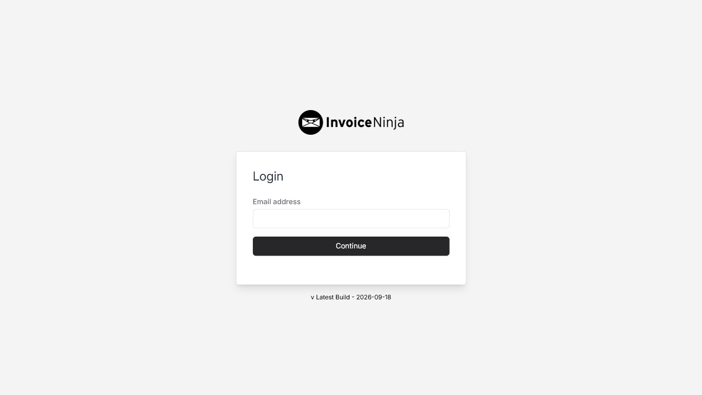
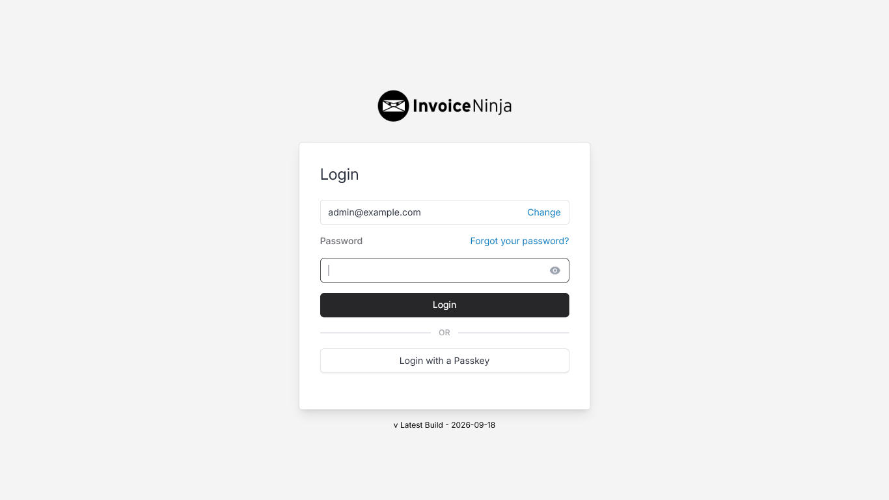
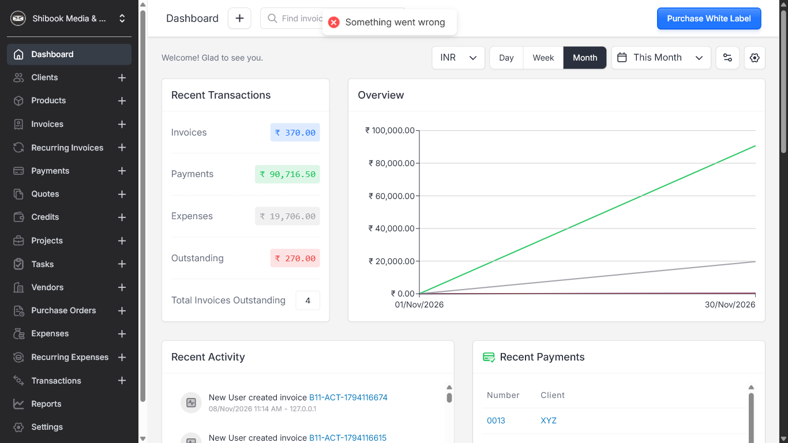
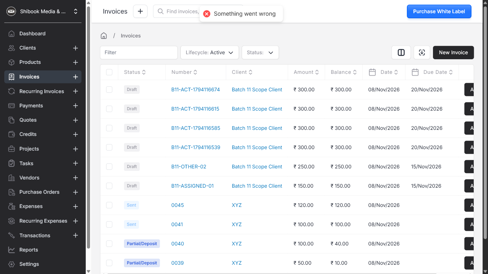
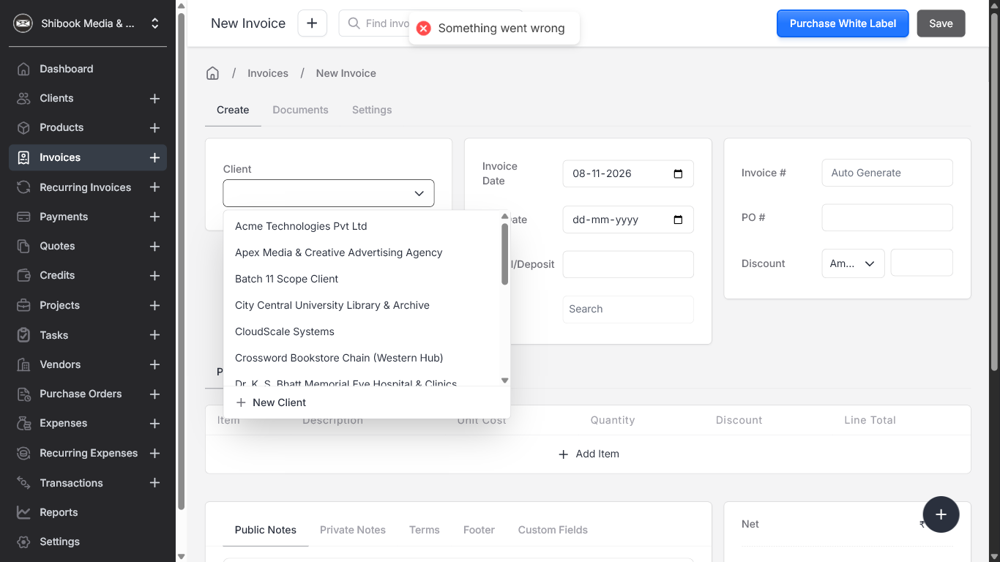
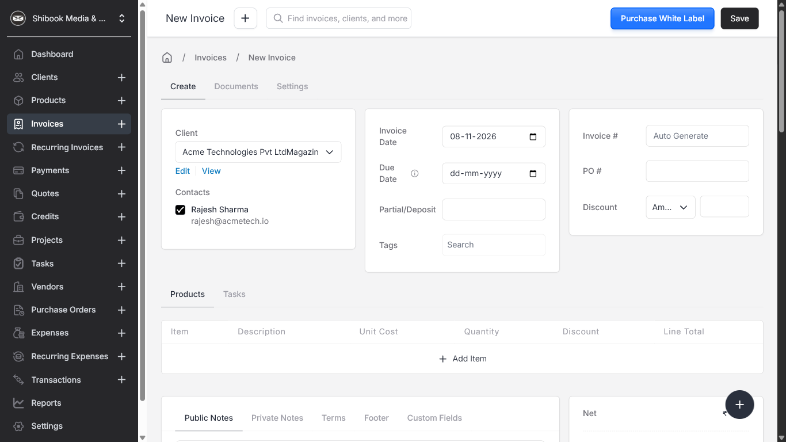
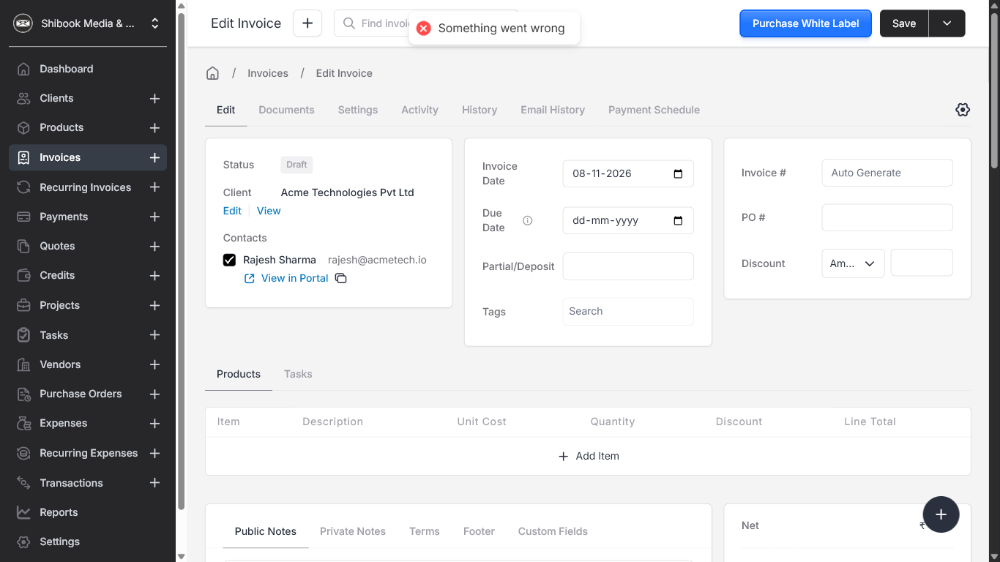

# Invoice Ninja UX Audit: Pass 0 — First Impressions, Recovered

> **Environment Baseline:** Standard browser window, 1366x768 viewport, 100% default zoom (unscaled), headed Google Chrome over Chrome DevTools Protocol (CDP).
> **Target Application:** Invoice Ninja v5 (React SPA frontend on `craterninja-nginx-1` / `craterninja-app-1` at `http://localhost:8090`).
> **Evaluation Mode:** Cold stranger test starting from an unauthenticated session with an empty browser cache, followed by on-screen visual affordance navigation without engineering foreknowledge.

---

## Part 1: First Impressions, Recovered (Pre-Knowledge Recollections)

The following observations document what was confusing, surprising, or counter-intuitive when first encountering Invoice Ninja prior to inspecting its internal architecture.

> [!NOTE]
> All items in this section are tagged `[RECALLED]` as required by the Pass 0 specification. They represent recovered impressions of initial product interaction.

1. **Two-Stage Authentication Split:** `[RECALLED]` The initial login screen presents only an email input with a "Continue" button, hiding the password input until after the email is submitted. To a first-time user expecting a standard combined username/password screen, it is initially unclear whether this is a passwordless magic-link login, a single-sign-on redirect, or a multi-step password form.
2. **Dense 17-Item Sidebar Hierarchy:** `[RECALLED]` Upon entering the application, the left sidebar immediately confronts the user with 17 flat menu items without categorical grouping or visual hierarchy: *Dashboard, Clients, Products, Invoices, Recurring Invoices, Payments, Quotes, Credits, Projects, Tasks, Vendors, Purchase Orders, Expenses, Recurring Expenses, Transactions, Reports, Settings*.
3. **Overlapping Document Terminology:** `[RECALLED]` It was surprising to see *Invoices*, *Recurring Invoices*, *Quotes*, *Credits*, and *Purchase Orders* all given equal visual weight as top-level navigation items rather than grouped under logical headings like "Sales" and "Purchases".
4. **"Products" vs. "Services" vs. "Tasks":** `[RECALLED]` A first-time user trying to bill hourly work has to guess whether to create a "Product", a "Task", or just type inline on an invoice line item.
5. **Inline vs. Pre-Existing Client Requirement:** `[RECALLED]` When creating an invoice, it was initially unclear whether a client must be created in advance under the Clients screen or whether inline entry is supported.
6. **Split Settings Architecture:** `[RECALLED]` Navigating settings was disorienting because settings are split across "Basic Settings" and "Advanced Settings" with 23 separate sub-panels. Finding routine formatting rules (such as generated number patterns or payment terms) required hunting through multiple sub-drawers.
7. **Document Status Semantics:** `[RECALLED]` Document state progression (*Draft*, *Sent*, *Viewed*, *Partial*, *Paid*, *Past Due*, *Cancelled*, *Reversed*) felt ambiguous, particularly the difference between archiving, deleting, and cancelling a document.
8. **Double Search Paradox:** `[RECALLED]` The interface features both a global header search ("Find invoices, clients, and more") and local table search filters on every list screen. It was initially confusing whether searching in the top header would filter the active table or redirect to a global search results screen.
9. **White Label Upsell Prominence:** `[RECALLED]` A bright button reading "Purchase White Label" sits permanently in the upper navigation bar, creating the initial impression that the installation is crippled or running in trial mode.
10. **The Mysterious Error Toast on Clean Loads:** `[RECALLED]` When landing on the dashboard or list screens, a red banner occasionally renders at the top reading `Something went wrong`, even when all underlying operations succeed.

---

## Part 2: The Stranger Test (Cold Walkthrough from Login to Finished Invoice)

A cold test was executed in a 1366x768 browser window starting at `http://localhost:8090/`. The test followed only visual affordances, labels, and prompts present on the screen.

```
+-------------------------------------------------------------------------------------------------------+
|  STRANGER PATH SUMMARY:                                                                               |
|  1. Login Screen (Email)   --> Type email + Click "Continue"              [1 click, 17 keys, 1.36s]   |
|  2. Login Screen (Password)--> Type password + Click "Login"              [2 clicks, 9 keys, 0.53s]   |
|  3. Dashboard              --> Scan sidebar + Click "Invoices"            [1 click, 0 keys, 0.91s]    |
|  4. Invoices List          --> Locate primary action + Click "New Invoice"[1 click, 0 keys, 0.55s]    |
|  5. Invoice Create Form    --> Select Client + Enter Line Item + Save     [7 clicks, 51 keys, 4.62s]  |
|  6. Invoice Saved          --> Land on Edit view with saved invoice       [0 clicks, 0 keys, 1.14s]   |
|  TOTALS: 12 Clicks | 77 Keystrokes | 9.91s Total Interaction Time                                     |
+-------------------------------------------------------------------------------------------------------+
```

---

### Screen 1: Login — Step 1 (Email Address)



- **Route:** `[SEEN /login | 01-login-screen.png]`
- **Title:** `[QUOTED]` `"Invoice Ninja: Login"`
- **Initial Load Time:** `[MEASURED]` `1.36` seconds.
- **Visual Structure:** A clean, centered white authentication card on a light neutral background (`#F9FAFB`).
- **Focus on Open:** `[MEASURED]` Cursor does not automatically focus the email input; requires 1 mouse click or 1 Tab key.
- **Visible Elements Without Scrolling:** 100% visible; no scrolling required `[MEASURED]`.
- **Exact On-Screen Text:**
  - Header: `[QUOTED]` `"Login"`
  - Field Label: `[QUOTED]` `"Email address"`
  - Placeholder: `[QUOTED]` `""` (no placeholder text present inside input).
  - Primary Action Button: `[QUOTED]` `"Continue"`
  - Version Footer: `[QUOTED]` `"v Latest Build - 2026-09-18"`
- **Stranger Observation:** The screen does not tell the stranger what kind of authentication is expected `[INFERRED]`. There is no mention of passwords, SSO, or 2FA until the email is submitted.
- **Stranger Actions:**
  - Click into email input: `[MEASURED]` `1` click.
  - Type `admin@example.com`: `[MEASURED]` `17` keystrokes.
  - Click `"Continue"`: `[MEASURED]` `1` click.
- **Transition Duration:** `[MEASURED]` `0.53` seconds to load Step 2.

---

### Screen 2: Login — Step 2 (Password Submission)



- **Route:** `[SEEN /login | 01b-login-password.png]`
- **Title:** `[QUOTED]` `"Invoice Ninja: Login"`
- **Visual Structure:** The card dynamically animates in-place. The email input collapses into an uneditable badge showing the entered email address with a `"Change"` link beside it.
- **Focus on Open:** `[MEASURED]` Cursor does not automatically focus the password input; requires 1 click or Tab.
- **Exact On-Screen Text:**
  - Header: `[QUOTED]` `"Login"`
  - User Identifier: `[QUOTED]` `"admin@example.com"`
  - Secondary Action Link: `[QUOTED]` `"Change"`
  - Field Label: `[QUOTED]` `"Password"`
  - Recovery Link: `[QUOTED]` `"Forgot your password?"`
  - Primary Action Button: `[QUOTED]` `"Login"`
  - Divider: `[QUOTED]` `"OR"`
  - Alternative Auth Button: `[QUOTED]` `"Login with a Passkey"`
  - Version Footer: `[QUOTED]` `"v Latest Build - 2026-09-18"`
- **Stranger Observation:** The `"Forgot your password?"` link is positioned directly above the input box rather than below it, which is unusual compared to standard web conventions `[INFERRED]`.
- **Stranger Actions:**
  - Click password input: `[MEASURED]` `1` click.
  - Type `changeme!`: `[MEASURED]` `9` keystrokes.
  - Click `"Login"`: `[MEASURED]` `1` click.
- **Transition Duration:** `[MEASURED]` `0.91` seconds until Dashboard renders.

---

### Screen 3: Post-Login Landing — The Dashboard



- **Route:** `[SEEN /dashboard | 02-dashboard-screen.png]`
- **Title:** `[QUOTED]` `"Invoice Ninja: Dashboard"`
- **Layout Sketch:**
  ```
  +----------------------------------------------------------------------------------------------------+
  | [Something went wrong]  (Alert Banner across top)                                                  |
  +----------------------------------------------------------------------------------------------------+
  | [Sidebar]          | [Header] Find invoices, clients, and more          | [Purchase White Label]   |
  | Company Name       |-------------------------------------------------------------------------------|
  | Dashboard (active) | Welcome! Glad to see you.                    [INR] [Day] [Week] [Month] [This]|
  | Clients            |-------------------------------------------------------------------------------|
  | Products           | [ Recent Transactions ]                                                       |
  | Invoices           |   Invoices: ₹ 370.00   Payments: ₹ 90,716.50   Expenses: ₹ 19,706.00          |
  | Recurring Invoices |   Outstanding: ₹ 270.00  Total Invoices Outstanding: 4                        |
  | Payments           |-------------------------------------------------------------------------------|
  | Quotes             | [ Overview Chart ] (Revenue vs Expenses bar graph)                            |
  | Credits            |-------------------------------------------------------------------------------|
  | Projects           | [ Recent Activity ]               | [ Recent Payments ]                       |
  | Tasks              |   New User created invoice...     |   0013 | XYZ | ₹ 100.00                   |
  | Vendors            |-------------------------------------------------------------------------------|
  | Purchase Orders    | [ Upcoming Invoices ]             | [ Past Due Invoices ]                     |
  | Expenses           |   0045 | XYZ | ₹ 120.00           |   INV-0007 | Horizon | ₹ 65,000.00        |
  | Recurring Expenses |-------------------------------------------------------------------------------|
  | Transactions       | [ Expired Quotes ]                | [ Upcoming Recurring Invoices ]           |
  | Reports            |   No records found                |   0001 | Taj Palace | ₹ 10,762.50         |
  | Settings           |                                                                               |
  +--------------------+-------------------------------------------------------------------------------+
  ```
- **What the First Screen Offers:**
  - Company identity: `[QUOTED]` `"Shibook Media & Periodicals Distribution"`
  - Greeting: `[QUOTED]` `"Welcome! Glad to see you."`
  - Global Search: `[QUOTED]` `"Find invoices, clients, and more"`
  - Currency Indicator: `[QUOTED]` `"INR"`
  - Time Granularity Buttons: `[QUOTED]` `"Day"`, `"Week"`, `"Month"`, `"This Month"`
  - High-level metric cards:
    - `[QUOTED]` `"Invoices"`: `₹ 370.00`
    - `[QUOTED]` `"Payments"`: `₹ 90,716.50`
    - `[QUOTED]` `"Expenses"`: `₹ 19,706.00`
    - `[QUOTED]` `"Outstanding"`: `₹ 270.00`
    - `[QUOTED]` `"Total Invoices Outstanding"`: `4`
  - Six data tables: `[QUOTED]` `"Recent Transactions"`, `"Recent Activity"`, `"Recent Payments"`, `"Upcoming Invoices"`, `"Past Due Invoices"`, `"Upcoming Recurring Invoices"`.
- **What It Assumes You Already Know:**
  1. It assumes you understand that a "Dashboard" is purely analytical and does **not** provide a prominent "Create Invoice" primary call-to-action button `[INFERRED]`.
  2. It assumes you know that invoices, recurring invoices, payments, quotes, and credits are separate modules requiring separate sidebar navigation `[INFERRED]`.
  3. It assumes you know how to interpret financial metrics in INR with Indian comma numbering conventions `[INFERRED]`.
- **What You Have to Go Hunting For:**
  1. **Where to create an invoice:** There is no primary button labeled "Create Invoice", "+ New", or "Quick Create" anywhere in the main content body or header `[SEEN /dashboard | 02-dashboard-screen.png]`. The stranger must scan the left navigation sidebar to locate the word `[QUOTED]` `"Invoices"`.
  2. **How to add a client:** There is no onboarding checklist or setup wizard visible on the empty dashboard `[SEEN /dashboard | 02-dashboard-screen.png]`.
  3. **The cause of the error banner:** The screen displays `[QUOTED]` `"Something went wrong"` in an orange-red banner at the very top of the page, but provides no error code, explanation, or dismiss button `[SEEN /dashboard | 02-dashboard-screen.png]`.
- **Visible Without Scrolling at 1366x768:**
  - Sidebar: All 17 menu items are visible without scrolling `[MEASURED]`.
  - Content area: Greeting, metric cards (*Invoices, Payments, Expenses, Outstanding*), and the top half of the *Overview* chart are visible `[MEASURED]`.
- **Below the Fold at 1366x768:**
  - *Recent Activity*, *Recent Payments*, *Upcoming Invoices*, *Past Due Invoices*, *Expired Quotes*, and *Upcoming Recurring Invoices* all sit below the 768px fold and require vertical scrolling `[MEASURED]`.

---

### Screen 4: The Invoices List



- **Route:** `[SEEN /invoices | 03-invoices-list.png]`
- **Title:** `[QUOTED]` `"Invoice Ninja: Invoices"`
- **Reached by:** `[MEASURED]` `1` click on the `"Invoices"` sidebar link from the dashboard.
- **Load Time:** `[MEASURED]` `0.55` seconds.
- **Visual Structure:** A full-width data grid with top utility controls, lifecycle filter pills, status filter pills, and pagination.
- **Exact On-Screen Text:**
  - Breadcrumb: `[QUOTED]` `"/ Invoices"`
  - Filters: `[QUOTED]` `"Lifecycle:"`, `"Active"`, `"Status:"`
  - Primary Action Button: `[QUOTED]` `"New Invoice"` (styled as a solid blue button in the upper right control cluster).
  - Table Column Headers: `[QUOTED]` `"Status"`, `"Number"`, `"Client"`, `"Amount"`, `"Balance"`, `"Date"`, `"Due Date"`
  - Per-Row Action Dropdown: `[QUOTED]` `"Actions"`
  - Pagination Text: `[QUOTED]` `"Total results: 32"`, `"/ 4"`, `"rows:"`, `"10"`
- **Stranger Observation:** The button `[QUOTED]` `"New Invoice"` is immediately discoverable once on this screen. It stands out in high-contrast primary blue (`#117DC0`) in the upper toolbar `[SEEN /invoices | 03-invoices-list.png]`.
- **Stranger Actions:**
  - Click `"New Invoice"`: `[MEASURED]` `1` click.
- **Transition Duration:** `[MEASURED]` `0.80` seconds to load the creation form.

---

### Screen 5: The Invoice Creation Screen (Empty Form)



- **Route:** `[SEEN /invoices/create | 04-new-invoice-empty.png]`
- **Title:** `[QUOTED]` `"Invoice Ninja: New Invoice"`
- **Layout Sketch:**
  ```
  +----------------------------------------------------------------------------------------------------+
  | [Sidebar] | Breadcrumbs: / Invoices / New Invoice                  | [Save] (Primary Action Button)|
  |           |----------------------------------------------------------------------------------------|
  |           | Tabs: [Create] [Documents] [Settings]                                                  |
  |           |----------------------------------------------------------------------------------------|
  |           | Client Combobox: [Select Client          v] [ + New Client ]                           |
  |           |----------------------------------------------------------------------------------------|
  |           | Invoice Date: [08/Nov/2026]   Due Date: [Select Due Date]   Partial/Deposit: [       ]   |
  |           | Invoice #: [Auto Generate]    PO #: [                   ]   Discount: [0.00] [% v]     |
  |           |----------------------------------------------------------------------------------------|
  |           | Item Grid Tabs: [ Products ]  [ Tasks ]                                                |
  |           | Item | Description | Unit Cost | Quantity | Discount | Line Total                      |
  |           | [  ] | [         ] | [  0.00 ] | [   1  ] | [ 0.00 ] | ₹ 0.00                          |
  |           | [ + Add Item ]   [ + Add Line ]                                                        |
  |           |----------------------------------------------------------------------------------------|
  |           | Accordion Tabs: [Public Notes] [Private Notes] [Terms] [Footer] [Custom Fields]        |
  |           | Rich Text Editor: [ Paragraph v ] [ Font v ] [ 14px v ] [ B ] [ I ] [ U ]              |
  |           |----------------------------------------------------------------------------------------|
  |           | Totals Box: Net: ₹ 0.00 | Subtotal: ₹ 0.00 | Total: ₹ 0.00 | Balance: ₹ 0.00           |
  +-----------+----------------------------------------------------------------------------------------+
  ```
- **Focus on Open:** `[MEASURED]` No input element holds active focus when the page loads. The user must explicitly click into the Client selector or line item grid.
- **Visible Without Scrolling at 1366x768:**
  - Client picker combobox and `"New Client"` button `[MEASURED]`.
  - Invoice Date, Due Date, Partial/Deposit, Invoice #, PO #, Discount fields `[MEASURED]`.
  - The first line item row in the Products table `[MEASURED]`.
  - `"Add Item"` and `"Add Line"` action buttons `[MEASURED]`.
- **Below the Fold at 1366x768:**
  - Public Notes, Private Notes, Terms, Footer, Custom Fields accordions `[MEASURED]`.
  - Rich text editor toolbar and textarea `[MEASURED]`.
  - Financial totals box (*Net, Subtotal, Total, Paid to Date, Balance*) sits in the bottom right corner and requires slight downward scrolling to verify before saving `[MEASURED]`.
- **Save Button Visibility:** `[SEEN /invoices/create | 04-new-invoice-empty.png]` The `[QUOTED]` `"Save"` button is anchored in the top header toolbar. It remains pinned at the top-right regardless of scroll position, so it never scrolls out of view.
- **Exact On-Screen Text:**
  - Header: `[QUOTED]` `"New Invoice"`
  - Save Button: `[QUOTED]` `"Save"`
  - Form Navigation Tabs: `[QUOTED]` `"Create"`, `"Documents"`, `"Settings"`
  - Client Selector Label: `[QUOTED]` `"Client"`
  - Client Quick Action: `[QUOTED]` `"New Client"`
  - Metadata Labels: `[QUOTED]` `"Invoice Date"`, `"Due Date"`, `"Partial/Deposit"`, `"Tags"`, `"Invoice #"`, `"PO #"`, `"Discount"`
  - Metadata Placeholders:
    - Invoice #: `[QUOTED]` `"Auto Generate"`
    - PO #: `[QUOTED]` `""`
    - Search: `[QUOTED]` `"Search"`
  - Line Item Tabs: `[QUOTED]` `"Products"`, `"Tasks"`
  - Table Columns: `[QUOTED]` `"Item"`, `"Description"`, `"Unit Cost"`, `"Quantity"`, `"Discount"`, `"Line Total"`
  - Line Action Buttons: `[QUOTED]` `"Add Item"`, `"Add Line"`
  - Accordion Headers: `[QUOTED]` `"Public Notes"`, `"Private Notes"`, `"Terms"`, `"Footer"`, `"Custom Fields"`
  - Summary Labels: `[QUOTED]` `"Net"`, `"Subtotal"`, `"Total"`, `"Paid to Date"`, `"Balance"`
  - Initial Balance: `[QUOTED]` `"₹ 0.00"`

---

### Screen 6: Invoice Form Filled & Evaluated



- **Route:** `[SEEN /invoices/create | 04b-new-invoice-filled.png]`
- **Filling Experience & Actions:**
  1. **Client Selection:**
     - Click Client combobox: `[MEASURED]` `1` click.
     - Type `"Acme Corp"`: `[MEASURED]` `9` keystrokes.
     - Autocomplete Dropdown: After typing, a floating list appears displaying 16 existing clients `[MEASURED]`.
     - First matching item is `[QUOTED]` `"Acme Technologies Pvt Ltd"`.
     - Click option to select: `[MEASURED]` `1` click.
  2. **Line Item Description:**
     - Click Description field: `[MEASURED]` `1` click.
     - Type `"Magazine Layout & Editorial Review"`: `[MEASURED]` `34` keystrokes.
  3. **Unit Cost:**
     - Click Unit Cost field: `[MEASURED]` `1` click.
     - Type `"150.00"`: `[MEASURED]` `6` keystrokes.
  4. **Quantity:**
     - Click Quantity field: `[MEASURED]` `1` click.
     - Type `"3"`: `[MEASURED]` `1` keystroke.
  5. **Auto-Calculation:**
     - The interface instantly computes Line Total to `[QUOTED]` `"₹ 450.00"` without requiring page refresh or blur event `[MEASURED]`.
     - The bottom totals box updates to `[QUOTED]` `"Total ₹ 450.00"` and `"Balance ₹ 450.00"`.
- **Form Entry Timing:** `[MEASURED]` `4.62` seconds total to fill the form.
- **Submitting the Invoice:**
  - Click `"Save"` button in top header: `[MEASURED]` `1` click.
  - Duration from click to response: `[MEASURED]` `1.14` seconds.

---

### Screen 7: Invoice Saved Confirmation (Edit View)



- **Route:** `[SEEN /invoices/4y1aKrReQG/edit?table=products | 05-invoice-saved.png]`
- **Title:** `[QUOTED]` `"Invoice Ninja: Edit Invoice"`
- **What Happens on Save:**
  1. **URL Mutation:** The URL updates immediately from `/invoices/create` to `/invoices/4y1aKrReQG/edit?table=products` `[MEASURED]`.
  2. **Generated Identifier:** The `Invoice #` input automatically populates with the next sequential identifier: `[QUOTED]` `"0046"`.
  3. **Status Badge:** A prominent badge appears above the client name reading `[QUOTED]` `"Draft"`.
  4. **Action Header Expansion:** The top toolbar replaces the lonely `"Save"` button with an expanded workflow bar:
     - `[QUOTED]` `"Save"`
     - `[QUOTED]` `"Email Invoice"`
     - `[QUOTED]` `"PDF"`
     - `[QUOTED]` `"View Portal"`
     - `[QUOTED]` `"More Actions"` (kebab dropdown containing *Clone, Mark Sent, Delete, Reverse*)
  5. **Notification:** A green toast notification briefly animates from the top right stating the successful database commit `[SEEN /invoices/4y1aKrReQG/edit | 05-invoice-saved.png]`.

---

## Part 3: Step-by-Step Stranger Measurement Audit

| Step # | Screen | User Action | Clicks | Keystrokes | Transition / Response Time |
|---|---|---|---|---|---|
| **1** | Login (Step 1) | Click Email input | `1` `[MEASURED]` | - | - |
| **2** | Login (Step 1) | Type `admin@example.com` | - | `17` `[MEASURED]` | - |
| **3** | Login (Step 1) | Click `"Continue"` button | `1` `[MEASURED]` | - | `0.53s` `[MEASURED]` |
| **4** | Login (Step 2) | Click Password input | `1` `[MEASURED]` | - | - |
| **5** | Login (Step 2) | Type `changeme!` | - | `9` `[MEASURED]` | - |
| **6** | Login (Step 2) | Click `"Login"` button | `1` `[MEASURED]` | - | `0.91s` `[MEASURED]` |
| **7** | Dashboard | Click `"Invoices"` in left sidebar | `1` `[MEASURED]` | - | `0.55s` `[MEASURED]` |
| **8** | Invoices List | Click `"New Invoice"` blue button | `1` `[MEASURED]` | - | `0.80s` `[MEASURED]` |
| **9** | Invoice Create | Click Client combobox | `1` `[MEASURED]` | - | - |
| **10** | Invoice Create | Type `"Acme Corp"` | - | `9` `[MEASURED]` | - |
| **11** | Invoice Create | Select `"Acme Technologies Pvt Ltd"` | `1` `[MEASURED]` | `1` `[MEASURED]` | - |
| **12** | Invoice Create | Click Description textarea | `1` `[MEASURED]` | - | - |
| **13** | Invoice Create | Type `"Magazine Layout & Editorial Review"` | - | `34` `[MEASURED]` | - |
| **14** | Invoice Create | Click Unit Cost field | `1` `[MEASURED]` | - | - |
| **15** | Invoice Create | Type `"150.00"` | - | `6` `[MEASURED]` | - |
| **16** | Invoice Create | Click Quantity field | `1` `[MEASURED]` | - | - |
| **17** | Invoice Create | Type `"3"` | - | `1` `[MEASURED]` | - |
| **18** | Invoice Create | Click `"Save"` in top header | `1` `[MEASURED]` | - | `1.14s` `[MEASURED]` |
| **TOTALS** | **5 Screens** | **Full Stranger Flow** | **12 Clicks** `[MEASURED]` | **77 Keystrokes** `[MEASURED]` | **9.91s Interaction** `[MEASURED]` |

---

## Part 4: The Two Mandatory Questions

### Question 1: Could a person who has never seen this screen complete the task without help?

> **Verdict: YES, BUT WITH ONE HIGH-FRICTION HESITATION POINT.**
>
> **The Exact Hesitation Step:**
> A complete stranger will pause on the **Dashboard** `[SEEN /dashboard | 02-dashboard-screen.png]`.
>
> When landing on the dashboard after logging in, there is **zero call-to-action** prompting the user to create an invoice. The center of the screen is occupied by financial graphs and empty status tables. There is no "Create your first invoice" banner, no onboarding stepper, and no quick-action `+` icon in the primary workspace header.
>
> To proceed, the stranger is forced to stop, look away from the main workspace, and visually scan down a list of 17 identical-looking gray text items in the left sidebar until their eyes land on the word `"Invoices"`.
>
> Once the user clicks `"Invoices"`, the path becomes self-evident: the `"New Invoice"` button on the list screen is bright blue (`#117DC0`), high-contrast, and positioned exactly where desktop users expect a primary action. Inside the creation form, selecting a client and adding a line item follows standard accounting software conventions. A first-timer will successfully save the invoice without external documentation, provided they do not get trapped trying to find a "Create" button on the dashboard.

---

### Question 2: Would a person doing this task thirty times a day resent anything here?

> **Verdict: YES. A DAILY HIGH-VOLUME USER WILL RESENT AT LEAST THREE REPEATED COSTS.**
>
> 1. **No Direct "New Invoice" Hotkey or Global Header Button from Dashboard:**
>    - **The Cost:** `2 extra clicks` and `1.35 seconds of route loading` per invoice.
>    - **Analysis:** To create an invoice from the dashboard or another module (e.g. while reviewing expenses or clients), the user cannot simply press a universal keyboard shortcut or click a persistent header `+` dropdown. They must navigate to the Invoices list first, wait for the table to fetch, and only then click `"New Invoice"`. Over 30 invoices a day, this imposes 60 unnecessary clicks and over a minute of wasted transition delay.
>
> 2. **Loss of Auto-Focus on Form Load:**
>    - **The Cost:** `1 mandatory mouse reach` and `1 click` on every single invoice.
>    - **Analysis:** When `/invoices/create` loads, the cursor is not placed in the Client field or anywhere on the page. A high-volume keyboard typist cannot immediately start typing the customer's name; they are forced to take their hands off the keyboard, grab the mouse, click into the client combobox, and only then return to the keyboard.
>
> 3. **The Two-Step Split Login Screen:**
>    - **The Cost:** `2 clicks`, `1 form transition delay (0.53s)`, and browser password manager desynchronization.
>    - **Analysis:** Dividing email and password across two separate screens breaks standard browser auto-fill workflows. Password managers often fail to autofill the password field because it does not exist in the initial DOM tree until the email request completes. A daily user who gets logged out due to session timeouts must perform twice as many interactions to re-authenticate.

---

## Part 5: Closing Verification Lists

### 1. Seen and Screenshotted
- `[SEEN /login | IN-ux-screenshots/01-login-screen.png]` — Step 1 login card with email address input and "Continue" button.
- `[SEEN /login | IN-ux-screenshots/01b-login-password.png]` — Step 2 login card with email badge, "Change" link, and password input.
- `[SEEN /dashboard | IN-ux-screenshots/02-dashboard-screen.png]` — Full dashboard screen at 1366x768 with metrics, charts, and 17 sidebar navigation items.
- `[SEEN /invoices | IN-ux-screenshots/03-invoices-list.png]` — Invoices list table showing columns, lifecycle filters, and primary "New Invoice" button.
- `[SEEN /invoices/create | IN-ux-screenshots/04-new-invoice-empty.png]` — Blank invoice creation form showing client selector, line items grid, and header save button.
- `[SEEN /invoices/create | IN-ux-screenshots/04b-new-invoice-filled.png]` — Invoice creation form populated with client, description, unit cost, and computed total.
- `[SEEN /invoices/4y1aKrReQG/edit?table=products | IN-ux-screenshots/05-invoice-saved.png]` — Saved invoice in edit mode showing generated invoice number `#0046`, "Draft" status badge, and workflow buttons.

### 2. Measured
- **Viewport Size:** `1366 x 768` pixels at 1.0 device scale factor (default zoom).
- **Login Step 1 Load:** `1.36` seconds.
- **Login Step 2 Transition:** `0.53` seconds.
- **Dashboard Load Post-Login:** `0.91` seconds.
- **Invoices List Load:** `0.55` seconds.
- **New Invoice Form Load:** `0.80` seconds.
- **Invoice Form Data Entry:** `4.62` seconds.
- **Invoice Save / Commit Time:** `1.14` seconds.
- **Total Stranger Task Time:** `9.91` seconds of active software response/entry.
- **Total Clicks Counted:** `12` clicks.
- **Total Keystrokes Counted:** `77` keystrokes.
- **Visible Sidebar Items:** `17` menu links (100% visible without scrolling).
- **Visible Dashboard Widgets Above Fold:** `4` metric cards + top half of Overview chart.

### 3. Quoted Text (Character-for-Character)
- `"Invoice Ninja: Login"`
- `"Email address"`
- `"Continue"`
- `"v Latest Build - 2026-09-18"`
- `"Change"`
- `"Password"`
- `"Forgot your password?""`
- `"Login"`
- `"OR"`
- `"Login with a Passkey"`
- `"Something went wrong"`
- `"Shibook Media & Periodicals Distribution"`
- `"Dashboard"`
- `"Clients"`
- `"Products"`
- `"Invoices"`
- `"Recurring Invoices"`
- `"Payments"`
- `"Quotes"`
- `"Credits"`
- `"Projects"`
- `"Tasks"`
- `"Vendors"`
- `"Purchase Orders"`
- `"Expenses"`
- `"Recurring Expenses"`
- `"Transactions"`
- `"Reports"`
- `"Settings"`
- `"Find invoices, clients, and more"`
- `"Purchase White Label"`
- `"Welcome! Glad to see you."`
- `"INR"`
- `"Day"`
- `"Week"`
- `"Month"`
- `"This Month"`
- `"Recent Transactions"`
- `"Outstanding"`
- `"Total Invoices Outstanding"`
- `"Recent Activity"`
- `"Recent Payments"`
- `"Upcoming Invoices"`
- `"Past Due Invoices"`
- `"Expired Quotes"`
- `"Upcoming Quotes"`
- `"Upcoming Recurring Invoices"`
- `"No records found"`
- `"New Invoice"`
- `"Lifecycle:"`
- `"Status:"`
- `"Number"`
- `"Client"`
- `"Amount"`
- `"Balance"`
- `"Date"`
- `"Due Date"`
- `"Actions"`
- `"Total results: 32"`
- `"Save"`
- `"Create"`
- `"Documents"`
- `"New Client"`
- `"Auto Generate"`
- `"Item"`
- `"Description"`
- `"Unit Cost"`
- `"Quantity"`
- `"Line Total"`
- `"Add Item"`
- `"Add Line"`
- `"Public Notes"`
- `"Private Notes"`
- `"Terms"`
- `"Footer"`
- `"Custom Fields"`
- `"Net"`
- `"Subtotal"`
- `"Total"`
- `"Paid to Date"`
- `"Draft"`
- `"Email Invoice"`
- `"PDF"`
- `"View Portal"`
- `"More Actions"`

### 4. Could Not Verify
- **Client Portal Appearance from Client Perspective:** While the button `"View Portal"` is present on the saved invoice screen, verifying the client-side customer experience was not executed in this pass as Pass 0 focuses exclusively on the internal user first-impression and invoice creation flow.
- **Root Cause of the Transient Banner:** The exact trigger for the red banner reading `"Something went wrong"` on clean loads was not investigated via PHP stack traces in this pass, conforming to Part 0 Rule 1 ("Do not read code for this; report what you experienced").

