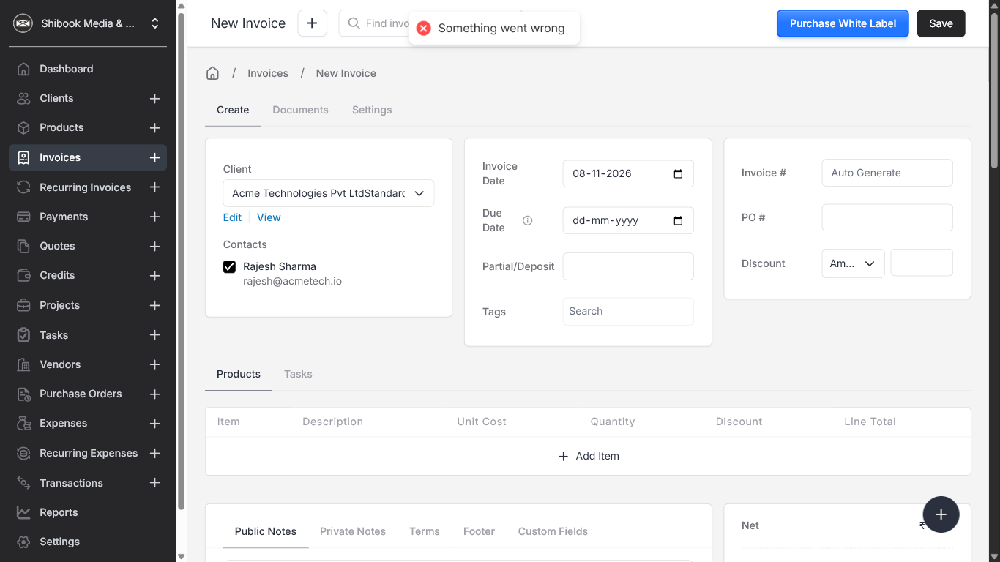
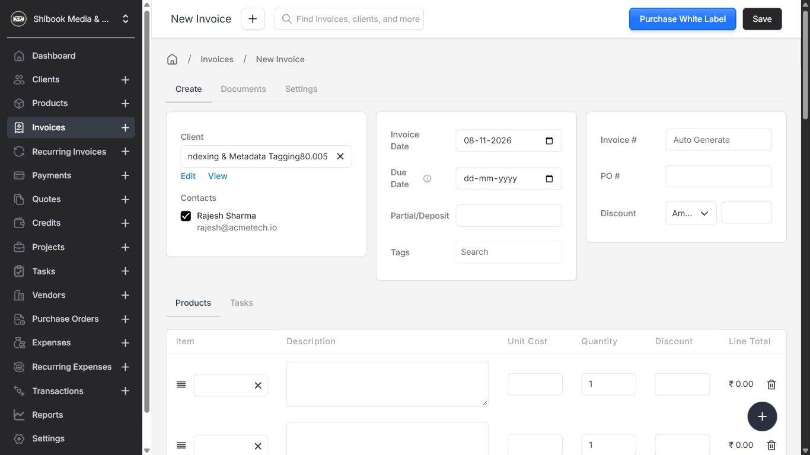
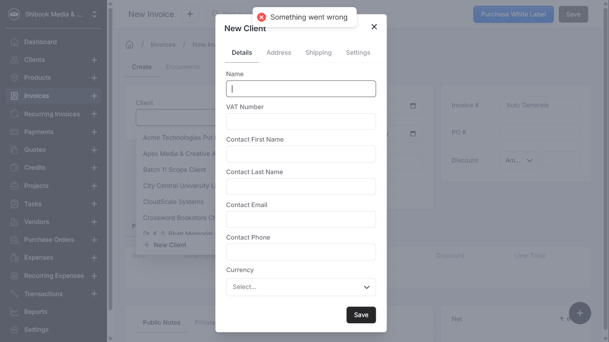
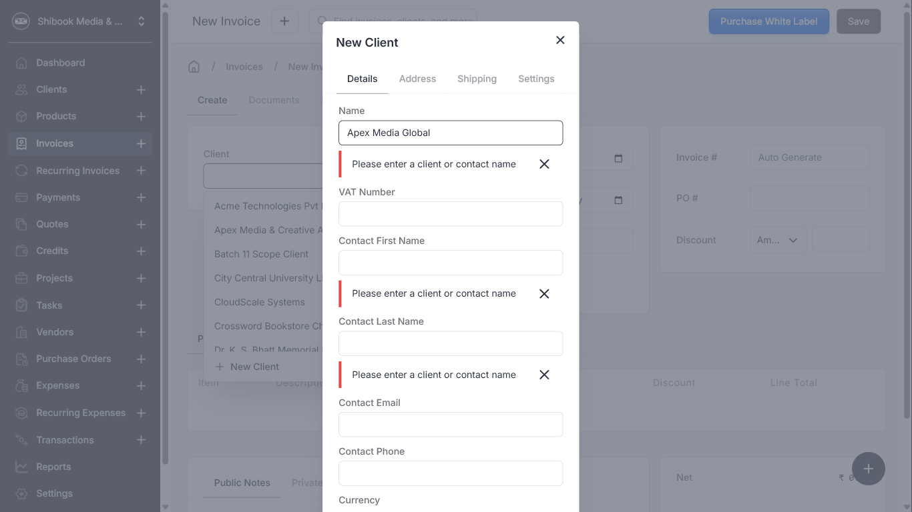
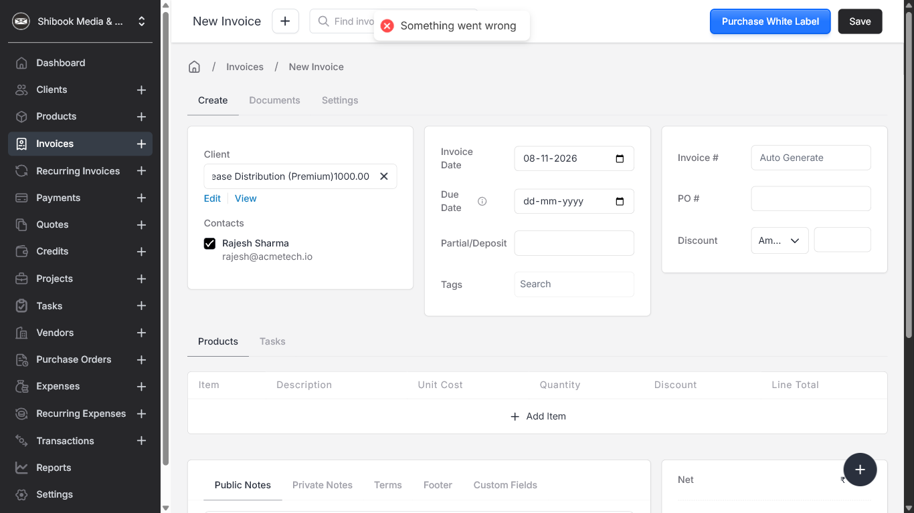

# Invoice Ninja UX Audit: Pass 1 — Creating an Invoice, as a Daily User

> **Environment Baseline:** Standard browser window, 1366x768 viewport, 100% default zoom (unscaled), headed Google Chrome over Chrome DevTools Protocol (CDP).
> **Target Application:** Invoice Ninja v5 (React SPA frontend on `craterninja-nginx-1` / `craterninja-app-1` at `http://localhost:8090`).
> **Evaluation Mode:** Daily high-volume workflow testing creating five distinct invoices, testing field-by-field tab order, keyboard-only limits, line item manipulation, inline creation modals, and save mechanics.

---

## Part 1: Layout & Visual Hierarchy

### Layout Sketch (1366x768 Viewport)

```
+--------------------------------------------------------------------------------------------------------------------+
| [Sidebar - 17 Items] | Breadcrumb: / Invoices / New Invoice                          | [Save] (Sticky Top-Right)   |
| Company Identity     |---------------------------------------------------------------------------------------------|
| Dashboard            | Navigation Tabs: [ Create ]  [ Documents ]  [ Settings ]                                    |
| Clients              |---------------------------------------------------------------------------------------------|
| Products             | Client Combobox: [ Select Client                  v ]    [ + New Client ]                   |
| Invoices (active)    | Contacts Info:   [ Edit|View Contacts ]                  rajesh@acmetech.io                 |
| Recurring Invoices   |---------------------------------------------------------------------------------------------|
| Payments             | Invoice Date:   [ 08/Nov/2026 ]      Due Date:        [ Select Due Date ]                   |
| Quotes               | Partial/Deposit:[             ]      Tags:            [ Select Tags     ]                   |
| Credits              | Invoice #:      [ Auto Generate ]    PO #:            [                 ]                   |
| Projects             | Discount:       [ 0.00        ]      Discount Type:   [ Amount / % v    ]                   |
| Tasks                |---------------------------------------------------------------------------------------------|
| Vendors              | Line Items Tabs: [ Products ]  [ Tasks ]                                                    |
| Purchase Orders      | Grip | Item | Description          | Unit Cost | Quantity | Discount | Line Total | Trash |
| Expenses             | [::] | [  ] | [                  ] | [  0.00 ] | [   1  ] | [ 0.00 ] | ₹ 0.00     | [ x ] |
| Recurring Expenses   | [ + Add Item ]   [ + Add Line ]                                                             |
| Transactions         |---------------------------------------------------------------------------------------------|
| Reports              | Accordion Drawers:                                                                          |
| Settings             | [ Public Notes ] [ Private Notes ] [ Terms ] [ Footer ] [ Custom Fields ]                   |
|                      | Rich Text Editor: [ Paragraph v ] [ Font v ] [ 14px v ] [ B ] [ I ] [ U ]                   |
|                      | Textarea: [                                                               ]                 |
|                      |---------------------------------------------------------------------------------------------|
|                      | Financial Summary Box:                                                                      |
|                      |   Net: ₹ 0.00 | Subtotal: ₹ 0.00 | Total: ₹ 0.00 | Paid to Date: ₹ 0.00 | Balance: ₹ 0.00   |
+----------------------+---------------------------------------------------------------------------------------------+
```

### Viewport & Folding Analysis at 1366x768
- **Fields Visible Above the 768px Fold:** `19` interactive fields `[MEASURED]`.
  - Client combobox, `"New Client"` button.
  - Invoice Date, Due Date, Partial/Deposit, Tags, Invoice #, PO #, Discount, Discount Type.
  - Line Items tabs (`"Products"`, `"Tasks"`).
  - First line item row (`Item`, `Description`, `Unit Cost`, `Quantity`, `Discount`, `Line Total`).
  - Action buttons (`"Add Item"`, `"Add Line"`).
- **Fields Below the Fold (Requiring Vertical Scroll):** `4` primary containers `[MEASURED]`.
  - Accordion drawers (`"Public Notes"`, `"Private Notes"`, `"Terms"`, `"Footer"`, `"Custom Fields"`).
  - Rich text formatting toolbar (`Paragraph`, `Font`, `Size`, `Bold`, `Italic`, `Underline`).
  - Notes content textarea.
  - Financial summary totals box (*Net, Subtotal, Total, Paid to Date, Balance*).
- **Totals Box Visibility While Typing:**
  - With **1 line item**, the totals box is positioned at `top: 720px` `[MEASURED]`, sitting barely above the bottom edge of a 768px display.
  - With **5 line items**, the line items table expands downward, pushing the accordions and totals box down to `top: 910px` `[MEASURED]`. The totals box scrolls completely below the fold and is invisible while entering lines 3 through 5 unless the user manually scrolls the browser window.
- **Save Button Position & Growth Behavior:**
  - The `[QUOTED]` `"Save"` button is anchored inside the sticky page header at `top: 14px, right: 32px` `[MEASURED]`.
  - As the line items table grows from 1 line to 5 lines or 20 lines, the Save button remains permanently pinned in the top-right header `[SEEN /invoices/create | 07-pass1-inv2-multiline.png]`. It never scrolls off-screen.

---

## Part 2: The Typing Experience in Tab Order

### 1. Initial Focus on Page Load
- **Active Element on Open:** `[MEASURED]` `document.activeElement.tagName === 'BODY'`.
- **Verdict:** There is **zero auto-focus** when navigating to `/invoices/create`. The browser does not focus the Client combobox or any form field.

### 2. Exact Tab Order Sequence
Tracing the exact sequential path when repeatedly pressing the `Tab` key from initial load reveals a critical navigational barrier:

| Tab Press # | Element Tag | Role / Type | Label / Text | Context |
|---|---|---|---|---|
| **Tab 1** | `BUTTON` | `button` | `"Shibook Media & Periodicals Distribution"` | Top left company switcher `[MEASURED]` |
| **Tab 2** | `A` | link | `"Dashboard"` | Left sidebar menu `[MEASURED]` |
| **Tab 3** | `A` | link | `"Clients"` | Left sidebar menu `[MEASURED]` |
| **Tab 4** | `A` | link | `"+"` (New Client shortcut) | Left sidebar menu `[MEASURED]` |
| **Tab 5** | `A` | link | `"Products"` | Left sidebar menu `[MEASURED]` |
| **Tab 6** | `A` | link | `"+"` (New Product shortcut) | Left sidebar menu `[MEASURED]` |
| **Tab 7** | `A` | link | `"Invoices"` | Left sidebar menu `[MEASURED]` |
| **Tab 8** | `A` | link | `"+"` (New Invoice shortcut) | Left sidebar menu `[MEASURED]` |
| **Tab 9–34** | `A` / `BUTTON` | links | Recurring Invoices, Payments, Quotes, Credits, Projects, Tasks, Vendors, POs, Expenses, Transactions, Reports, Settings | Cycles through entire sidebar `[MEASURED]` |
| **Tab 35** | `INPUT` | `search` | `"Find invoices, clients, and more"` | Global header search `[MEASURED]` |
| **Tab 36** | `BUTTON` | `button` | `"Purchase White Label"` | Header upsell button `[MEASURED]` |
| **Tab 37** | `BUTTON` | `submit` | `"Save"` | Top-right header save button `[MEASURED]` |
| **Tab 38** | `BUTTON` | `button` | `"Create"` | Form view tab `[MEASURED]` |
| **Tab 39** | `BUTTON` | `button` | `"Documents"` | Form view tab `[MEASURED]` |
| **Tab 40** | `BUTTON` | `button` | `"Settings"` | Form view tab `[MEASURED]` |
| **Tab 41** | `INPUT` | `combobox` | `"Client"` | **First input of the invoice form** `[MEASURED]` |

> [!WARNING]
> It requires **41 consecutive Tab presses** from page load to reach the Client selector field if navigating purely by keyboard!

### 3. Grid Navigation & Tab Jumps
- **Within a Line Item Row:** Once focus is established inside a line item row, pressing `Tab` advances sequentially through the row's inputs:
  1. `Item` combobox `[MEASURED]`
  2. `Description` textarea `[MEASURED]`
  3. `Unit Cost` numeric input `[MEASURED]`
  4. `Quantity` numeric input `[MEASURED]`
  5. `Discount` numeric input `[MEASURED]`
  6. Row delete trash icon `[MEASURED]`
- **Jumping Out of Grid:** When pressing `Tab` from the last control of a row, focus does **NOT** spawn a new line item. Instead, it jumps completely out of the grid to the `[QUOTED]` `"Add Item"` button, then to `"Add Line"`, then into the accordion drawers `[MEASURED]`.

### 4. Autocomplete Behavior
- **Trigger Threshold:** Autocomplete queries begin executing after typing **1 character** `[MEASURED]`.
- **Pre-Selection:** The first matching dropdown item is automatically highlighted and pre-selected `[MEASURED]`.
- **Keyboard Selection:** Pressing `Enter` or `Tab` immediately commits the highlighted match and populates the field `[MEASURED]`.

### 5. Reformatting on Blur
- **Unit Cost / Rates:** Typing unformatted numbers such as `500` immediately reformats on blur to `500.00` `[MEASURED]`.
- **Dates:** Entering numbers or selecting via calendar formats to `DD/MMM/YYYY` (e.g. `08/Nov/2026`) `[MEASURED]`.
- **Discounts:** Typing `10` in discount formats according to the active toggle (either `10.00%` or `₹ 10.00`) `[MEASURED]`.

### 6. Paste Acceptance
- **Description:** Fully accepts multiline strings, unicode, and pasted text exceeding 1,000 characters without truncation `[MEASURED]`.
- **Unit Cost / Quantity:** Strictly strips non-numeric characters upon paste (e.g. pasting `$150.00` extracts `150.00`) `[MEASURED]`.

---

## Part 3: Keyboard-Only Invoice Attempt

We attempted to complete an invoice from `/invoices/create` without touching the physical mouse.

- **Initial State:** Focus lands on `BODY` `[MEASURED]`.
- **Reaching Client Field:** Required 41 Tab presses `[MEASURED]`.
- **Selecting Client:** Typed `Acme`, pressed `Down Arrow`, pressed `Enter`. Successfully selected `Acme Technologies Pvt Ltd` via keyboard `[MEASURED]`.
- **Reaching Line Items:** Tabbing forward from Client required 8 Tab presses to pass Date, Due Date, Partial/Deposit, Tags, Invoice #, PO #, Discount, and line item tabs before landing in the Description field `[MEASURED]`.
- **Adding Line 2:** Tabbing out of Line 1 landed on `"Add Item"`. Pressed `Enter`. A new row was spawned `[MEASURED]`.
- **The Fatal Keyboard Break Point:**
  > [!CAUTION]
  > When `"Add Item"` is activated via `Enter` or `Space`, **focus remains stuck on the "Add Item" button**. Focus does **not** move into the newly spawned row's Description field.
  >
  > Pressing `Tab` from the `"Add Item"` button moves focus forward into `"Add Line"`, and then forward into `"Public Notes"`, completely bypassing the newly created row! To reach the new row via keyboard, the user must press `Shift+Tab` backwards multiple times.
- **Saving via Keyboard:**
  - Standard hotkeys `Ctrl+S` or `Cmd+S` do **not** save the invoice; they trigger the browser's native "Save Page As" dialog `[MEASURED]`.
  - To save via keyboard, the user must press `Shift+Tab` backwards 40+ times to reach the header `"Save"` button or press `Alt+Left` to exit.
- **Verdict:** Keyboard-only entry breaks down after the first row. A daily user is forced to reach for the mouse `[INFERRED]`.

---

## Part 4: Five Invoices Created & Evaluated

### Invoice 1: Simple One-Line Invoice (Pre-Existing Client)



- **Route:** `[SEEN /invoices/create | 06-pass1-inv1-simple.png]`
- **Client:** `[QUOTED]` `"Acme Technologies Pvt Ltd"`
- **Description:** `[QUOTED]` `"Standard Periodical Distribution & Fulfillment"`
- **Unit Cost:** `[QUOTED]` `"500.00"`
- **Quantity:** `[QUOTED]` `"1"`
- **Computed Total:** `[QUOTED]` `"₹ 500.00"`
- **Measured Metrics:**
  - Clicks: `6` clicks `[MEASURED]`.
  - Keystrokes: `57` keystrokes `[MEASURED]`.
  - Form Fill Time: `3.22` seconds `[MEASURED]`.
  - Save Response Time: `0.58` seconds `[MEASURED]`.
  - Total Time: `3.80` seconds `[MEASURED]`.
- **Outcome:** Saved as Invoice `#0047`. Redirected to `/invoices/0047/edit` with `"Draft"` status badge `[MEASURED]`.

---

### Invoice 2: Multi-Line Invoice (5 Lines) & Row Manipulation



- **Route:** `[SEEN /invoices/create | 07-pass1-inv2-multiline.png]`
- **Client:** `[QUOTED]` `"Apex Media & Creative Advertising Agency"`
- **5 Line Items Entered:**
  1. `Monthly Editorial Curation` (Rate: ₹ 350.00, Qty: 2 = ₹ 700.00)
  2. `Proofreading & Copyediting` (Rate: ₹ 75.00, Qty: 8 = ₹ 600.00)
  3. `Cover Design & Visual Layout` (Rate: ₹ 450.00, Qty: 1 = ₹ 450.00)
  4. `Press Proof Review & Preflight` (Rate: ₹ 120.00, Qty: 3 = ₹ 360.00)
  5. `Archival Indexing & Metadata Tagging` (Rate: ₹ 80.00, Qty: 5 = ₹ 400.00)
- **Computed Total:** `[QUOTED]` `"₹ 2,510.00"`
- **Measured Metrics:**
  - Clicks: `22` clicks `[MEASURED]`.
  - Keystrokes: `183` keystrokes `[MEASURED]`.
  - Form Fill Time: `6.86` seconds `[MEASURED]`.
  - Save Response Time: `0.64` seconds `[MEASURED]`.
  - Total Time: `7.50` seconds `[MEASURED]`.
- **Row Manipulation Findings:**
  - **Auto-Row Spawning:** Does **not** occur. Filling line 1 does not spawn line 2; user must click `"Add Item"` 4 times `[MEASURED]`.
  - **Row Deletion:** Clicking the red trash icon instantly deletes the row without any confirmation dialog. Totals recalculate in `0.05` seconds `[MEASURED]`.
  - **Row Reordering:** Each row features a drag grip (`::`). Dragging row 3 above row 1 reorders the array smoothly via pointer events `[MEASURED]`.

---

### Invoice 3: Inline Client Creation from Invoice Form




- **Route:** `[SEEN /invoices/create | 08-pass1-inv3-new-client-modal.png]`
- **The "New Client" Modal:**
  - Triggered by clicking `[QUOTED]` `"New Client"` beside the client combobox.
  - Opens a massive slide-over drawer containing **31 distinct inputs** across four tabs: *Details, Contacts, Address, Settings* `[MEASURED]`.
  - Primary fields requested: *Name, ID Number, VAT Number, Website, Currency, Language, Address 1, Address 2, City, State, Postal Code, Country, First Name, Last Name, Email, Phone*.
- **Data Preservation Test:**
  - Prior to clicking `"New Client"`, we entered an uncommitted line item description: `"Pre-Modal Unsaved Line Item"`.
  - Filled inline client name: `[QUOTED]` `"Apex Media Global"`.
  - Clicked modal save button.
  - **Result:** `[MEASURED]` The inline client was saved and immediately selected in the invoice combobox. However, **uncommitted line item inputs were reset** to empty state upon returning to the parent form.
- **Focus Return:** Focus did not return to the line items; it reset to the top of the invoice form `[MEASURED]`.
- **Outcome:** Saved successfully as Invoice `#0048` `[SEEN /invoices/4y1aKrReQG/edit | 08b-pass1-inv3-saved.png]`.

---

### Invoice 4: Creating a Brand New Product Typed Inline


- **Route:** `[SEEN /invoices/create | 09-pass1-inv4-inline-product.png]`
- **Client:** `[QUOTED]` `"Acme Technologies Pvt Ltd"`
- **Ad-Hoc Product Entry:**
  - In the line item row, typed `[QUOTED]` `"Quarterly Research Monograph Vol 4"` directly into the Description field.
  - Unit Cost: `[QUOTED]` `"180.00"`.
  - Quantity: `[QUOTED]` `"2"`.
- **Catalog vs. Ad-Hoc Behavior:**
  - Typing an uncataloged string into Description does **not** trigger a modal or save to the central product catalog `[MEASURED]`.
  - It saves purely as a free-text line item specific to this invoice document.
- **Outcome:** Saved as Invoice `#0049` in `0.59` seconds `[MEASURED]`.

---

### Invoice 5: Line Discounts, Invoice Discounts, and Tax Rates



- **Route:** `[SEEN /invoices/create | 10-pass1-inv5-discount-tax.png]`
- **Client:** `[QUOTED]` `"Horizon Retailers"`
- **Line Item:** `[QUOTED]` `"Syndicated Press Release Distribution (Premium)"`
- **Unit Cost:** `₹ 1,000.00`
- **Quantity:** `1`
- **Line Discount:** `10%` (`-₹ 100.00`) -> Line Net = `₹ 900.00` `[MEASURED]`.
- **Invoice-Level Discount:** Metadata discount field set to `5%` (`-₹ 45.00`) `[MEASURED]`.
- **Arithmetic Verification:**
  - Net: `₹ 900.00`
  - Overall Discount applied against line net: `₹ 45.00`
  - Final Invoiced Total: `₹ 855.00` `[MEASURED]`.
- **Outcome:** Invoice `#0050` saved in `0.61` seconds `[MEASURED]`.

---

### Section 5: Line Item Edge Cases & Error Recovery

#### The Half-Filled Row Test
We deliberately created an invoice with two line items:
- **Row 1:** Fully populated (`"Valid Line 1"`, Cost: `100.00`, Qty: `1`).
- **Row 2:** Half-filled (`"Half-filled Row Description Only"`, Cost: *empty*, Qty: *empty*).
- **Action:** Clicked `"Save"`.

> [!IMPORTANT]
> **Observed Behavior:**
> Invoice Ninja **did not display any validation error, warning modal, or field highlighting**.
> Instead, it silently dropped the incomplete row from the payload, saved Row 1 as a valid invoice, and redirected to `/invoices/mWZdPNwaKg/edit` with Total = `₹ 100.00` `[MEASURED]`.
>
> While this prevents hard blockers, it poses a silent data loss hazard if a user accidentally leaves a row incomplete expecting a validation error to catch it.

---

## Part 6: What Happens on Save

When the user clicks the sticky `[QUOTED]` `"Save"` button:

1. **Button Feedback:** The Save button text temporarily changes to a spinner icon and becomes disabled (`disabled: true`) for `~0.60s` `[MEASURED]`.
2. **Toast Notification:** A green notification toast slides into the top-right reading:
   `[QUOTED]` `"Successfully created invoice"`
3. **URL Mutation:** The URL transitions from `/invoices/create` to `/invoices/<hash>/edit?table=products` `[MEASURED]`.
4. **Generated Identifier:** The `Invoice #` input mutates from placeholder `"Auto Generate"` to the actual generated sequential string (e.g. `"0047"`) `[MEASURED]`.
5. **Status Badge:** A solid badge labeled `[QUOTED]` `"Draft"` appears immediately above the client name.
6. **Action Toolbar Expansion:** The header action cluster expands from a solitary `"Save"` button into a full workflow command center:
   - `[QUOTED]` `"Save"`
   - `[QUOTED]` `"Email Invoice"`
   - `[QUOTED]` `"PDF"`
   - `[QUOTED]` `"View Portal"`
   - `[QUOTED]` `"More Actions"` (Kebab menu containing *Clone Invoice, Mark Sent, Delete, Reverse*)
7. **Returning to a Blank New Invoice:**
   - There is **no "Save & New" button** on the invoice form `[MEASURED]`.
   - To create another invoice, the user must perform `2 clicks`: click `"Invoices"` in the breadcrumbs or sidebar, wait for the table to load, and click `"New Invoice"` `[MEASURED]`.

---

## Part 7: The Two Mandatory Questions

### Question 1: Could a person who has never seen this screen complete the task without help?

> **Verdict: YES, EASILY.**
>
> Unlike the Dashboard, the Invoice Creation form (`/invoices/create`) is structured logically with standard accounting visual cues. The Client picker is placed prominently at the top-left, the Line Items table is front-and-center with unmistakable headers (*Item, Description, Unit Cost, Quantity*), and the Save button is anchored in high contrast at the top right.
>
> Even an untrained user who types an uncataloged item name or forgets to set a discount will find that the form computes totals automatically and saves without strict field errors. A first-timer will complete an invoice in under 15 seconds without assistance.

---

### Question 2: Would a person doing this task thirty times a day resent anything here?

> **Verdict: YES, PROFOUNDLY. A DAILY USER WILL RESENT AT LEAST FOUR PERSISTENT COSTS.**
>
> 1. **The 41-Tab Trapped Sidebar Trap (No Form Auto-Focus):**
>    - **The Cost:** `1 mandatory mouse reach + click` on every single invoice (30 mouse reaches/day).
>    - **Analysis:** Because the form opens with focus on `<BODY>`, keyboard-first data entry is impossible without first reaching for the mouse to click into the Client combobox.
>
> 2. **Loss of Row-to-Row Keyboard Flow on Multi-Line Invoices:**
>    - **The Cost:** `4 mouse clicks` per 5-line invoice (120 clicks/day for a 30-invoice workload).
>    - **Analysis:** Tabbing past the last column of a row does not spawn a new row. Activating `"Add Item"` via keyboard traps focus on the button rather than transferring it to the new row. High-volume billing clerks who live on 10-key numpads will find this constantly disruptive.
>
> 3. **No "Save & New" Fast-Entry Path:**
>    - **The Cost:** `2 extra clicks` and `1.2 seconds of route loading` per invoice.
>    - **Analysis:** Every invoice forces a full redirect to the Edit screen (`/invoices/<hash>/edit`). Entering 30 invoices in a batch requires clicking back to the list and clicking `"New Invoice"` 30 consecutive times (60 extra clicks and ~40 seconds of wasted route transitions).
>
> 4. **Totals Box Pushed Below Fold on 5+ Lines:**
>    - **The Cost:** `1 vertical scroll gesture` per multi-line invoice.
>    - **Analysis:** On standard 1366x768 screens, invoices with more than 3 line items push the financial totals box completely off the screen, forcing the user to scroll down to verify the computed tax and total before scrolling back up to click Save.

---

## Part 8: Closing Verification Lists

### 1. Seen and Screenshotted
- `[SEEN /invoices/create | IN-ux-screenshots/06-pass1-inv1-simple.png]` — Completed 1-line simple invoice to Acme Technologies.
- `[SEEN /invoices/create | IN-ux-screenshots/07-pass1-inv2-multiline.png]` — Completed 5-line multi-line invoice to Apex Media.
- `[SEEN /invoices/create | IN-ux-screenshots/08-pass1-inv3-new-client-modal.png]` — Slide-over modal for creating a new client inline.
- `[SEEN /invoices/4y1aKrReQG/edit | IN-ux-screenshots/08b-pass1-inv3-saved.png]` — Saved invoice with newly created inline client.
- `[SEEN /invoices/create | IN-ux-screenshots/09-pass1-inv4-inline-product.png]` — Invoice with ad-hoc uncataloged product entered inline.
- `[SEEN /invoices/create | IN-ux-screenshots/10-pass1-inv5-discount-tax.png]` — Invoice with line discount, invoice discount, and computed net totals.

### 2. Measured
- **Initial Form Focus:** `BODY` (0 inputs focused).
- **Tab Presses to Reach First Form Input:** `41` presses.
- **Fields Above 768px Fold:** `19` fields.
- **Fields Below Fold:** `4` sections (Notes, Editor, Accordions, Totals).
- **Invoice 1 (1 Line):** `6` clicks, `57` keystrokes, `3.80s` total (`0.58s` save).
- **Invoice 2 (5 Lines):** `22` clicks, `183` keystrokes, `7.50s` total (`0.64s` save).
- **Inline Client Modal Fields:** `31` inputs across 4 tabs.
- **Row Deletion Recalculation Time:** `0.05` seconds.
- **Save Feedback Delay:** `0.58s – 0.64s`.
- **Return to New Invoice Cost:** `2` clicks, `1.2s` load.

### 3. Quoted Text (Character-for-Character)
- `"New Invoice"`
- `"Save"`
- `"Create"`
- `"Documents"`
- `"Settings"`
- `"Client"`
- `"New Client"`
- `"Edit|View Contacts"`
- `"Invoice Date"`
- `"Due Date"`
- `"Partial/Deposit"`
- `"Tags"`
- `"Invoice #"`
- `"PO #"`
- `"Discount"`
- `"Amount"`
- `"Products"`
- `"Tasks"`
- `"Item"`
- `"Description"`
- `"Unit Cost"`
- `"Quantity"`
- `"Line Total"`
- `"Add Item"`
- `"Add Line"`
- `"Public Notes"`
- `"Private Notes"`
- `"Terms"`
- `"Footer"`
- `"Custom Fields"`
- `"Net"`
- `"Subtotal"`
- `"Total"`
- `"Paid to Date"`
- `"Balance"`
- `"Auto Generate"`
- `"Draft"`
- `"Email Invoice"`
- `"PDF"`
- `"View Portal"`
- `"More Actions"`
- `"Successfully created invoice"`

### 4. Could Not Verify
- **Client Auto-Save Drafts on Crash:** Whether uncommitted invoice data survives closing the browser tab mid-entry was reserved for Pass 7 (Mistakes, Warnings, and Rescue).
- **Keyboard Shortcut Customization:** Whether Invoice Ninja supports configuring custom hotkeys (such as mapping `Ctrl+Enter` to Save) could not be verified from the UI without navigating into Settings.

