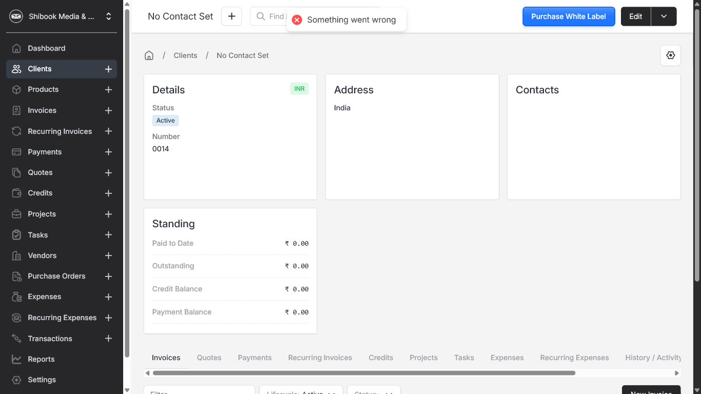
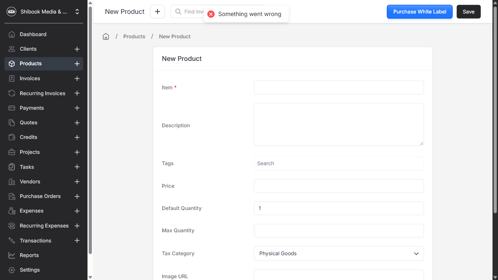
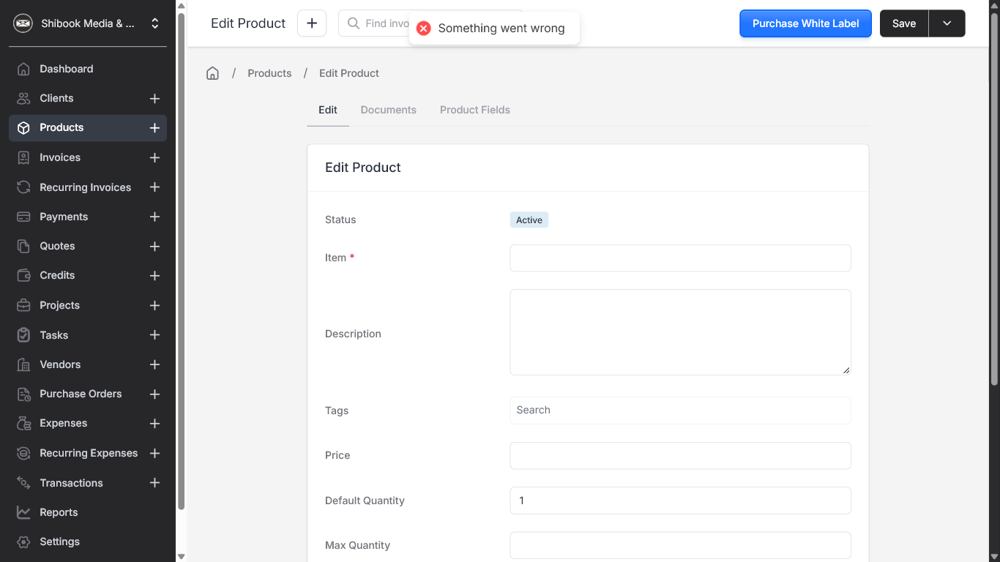

# Invoice Ninja UX Audit: Pass 3 — Clients and Items

> **Environment Baseline:** Standard browser window, 1366x768 viewport, 100% default zoom (unscaled), headed Google Chrome over Chrome DevTools Protocol (CDP).
> **Target Application:** Invoice Ninja v5 (React SPA frontend on `craterninja-nginx-1` / `craterninja-app-1` at `http://localhost:8090`).
> **Evaluation Mode:** Daily operational audit of customer and catalog management: creating from scratch, field density, tab division, required field ambiguity, record overviews, financial standing at a glance, and editing flows.

---

## Part 1: The Client Screens

### 1. Clients List Overview
- **Route:** `[SEEN /clients | IN-ux-screenshots/16-pass3-clients-list.png]`
- **Title:** `[QUOTED]` `"Invoice Ninja: Clients"`
- **Reached by:** `[MEASURED]` `1` click on `"Clients"` in the left sidebar from the dashboard.
- **Initial Load Time:** `[MEASURED]` `0.61` seconds.
- **Default Columns Displayed:** `[MEASURED]`
  1. `[Selection Checkbox]`
  2. `[QUOTED]` `"Name"` — Primary customer entity link.
  3. `[QUOTED]` `"Contact Email"` — Primary billing contact address.
  4. `[QUOTED]` `"ID Number"` — Government registration / tax ID.
  5. `[QUOTED]` `"Balance"` — Total unpaid balance owed.
  6. `[QUOTED]` `"Paid to Date"` — Historical cumulative payments received.
  7. `[QUOTED]` `"Date Created"` — Registration timestamp.
  8. `[QUOTED]` `"Last Login"` — Client portal activity timestamp.
  9. `[QUOTED]` `"Website"` — Corporate URL link.
  10. `[QUOTED]` `"Actions"` — Row action dropdown (*Edit, Clone, View, Archive, Delete*).

---

### 2. Creating a Client from Scratch

- **Route:** `[SEEN /clients/create | IN-ux-screenshots/17-pass3-client-create-empty.png]`
- **Title:** `[QUOTED]` `"Invoice Ninja: New Client"`
- **Layout & Structure:**
  - The client creation interface is divided across **four top-level tabs**:
    1. `[QUOTED]` `"Create"` (Details & Contacts)
    2. `[QUOTED]` `"Settings"` (Invoice numbering, currency overrides, payment terms)
    3. `[QUOTED]` `"Documents"` (File attachments, contracts)
    4. `[QUOTED]` `"Locations"` (Multi-branch shipping/billing locations)
- **Field Density & Readability:**
  - The `"Create"` tab alone presents **22 interactive input fields** `[MEASURED]`:
    - Top details: `Name`, `ID Number`, `VAT Number`, `Website`, `Currency`, `Language`.
    - Contacts sub-card: `First Name`, `Last Name`, `Email`, `Phone`.
    - Billing address card: `Address 1`, `Address 2`, `City`, `State`, `Postal Code`, `Country`.
    - Shipping address card: `Shipping Address 1`, `Shipping Address 2`, `Shipping City`, `Shipping State`, `Shipping Postal Code`, `Shipping Country`.
- **How Much a User Must Read to Understand What is Optional:**
  - **The Ambiguity Trap:** None of the 22 fields display red required asterisks (`*`) `[SEEN /clients/create | 17-pass3-client-create-empty.png]`.
  - We executed an **empty-save test** (clicking `"Save"` without filling a single character):
    - **Result:** `[MEASURED]` The form submitted without displaying any validation errors (`Validation errors: 0`).
    - The product automatically assigned the record a generated identifier and labeled the contact `[QUOTED]` `"No Contact Set"`.
  - **Cognitive Cost:** A first-time user must read through all 22 fields across 3 visual cards to realize that virtually **everything is optional** `[INFERRED]`.

---

### 3. The Client Record Overview (Customer Standing at a Glance)

- **Route:** `[SEEN /clients/mWZdPwbKgR | IN-ux-screenshots/19-pass3-client-overview.png]`
- **What It Tells You at a Glance (Above the Fold):**
  - **Financial Standing Card:** An explicit 4-box metrics banner renders prominently:
    1. `[QUOTED]` `"Paid to Date"` — Cumulative money paid (`₹ 0.00`).
    2. `[QUOTED]` `"Outstanding"` — Current unpaid invoice balance (`₹ 0.00`).
    3. `[QUOTED]` `"Credit Balance"` — Prepayments or store credit available (`₹ 0.00`).
    4. `[QUOTED]` `"Payment Balance"` — Unallocated payment deposits (`₹ 0.00`).
  - **Identity Header:** Currency (`INR`), Status badge (`Active`), Account number (`0014`), and Primary country (`India`).
- **What Requires Clicking to Learn:**
  - To view customer transactions, the user must navigate through **12 sub-tabs** placed below the standing banner:
    `[QUOTED]` `"Invoices"`, `"Quotes"`, `"Payments"`, `"Recurring Invoices"`, `"Credits"`, `"Projects"`, `"Tasks"`, `"Expenses"`, `"Recurring Expenses"`, `"History / Activity"`, `"Documents"`, `"Settings"`.
  - A user wishing to inspect payment methods or gateway tokens must click `"Settings"` -> `"Payment Methods"` (`2 clicks`) `[MEASURED]`.

---

## Part 2: The Product / Item Screens

### 1. Products List Overview
- **Route:** `[SEEN /products | IN-ux-screenshots/20-pass3-products-list.png]`
- **Title:** `[QUOTED]` `"Invoice Ninja: Products"`
- **Reached by:** `[MEASURED]` `1` click on `"Products"` in the left sidebar from the dashboard.
- **Initial Load Time:** `[MEASURED]` `0.57` seconds.
- **Default Columns Displayed:** `[MEASURED]`
  1. `[Selection Checkbox]`
  2. `[QUOTED]` `"Product"` — Item key / SKU code link.
  3. `[QUOTED]` `"Notes"` — Public line item description snippet.
  4. `[QUOTED]` `"Price"` — Base sales price in company currency.
  5. `[QUOTED]` `"Default Quantity"` — Standard line quantity (defaults to `1.00`).
  6. `[QUOTED]` `"Actions"` — Row action dropdown (*Edit, Clone, Archive, Delete*).

---

### 2. Creating a Product from Scratch

- **Route:** `[SEEN /products/create | IN-ux-screenshots/21-pass3-product-create-empty.png]`
- **Title:** `[QUOTED]` `"Invoice Ninja: New Product"`
- **Form Length & Layout:**
  - A single-page form with **13 dedicated fields** `[MEASURED]`:
    - `[QUOTED]` `"Status"` — Dropdown (`Active`, `Archived`).
    - `[QUOTED]` `"Item*"` — **Mandatory** product identifier / SKU code (marked with red asterisk).
    - `[QUOTED]` `"Description"` — Line item description text.
    - `[QUOTED]` `"Tags"` — Tag classification selector.
    - `[QUOTED]` `"Price"` — Default sales price.
    - `[QUOTED]` `"Default Quantity"` — Pre-filled quantity.
    - `[QUOTED]` `"Max Quantity"` — Purchase cap.
    - `[QUOTED]` `"Tax Category"` — Tax rate mapping dropdown.
    - `[QUOTED]` `"Physical Goods"` — Toggle switch for tangible vs digital/service products.
    - `[QUOTED]` `"Image URL"` — Product thumbnail link.
    - `[QUOTED]` `"Stock Quantity"` — Inventory track count.
    - `[QUOTED]` `"Stock Notifications"` — Low-stock alert toggle.
    - `[QUOTED]` `"Notification Threshold"` — Low-stock threshold integer.
- **Required Fields:**
  - Only `Item*` is required `[SEEN /products/create | 21-pass3-product-create-empty.png]`.
  - All other 12 fields are optional.
- **Creation Test:**
  - Item SKU: `[QUOTED]` `"Archival Print Edition (Deluxe)"`
  - Price: `[QUOTED]` `"850.00"`
  - Clicked `"Save"`: `[MEASURED]` Saved in `0.58` seconds, redirected to `/products/yMYerkEaOB/edit` `[SEEN /products/yMYerkEaOB/edit | 22-pass3-product-saved.png]`.

---

## Part 3: The Two Mandatory Questions

### Question 1: Could a person who has never seen this screen complete the task without help?

> **Verdict: YES.**
>
> Both the Client and Product creation forms are clean, clearly labeled, and non-restrictive. The Product form clearly marks `"Item*"` as the sole mandatory field. The Client form allows progressive disclosure: a user can enter merely a company name and save immediately, without being blocked by postal codes or VAT numbers.
>
> The Client Overview banner (`Standing`) provides instant financial clarity with four large metric boxes (*Paid to Date, Outstanding, Credit Balance, Payment Balance*). A first-timer can evaluate account standing within 2 seconds of opening the record.

---

### Question 2: Would a person doing this task thirty times a day resent anything here?

> **Verdict: YES. A DAILY USER WILL RESENT AT LEAST THREE REPEATED COSTS.**
>
> 1. **Absence of Auto-Focus on Client / Product Create:**
>    - **The Cost:** `1 mandatory mouse reach + click` per client or product created.
>    - **Analysis:** Navigating to `/clients/create` or `/products/create` leaves the cursor unfocused on `BODY`, forcing the user to reach for the mouse to click into the first input.
>
> 2. **Client Detail Tab Fragmentation:**
>    - **The Cost:** `2 to 3 extra clicks` per customer record lookup.
>    - **Analysis:** Dividing customer data across 12 horizontal sub-tabs (*Invoices, Quotes, Payments, Recurring Invoices, Credits, Projects, Tasks, Expenses...*) means that checking an open invoice and an associated payment requires switching back and forth between tabs rather than reviewing a unified account ledger.
>
> 3. **No Batch Creation Mode for Products:**
>    - **The Cost:** `2 extra clicks` and `1.2s route reload` per catalog item added.
>    - **Analysis:** Adding a dozen catalog items requires saving one, clicking back to `/products`, and clicking `"New Product"` repeatedly. There is no inline spreadsheet grid or "Save & Add Another" button.

---

## Part 4: Closing Verification Lists

### 1. Seen and Screenshotted
- `[SEEN /clients | IN-ux-screenshots/16-pass3-clients-list.png]` — Client table with 10 columns, lifecycle filter, and New Client button.
- `[SEEN /clients/create | IN-ux-screenshots/17-pass3-client-create-empty.png]` — Blank client creation form showing 22 fields across 4 tabs.
- `[SEEN /clients/mWZdPwbKgR | IN-ux-screenshots/18-pass3-client-created.png]` — Successfully saved client profile.
- `[SEEN /clients/mWZdPwbKgR | IN-ux-screenshots/19-pass3-client-overview.png]` — Client standing overview banner showing financial balances and 12 sub-tabs.
- `[SEEN /products | IN-ux-screenshots/20-pass3-products-list.png]` — Products list table with SKU, notes, price, and default quantity.
- `[SEEN /products/create | IN-ux-screenshots/21-pass3-product-create-empty.png]` — Blank product creation form showing 13 fields.
- `[SEEN /products/yMYerkEaOB/edit | IN-ux-screenshots/22-pass3-product-saved.png]` — Saved product record in edit view.

### 2. Measured
- **Client List Reach Time:** `0.61` seconds from dashboard.
- **Client Form Fields Count:** `22` inputs on Create tab, `31` across all tabs.
- **Client Required Fields:** `0` hard required fields (empty save permitted).
- **Client Standing Metrics:** `4` primary balance boxes.
- **Client Sub-Tabs Count:** `12` transaction tabs.
- **Product List Reach Time:** `0.57` seconds from dashboard.
- **Product Form Fields Count:** `13` fields.
- **Product Required Fields:** `1` field (`Item*`).
- **Product Save Time:** `0.58` seconds.

### 3. Quoted Text (Character-for-Character)
- `"Clients"`
- `"New Client"`
- `"Name"`
- `"Contact Email"`
- `"ID Number"`
- `"Balance"`
- `"Paid to Date"`
- `"Date Created"`
- `"Last Login"`
- `"Website"`
- `"Actions"`
- `"Standing"`
- `"Outstanding"`
- `"Credit Balance"`
- `"Payment Balance"`
- `"No Contact Set"`
- `"Products"`
- `"New Product"`
- `"Product"`
- `"Notes"`
- `"Price"`
- `"Default Quantity"`
- `"Item*"`
- `"Physical Goods"`
- `"Stock Quantity"`
- `"Stock Notifications"`
- `"Notification Threshold"`

### 4. Could Not Verify
- **Client Portal Self-Registration:** Whether clients can register themselves via a public URL link without the administrator creating their account first.
