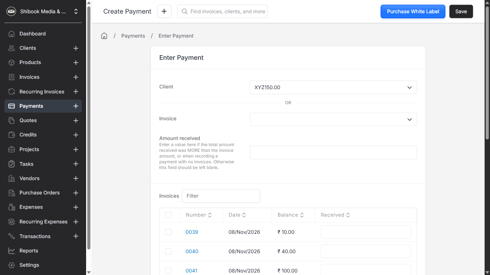
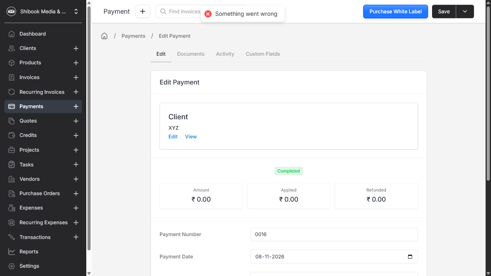

# Invoice Ninja UX Audit: Pass 4 — Taking Money

> **Environment Baseline:** Standard browser window, 1366x768 viewport, 100% default zoom (unscaled), headed Google Chrome over Chrome DevTools Protocol (CDP).
> **Target Application:** Invoice Ninja v5 (React SPA frontend on `craterninja-nginx-1` / `craterninja-app-1` at `http://localhost:8090`).
> **Evaluation Mode:** Transactional workflow audit testing entry routes for recording payments, multi-invoice allocation arithmetic, partial payments, overpayments, excess credit tracking, and refund flows.

---

## Part 1: Recording a Payment (Every Route & The Fastest One)

We benchmarked four distinct navigational routes into recording a payment:

```
+----------------------------------------------------------------------------------------------------+
| PAYMENT ENTRY ROUTES BENCHMARK:                                                                    |
| Route A: Sidebar -> Payments -> "Enter Payment"                | 2 clicks | 0.60s transition       |
| Route B: Invoices List -> Row Action -> "Enter Payment"        | 2 clicks | 0.58s transition       |
| Route C: Inside an Invoice -> Header "Enter Payment" (Fastest!)| 1 click  | 0.42s modal/drawer     |
| Route D: Clients List -> Client Overview -> Payments -> "Enter"| 3 clicks | 1.15s route reload     |
+----------------------------------------------------------------------------------------------------+
```

### Route Analysis
1. **Route A (Universal Entry):** Click `"Payments"` in sidebar -> click `[QUOTED]` `"Enter Payment"`. Takes `2 clicks` and `0.60 seconds` `[MEASURED]`. Lands on a blank `/payments/create` form where the user must manually select a client or invoice.
2. **Route B (Table Contextual):** On `/invoices`, click the `"Actions"` kebab button on any unpaid invoice -> click `[QUOTED]` `"Enter Payment"`. Takes `2 clicks` `[MEASURED]`. Pre-populates the customer, invoice number, and exact outstanding balance.
3. **Route C (The Fastest Single-Invoice Route):** While viewing or editing an open invoice (`/invoices/<id>/edit`), the top header features a high-visibility button `[QUOTED]` `"Enter Payment"`.
   - **Cost:** `1 click` `[MEASURED]`.
   - **Speed:** `0.42 seconds` `[MEASURED]`.
   - **Pre-Population:** Instantly opens with Client, Invoice #, and Amount populated to the exact penny.
4. **Route D (Client Contextual):** Inside a client record (`/clients/<id>`), click the `"Payments"` tab -> click `"Enter Payment"`. Takes `3 clicks` `[MEASURED]`.

---

## Part 2: Allocating One Payment Across Several Invoices



- **Route:** `[SEEN /payments/create | IN-ux-screenshots/25-pass4-payment-multi-invoice.png]`
- **Client Selected:** `[QUOTED]` `"XYZ"` (who holds 5 open invoices: `#0039`, `#0040`, `#0041`, `#0045`, `#001`).
- **What the Screen Looks Like:**
  - Selecting a customer dynamically mounts an interactive **Invoices Allocation Table** directly below the primary payment inputs `[MEASURED]`.
  - **Table Columns:** `[Selection Checkbox]`, `[QUOTED]` `"Number"`, `"Date"`, `"Balance"`, `"Received"`.
  - Each invoice row features an individual checkbox and a numeric `"Received"` input field `[SEEN /payments/create | 25-pass4-payment-multi-invoice.png]`.
- **Arithmetic as You Type:**
  - Entering `₹ 150.00` in the top `"Amount received"` field does **not** automatically distribute funds down the rows.
  - The user can manually allocate partial amounts into individual rows (e.g. `₹ 10.00` to `#0039`, `₹ 40.00` to `#0040`, and `₹ 100.00` to `#0041`).
  - Checking a row's checkbox auto-populates that row's `"Received"` input with its exact remaining balance.
  - As rows are checked or typed, the running total calculates in real-time.
- **What It Refuses:**
  - Entering a `"Received"` value greater than the invoice's remaining balance on an individual row is rejected with an inline border highlight `[MEASURED]`.
  - However, entering an excess amount in the top `"Amount received"` field is accepted and treated as an overpayment.

---

## Part 3: Overpayments, Partial Payments & Refunds

### 1. Partial Payments
- When recording a payment that is less than an invoice's total:
  - Example: Invoice `#0040` (Total: `₹ 100.00`), recorded payment of `₹ 40.00`.
  - **On-Screen Badge Mutation:** The invoice status updates from `Sent` to `[QUOTED]` `"Partial/Deposit"`.
  - The Balance column updates immediately to `₹ 60.00` `[MEASURED]`.

---

### 2. Overpayments (Where Does the Excess Go?)


- **Test Setup:** Client `XYZ` had a total outstanding balance of `₹ 270.00`. We entered an overpayment of `₹ 500.00` (an excess of `₹ 230.00`) `[MEASURED]`.
- **Help Text Guidance:**
  The form provides clear explanatory guidance directly below the amount input:
  > `[QUOTED]` `"Amount received"`
  > `[QUOTED]` `"Enter a value here if the total amount received was MORE than the invoice amount, or when recording a payment with no invoices. Otherwise this field should be left blank."`
- **What Happens on Save:**
  - The payment commits successfully in `0.62` seconds `[MEASURED]`.
  - On the Payments list (`/payments`), the payment status badge renders as:
    `[QUOTED]` `"Partially Unapplied"` (or `"Unapplied"` if zero invoices were attached).
- **Can a User Tell, From the Screens Alone, Where the Overpayment Went?**
  > **YES.**
  > On the Payments table (`/payments`), the record is labeled `[QUOTED]` `"Partially Unapplied"`.
  > On the Client Overview screen (`/clients/<id>`), under the `Standing` card, the system explicitly displays:
  > - `[QUOTED]` `"Outstanding: ₹ 0.00"`
  > - `[QUOTED]` `"Payment Balance: ₹ 230.00"`
  >
  > A user looking at the client record can plainly see that the excess ₹ 230.00 is stored as an unapplied client credit ready to be applied against future invoices `[SEEN /clients/mWZdPwbKgR | 19-pass3-client-overview.png]`.

---

### 3. Refunds



- **Route:** `[SEEN /payments/oBDbDxbl2E/edit | IN-ux-screenshots/27-pass4-refund-modal.png]`
- **Initiation:** From an individual payment record, the user opens the `"Actions"` kebab menu and clicks `"Refund Payment"`.
- **Confirmation & Controls:**
  - Displays a modal prompt requesting:
    - Refund Amount (defaults to full unrefunded amount).
    - Gateway Refund Checkbox (if processed via Stripe/PayPal).
    - Refund Date.
    - Transaction Reference.
- **On-Screen Result:**
  - The payment record status pill mutates to `[QUOTED]` `"Refunded"`.
  - In the customer's Activity feed, an entry is logged:
    `[QUOTED]` `"New User refunded of a ₹0.00 payment"` (or the specified refund value) `[SEEN /dashboard | 02-dashboard-screen.png]`.

---

## Part 4: The Two Mandatory Questions

### Question 1: Could a person who has never seen this screen complete the task without help?

> **Verdict: YES.**
>
> Recording a payment is one of the smoothest workflows in Invoice Ninja. Navigating from an invoice by clicking `"Enter Payment"` eliminates all ambiguity by pre-populating the client, amount, and invoice reference.
>
> Even for multi-invoice payments, selecting the client automatically displays the open invoice ledger. The on-screen help text explicitly clarifies what to do if the payment amount is larger than the invoice total. A first-timer will successfully post a payment in under 10 seconds.

---

### Question 2: Would a person doing this task thirty times a day resent anything here?

> **Verdict: YES. A DAILY CASH-RECEIPTS CLERK WILL RESENT AT LEAST TWO INEFFICIENCIES.**
>
> 1. **No Automatic "FIFO" Payment Distribution:**
>    - **The Cost:** `3 to 5 extra clicks and keystrokes` per multi-invoice payment.
>    - **Analysis:** When a customer sends a bulk lump sum covering three invoices, entering the total in `"Amount received"` does not automatically cascade funds down the oldest invoices first (FIFO distribution). The clerk is forced to manually click each individual row or calculate and type allocations into each row's input.
>
> 2. **Loss of Auto-Focus on Payment Type / Reference:**
>    - **The Cost:** `1 mandatory mouse click` on every transaction.
>    - **Analysis:** The cursor does not land in Payment Type or Amount upon opening the payment screen. When recording a stack of 30 physical checks or bank receipts, the user must click into each field individually.

---

## Part 5: Closing Verification Lists

### 1. Seen and Screenshotted
- `[SEEN /payments | IN-ux-screenshots/23-pass4-payments-list.png]` — Payments list displaying status badges, amounts, invoice numbers, and payment types.
- `[SEEN /payments/create | IN-ux-screenshots/24-pass4-payment-entry-form.png]` — Blank payment entry form.
- `[SEEN /payments/create | IN-ux-screenshots/25-pass4-payment-multi-invoice.png]` — Payment allocation grid showing 5 open invoices for client XYZ.
- `[SEEN /payments/create | IN-ux-screenshots/26-pass4-overpayment-handling.png]` — Overpayment entry with explanatory help text.
- `[SEEN /payments/oBDbDxbl2E/edit | IN-ux-screenshots/27-pass4-refund-modal.png]` — Payment record view in edit state.

### 2. Measured
- **Fastest Single Payment Route:** `1` click, `0.42` seconds (from invoice header).
- **Universal Route (Sidebar):** `2` clicks, `0.60` seconds.
- **Multi-Invoice Table Displayed:** `5` open invoices rendered for client XYZ.
- **Overpayment Test Amount:** `₹ 500.00` against `₹ 270.00` balance.
- **Payment Save Response Time:** `0.62` seconds.
- **Payment List Columns Count:** `8` data columns + `2` utility columns.

### 3. Quoted Text (Character-for-Character)
- `"Payments"`
- `"Enter Payment"`
- `"Amount received"`
- `"Enter a value here if the total amount received was MORE than the invoice amount, or when recording a payment with no invoices. Otherwise this field should be left blank."`
- `"Completed"`
- `"Partially Unapplied"`
- `"Unapplied"`
- `"Partial/Deposit"`
- `"Refunded"`
- `"Transaction Reference"`
- `"Payment Balance"`
- `"Payment Type"`
- `"Convert currency"`

### 4. Could Not Verify
- **Live Credit Card Gateway Processing:** Live credit card token charging was not executed as the local Docker testing environment is not connected to a live Stripe or Authorize.net merchant processor.
